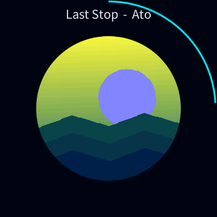

# JukeDial

*A pocket music player and desk gadget on the ESP32-S31. JukeDial continues the earlier JukeChip project.*

**English** | [繁體中文](README.zh-TW.md) | [简体中文](README.zh-CN.md)

&nbsp;&nbsp;

 
<em>Left: the round board (JC3636F118). Right: the square FakePod.</em>

**JukeDial** is a pocket music player and desk gadget for the **ESP32-S31**. One code base runs on two boards: **JC3636F118** (360 x 360 round touch screen, knob, haptic motor, LED ring) and **FakePod** (460 x 460 square screen, two keys, AXP2101 power chip, CS43131 DAC). It plays music from a TF card, outputs through a wired DAC, Bluetooth or Auracast, tunes internet radio, and adds a clock, small tools, games, an instrument app and ambient screens. Everything is driven by gestures (flick, drag, hold) and the knob, with no deep menus to dig through. Built on ESP-IDF v6.1, LVGL 9.5 and Bluedroid; the interface is in Traditional Chinese, Simplified Chinese and English.

**What it looks like** (simulator screenshots; the track and station names are invented):

 

## Principles
JukeDial's priorities are explicit: **support as many formats as possible, the best sound quality possible, and as many potentially useful features as possible, after checking that they can be done**. Frame rate (fps) and visual flair come after that.
- Trade-offs are made only when something is truly full (flash, internal RAM, CPU), and the reason is stated.
- Otherwise the rule is maximum compatibility and breadth; features that are not mature yet sit in an "experimental" setting that is off by default, with an honest note about the risk.
- All of this within what a portable device and portable audio gear should be: easy to carry, easy to use, music first.
- The one exception: it is **not an AI client**.

## Features
- Local music from the TF card: covers, playback speed (0.75 to 2x, pitch kept), crossfade, spectrum pages and an effects app.
- Wired hi-res output up to 384 kHz (the ceiling is selectable); Bluetooth SBC / AAC / aptX / aptX HD / LDAC (LDAC adapts between 990 / 660 / 492 / 330 kbps with the link quality); Auracast broadcast and listening.
- A separate volume for each output: one for wired, one for each Bluetooth headset, one for speaker mode.
- Internet radio over http and https, plus a **broadcast-radio mode** that broadcasts a station over Auracast.
- Clock, alarm, pomodoro, drink reminder, habit check-in; manual time setting; white noise, ambient screens, breathing guide.
- Fifteen games and a set of small tools playable on both screens (the gravity maze on the round board, the tilt maze on the FakePod); an instrument app (drum pads, looper, chip / FM voices, sample kits).
- **External mode:** the player becomes a USB drive, a USB sound card and a USB / Bluetooth media keypad; the drive mode protects the card.
- **Card diagnostics:** measures read speed and write-read-back and tells you which formats the card can keep up with.
- **Honest audio output:** Bluetooth audio and wired output pages, plus a details page that says what was changed in the sound and why (guide chapter 17). FakePod: CS43131 hardware volume, 32 to 384 kHz passthrough, 16 to 32 kHz upsampling.
- **Ten colour themes** (five dark, five light) as card files with a template for your own (guide chapter 18); every menu cell has an icon.
- **Boot picture:** a 360 x 360 JPEG at power-on, one per boot mode; the card pack ships default icons and the web tool can turn it off.
- A browser web tool (Chrome / Edge): settings, station lists, library fonts and **flashing**.

## What each board has
"Supported" means implemented and used on real hardware; "Experimental" is off by default or has known risks; "-" means the board does not have that hardware. FakePod support is newer and has been exercised less on real hardware than the round board.

| Feature | Round (JC3636F118) | Square (FakePod) |
|---|---|---|
| TF card music, covers, speed, crossfade | Supported | Supported |
| Wired output | Supported (PCM5102A, software volume, up to 384 kHz) | Supported (CS43131, hardware volume, 32 to 384 kHz passthrough) |
| Output drive 1.0 / 1.41 V | - | Supported |
| Output drive 1.73 V | - | Experimental |
| Bluetooth headphones SBC / AAC / aptX / aptX HD / LDAC | Supported | Supported |
| Bluetooth speaker mode (phone to player) | Supported | Supported |
| Auracast broadcast and listening, broadcast-radio mode | Supported | Supported |
| Internet radio (http / https) | Supported | Supported |
| Clock, alarm, pomodoro, manual time setting | Supported (time not kept while powered off) | Supported (built-in clock, time kept while powered off) |
| Games and tools | Supported (gravity maze) | Supported (tilt maze) |
| Instrument app | Supported | Supported |
| External mode (drive / sound card / keypad) | Supported | Supported |
| Card diagnostics | Supported | Supported |
| Knob, haptics, LED ring | Supported | - |
| Two keys, invisible nine-grid tap zones, blind keys with the screen off | - | Supported |
| Battery level, auto power-off, charge screen | - (reads the supply voltage only) | Experimental |
| Headphone-jack detection, inline remote | - | Not supported |
| Experimental formats (some AdLib / tracker), CPU clock scaling | Experimental | Experimental |
| Flashing from the web tool | Supported | Supported |

## Supported audio
**Files** (files of 2 GiB or more are skipped):

| Class | Formats |
|---|---|
| Common | MP3, FLAC, Ogg Vorbis / Opus, M4A (AAC), Musepack (SV7 / SV8), TTA |
| PCM | WAV (PCM 16 / 24 / 32-bit, float32), AIFF / AIFF-C (PCM) |
| Chip, game and tracker music | HivelyTracker / AHX (.ahx, .hvl), C64 SID (.sid), DOS AdLib music (RAD, HSC, IMF, DRO, CMF, A2M and about 30 more), PICO-8 cartridges (.p8, .p8.png), ADX / VAG / BRSTM, Atari ST YM, tracker modules (libxmp: MOD / XM / S3M / IT plus about 45 more, and ProWizard / PowerPacker packed Amiga modules) |

**Sample rates and bit depth:**

| | |
|---|---|
| Sample rates | 44.1 / 48 kHz everywhere; the wired DAC adds 88.2 / 96 / 176.4 / 192 kHz, up to 384 kHz. The ceiling is a setting: the round board defaults to 48 kHz (raise it under Settings > Wired output, or run the rate test); the FakePod defaults to 384 kHz (passthrough). |
| Sources the DAC will not take | Are resampled; below 32 kHz on the wired path: played natively on the round board; on the FakePod 16 to 32 kHz is upsampled and below 16 kHz is refused with a reason. |
| Bit depth | 16 / 24 / 32-bit sources; the USB sound card does 16 / 24 / 32-bit. |

## Outputs
- Wired hi-res DAC
- Bluetooth headphones: SBC, AAC, aptX, aptX HD, LDAC (the default firmware has all of them)
  - aptX and LDAC are encoded by JukeDial, so they exist only in headphone mode, and only at 44.1 / 48 kHz; speaker mode (phone to player) receives SBC / AAC
  - LDAC adapts between 990 / 660 / 492 / 330 kbps with the link quality; with Wi-Fi on it tops out near 660 kbps
- Bluetooth speaker mode: an exclusive source; picking a local track asks to leave it (leaving restarts the device)
- Auracast broadcast and listening (Wi-Fi is off while the full player broadcasts)
- Broadcast-radio mode
- External mode: USB drive, USB sound card, USB / BLE keys

## TF card
FAT32 or exFAT, with an **MBR** partition table (GPT cards do not mount), files under 2 GiB. Put your content at the top level (for example `export/<album>/`); everything the player makes lives in `_player/` (settings, index, fonts, loops, logs). See [guide chapter 12](docs/guide/en/12-card.md). A ready-made card template: `make card-zip`. The boot picture is `_player/splash/<mode>.jpg` or `_player/splash.jpg` (360 x 360 JPEG).

## Quick start
1. Put music on the card, insert it, power with USB-C.
2. Pick a language and do the one-minute gesture tour.
3. Flick down for quick settings, flick up for the page menu, hold 3 seconds to go home. The FakePod's playing page uses an invisible nine-grid (the first tap shows nine labels, the second tap acts).
4. For radio, Wi-Fi credentials, station lists and fonts, use the web tool: open the hosted page (GitHub Pages; its address is on the Releases page) in Chrome or Edge and press Connect. If it cannot be reached, run the web tool locally from `jukedial-<version>-webtool.zip` (`serve.sh` or `serve.bat`, then open `http://localhost:8000`; double-clicking `index.html` does not work). The main settings can also be edited as text files on the card without the web tool (see [guide chapter 12](docs/guide/en/12-card.md)).
5. Read the [hardware chapter](docs/guide/en/00-hardware.md) to know the two boards.
6. To flash: download the merged image for your board from Releases, open the hosted web tool, go to the Flash tab, choose your board, pick the file, press "Connect and check", then "Start writing"; an update keeps settings and pairings (only the "Factory reset" option erases them). Without the hosted page: the local web tool or a one-line esptool command, see [guide chapter 13](docs/guide/en/13-web-tool.md). Or build from source (next section).

## Building from source and flashing
The full steps are in [guide chapter 20](docs/guide/en/20-build-flash.md); in outline:
1. **Prerequisites:** ESP-IDF **v6.1** (the ESP32-S31 is a preview target, so every `idf.py` call takes `--preview`; the Makefile expects to activate IDF with `$HOME/.espressif/tools/activate_idf_v6.1.sh`), Python 3, CMake and a C compiler; the simulator also needs SDL2. The first build downloads `app/managed_components/` through the IDF component manager (network needed).
2. **Not in git:** the font partition image (`make fontpak`; the released images already include the fonts), the patched Bluedroid (`make build` generates it), the card pack (`make card-zip`).
3. **First flash of the round board:** set `PORT` in `.local/board.mk` (see `.local/board.mk.example`), then `make backup` (the Makefile refuses to flash without a backup), `make flash-all`, `make flash-fonts`.
4. **FakePod:** write four offsets by hand with esptool (0x2000, 0x8000, 0x10000, 0xC00000), ending with `--after watchdog-reset`; download mode is both keys held while powering on. (A released image is one merged file written at offset 0: guide chapter 13.)
5. **Simulator and tests:** `make sim-run` (desktop simulator), `make test`, `make sim-test`.

## Guide
[Read the guide](docs/guide/en/01-first-boot.md): 0 [hardware](docs/guide/en/00-hardware.md), 1 first boot, 2 gestures, 3 music, 4 radio, 5 Bluetooth and Auracast, 6 clock, 7 tools and games, 8 instruments, 9 ambient, 10 quick settings, 11 settings, 12 card, 13 web tool and flashing, 14 external mode, 15 safe mode and recovery, 16 FAQ, 17 [audio output](docs/guide/en/17-audio-output.md), 18 [themes](docs/guide/en/18-themes.md), 19 [FakePod](docs/guide/en/19-fakepod.md), 20 [building and flashing from source](docs/guide/en/20-build-flash.md).

## Known limitations
- FakePod: no headphone-jack detection or inline remote; the battery level, auto power-off, low-battery and charge screens are not fully verified on hardware; pausing above 96 kHz can drop up to about 250 ms; a 384 kHz FLAC with a 32768 block size (the ffmpeg default) is halved to 96 kHz; the 1.73 V output drive is experimental.
- Round board: no battery gauge (supply voltage only), no real-time clock, no hardware volume (software attenuation; volume 100 = full scale).
- The USB drive mode's card protections, and how well the three-in-one USB device works on each operating system, are not fully verified on hardware yet.
- Auracast: Wi-Fi is off while the full player broadcasts (memory). Bluetooth speaker mode is an exclusive source.
- Files: 2 GiB or more are skipped; only MBR partitioning (GPT cards do not mount); the album view does not support progressive JPEG, PNG or HEIC.
- The web tool needs desktop Chrome or Edge (Web Serial).
- Not available: AirPlay, playlists, .eq import, WavPack / APE / CUE / DSD.
- Many items still await long, multi-device checks on hardware; for the longer list and every change see [CHANGELOG.md](CHANGELOG.md).

## Downloads and releases
Releases are on the project's GitHub and Gitee Releases pages (the same files). Versions are dates, for example `2026.11.22`. Each release has:
- `jukedial-<version>-round.bin` and `jukedial-<version>-fakepod.bin`: one merged image per board (bootloader, partition table, app and fonts)
- `jukedial-<version>-card.zip`: the TF card contents (unzip into the card's root)
- `jukedial-<version>-webtool.zip`: the web tool for offline (local) use
- `SHA256SUMS` and the release notes
- GitHub (main): https://github.com/JokerCatz/JukeDial
- Gitee (mirror): https://gitee.com/jokercatz/JukeDial
- Web tool (settings and flashing, Chrome or Edge): https://jokercatz.github.io/JukeDial/

The device's help page shows one QR code for each address in `setup_url` in `_player/config/app.txt` (space-separated, the main one first, at most 4).

## Licence
JukeDial's own code is under **LGPL-2.1-or-later** (`LICENSE`); a firmware binary that includes LDAC (Apache-2.0) is in effect distributed under LGPL-3 terms. The full explanation is in [LICENSING.md](LICENSING.md), and third-party components and notices are in [THIRD_PARTY_NOTICES.md](THIRD_PARTY_NOTICES.md). LDAC and aptX are supported for personal, non-commercial use and carry no Sony or Qualcomm certification. Fonts are Noto (OFL) and are not in the repository; icons: Tabler Icons (MIT) and Material Symbols (Apache-2.0).

## For developers
`docs/guide/en/00-hardware.md` introduces the two boards; `sim/README.md` describes the host simulator; `docs/dev/` holds the developer notes (feature map, how it is tested, what was measured, fonts, releases). The guide's picture list and screenshot script: `docs/guide/shotlist.md`, `tools/simtools/guide_shots.py`. The flashing and audio safety rules live in the Makefile's checks: it will not flash without a backup, or to a port that is not a `/dev/serial/by-id/*` path.
