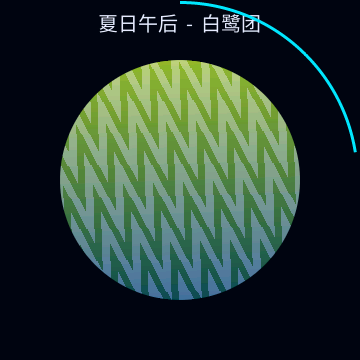

# JukeDial

*ESP32-S31 上的便携音乐播放器与桌面小玩意儿；JukeDial 延续此前的 JukeChip 项目。*

[English](README.md) | [繁體中文](README.zh-TW.md) | **简体中文**

&nbsp;&nbsp;

 
<em>左：圆形主板（JC3636F118）。右：方形 FakePod。</em>

**实际画面**（模拟器截图，曲目与电台名称都是虚构的）：

 

## 基本精神
JukeDial 的优先顺序很明确：**尽量多支持格式、尽量好的音质、尽量多可能用得到的功能，并先确认做得到**。画面流畅度（fps）和界面花哨程度排在后面。
- 只有真的满了，也就是 flash 或内部 RAM 放不下、CPU 跑不动，才做取舍，并且说明原因。
- 其余情况一律以最大兼容、广纳各种需求为原则；还不够成熟的功能放在默认关闭的“实验性”设置里，并如实说明风险。
- 前提是不违背随身设备与随身音频设备的本分：好带、好用、音乐优先。
- 唯一的例外：**不做成 AI 客户端**。

## 特色
- TF 卡本机音乐：封面、倍速（0.75 到 2 倍，音高不变）、淡入淡出、频谱页与音效 app。
- 有线高解析输出最高 384 kHz（上限可选）；蓝牙 SBC／AAC／aptX／aptX HD／LDAC（LDAC 会依连接质量在 990／660／492／330 kbps 间调整）；Auracast 广播与收听。
- 每个输出各有自己的音量：有线一个、每副蓝牙耳机各一个、扬声器模式一个。
- 网络电台支持 http 与 https，另有**广播电台模式**，把电台用 Auracast 广播出去。
- 时钟、闹钟、番茄钟、喝水提醒、习惯打卡；手动设置时间；白噪音、氛围画面、呼吸引导。
- 十五个游戏与一组小工具，圆屏方屏都能玩（圆形板的重力迷宫、FakePod 的倾斜迷宫）；乐器 app（鼓垫、循环录音、芯片／FM 音色、采样套件）。
- **外接模式：** 播放器变成 U 盘、USB 声卡，以及 USB／蓝牙媒体按键板；U 盘模式有保护存储卡的机制。
- **存储卡诊断：** 量读取速度与写入读回，告诉你这张卡跟得上哪些格式。
- **诚实的音频输出：**蓝牙音频与有线输出设置页，以及说明声音被改了什么、为什么的详细页（指南第 17 章）。FakePod：CS43131 硬件音量、32 到 384 kHz 直通、16 到 32 kHz 升频。
- **十个配色主题**（五深五浅）以卡片文件提供，附自定义模板（指南第 18 章）；每个菜单格都有图标。
- **开机画面：**开机时显示一张 360 × 360 的 JPEG，每种开机方式一张；卡片包附默认图标，可在网页工具关闭。
- 浏览器网页工具（Chrome／Edge）：设置、电台列表、曲库字体与**刷机**。

## 两块板的功能
“支持”是已实现并在实机上用过；“实验性”默认关闭或有已知风险；“—”是这块板没有该硬件。FakePod 的支持比较新，实机上试过的项目比圆形板少。

| 功能 | 圆形（JC3636F118） | 方形（FakePod） |
|---|---|---|
| TF 卡音乐、封面、倍速、淡入淡出 | 支持 | 支持 |
| 有线输出 | 支持（PCM5102A，软件音量，最高 384 kHz） | 支持（CS43131，硬件音量，32 到 384 kHz 直通） |
| 输出推力 1.0／1.41 V | — | 支持 |
| 输出推力 1.73 V | — | 实验性 |
| 蓝牙耳机 SBC／AAC／aptX／aptX HD／LDAC | 支持 | 支持 |
| 蓝牙扬声器模式（手机到播放器） | 支持 | 支持 |
| Auracast 广播与收听、广播电台模式 | 支持 | 支持 |
| 网络电台（http／https） | 支持 | 支持 |
| 时钟、闹钟、番茄钟、手动设置时间 | 支持（关机后时间不保留） | 支持（内置时钟，关机后保留） |
| 游戏与小工具 | 支持（重力迷宫） | 支持（倾斜迷宫） |
| 乐器 app | 支持 | 支持 |
| 外接模式（U 盘／声卡／按键） | 支持 | 支持 |
| 存储卡诊断 | 支持 | 支持 |
| 旋钮、振动、LED 灯环 | 支持 | — |
| 两个按键、隐形九宫格点击区、屏幕关着时的盲按 | — | 支持 |
| 电量显示、自动关机、充电画面 | —（只读供电电压） | 实验性 |
| 耳机插孔检测、线控 | — | 不支持 |
| 实验性格式（部分 AdLib／tracker）、CPU 时钟切换 | 实验性 | 实验性 |
| 网页工具刷机 | 支持 | 支持 |

## 支持的音频
**文件**（2 GiB 以上的文件会被略过）：

| 类别 | 格式 |
|---|---|
| 常见 | MP3、FLAC、Ogg Vorbis／Opus、M4A（AAC）、Musepack（SV7／SV8）、TTA |
| PCM | WAV（PCM 16／24／32 位、float32）、AIFF／AIFF-C（PCM） |
| 芯片、游戏与 tracker 音乐 | HivelyTracker／AHX（.ahx、.hvl）、C64 SID（.sid）、DOS AdLib 音乐（RAD、HSC、IMF、DRO、CMF、A2M 等约 30 种）、PICO-8 卡带（.p8、.p8.png）、ADX／VAG／BRSTM、Atari ST YM、tracker 模块（libxmp：MOD／XM／S3M／IT 加约 45 种格式，以及 ProWizard／PowerPacker 打包的 Amiga 模块） |

**采样率与位深：**

| | |
|---|---|
| 采样率 | 各处都支持 44.1／48 kHz；有线 DAC 另有 88.2／96／176.4／192 kHz，最高 384 kHz。上限是个设置：圆形板默认 48 kHz，要到“设置 → 有线输出”调高，或跑采样率测试；FakePod 默认 384 kHz（直通）。 |
| DAC 不吃的来源 | 会重采样；低于 32 kHz 的来源在有线路径上：圆形板原生播放，FakePod 16 到 32 kHz 升频、低于 16 kHz 拒绝并说明原因。 |
| 位深 | 16／24／32 位来源；USB 声卡 16／24／32 位。 |

## 输出
- 有线高解析 DAC
- 蓝牙耳机：SBC、AAC、aptX、aptX HD、LDAC（默认固件就含全部）
  - aptX 与 LDAC 只在耳机模式（由 JukeDial 编码发送），且只有 44.1／48 kHz；扬声器模式（手机到播放器）接收 SBC／AAC
  - LDAC 码率会在 990／660／492／330 kbps 之间依连接质量调整；开着 Wi-Fi 时上限约 660 kbps
- 蓝牙扬声器模式：独占的来源，要播放本机曲目时会先问是否离开（离开会重启）
- Auracast 广播与收听（完整播放器广播时 Wi-Fi 关闭）
- 广播电台模式
- 外接模式：U 盘、USB 声卡、USB／BLE 按键

## TF 卡
FAT32 或 exFAT，分区表要是 **MBR**（GPT 卡挂载不了），单文件小于 2 GiB。你的内容放最上层（例如 `export/<专辑>/`），播放器自己生成的东西都在 `_player/`（设置、索引、字体、循环录音、记录）。详见[指南第 12 章](docs/guide/zh-CN/12-card.md)。现成的卡片模板：`make card-zip`。开机画面是 `_player/splash/<模式>.jpg` 或 `_player/splash.jpg`（360 × 360 JPEG）。

## 快速上手
1. 把音乐放进卡、插入，用 USB-C 供电。
2. 选语言，做一分钟的手势教学。
3. 快速往下滑是快捷面板，快速往上滑是该页菜单，按住 3 秒回首页。FakePod 的播放页用隐形九宫格（第一下点屏幕显示九个标签，第二下才执行）。
4. 电台、Wi-Fi 网络文件、电台列表与字体，请用网页工具：用 Chrome 或 Edge 打开托管网页（在 GitHub Pages，网址在 Releases 页面）并按“连接”。连不上时，可用 `jukedial-<版本>-webtool.zip` 在本机运行（`serve.sh` 或 `serve.bat`，再打开 `http://localhost:8000`；直接双击 `index.html` 不行）。主要设置也可以不用网页工具，直接编辑卡上的文本文件（见[指南第 12 章](docs/guide/zh-CN/12-card.md)）。
5. 先看[硬件章](docs/guide/zh-CN/00-hardware.md)认识两块板。
6. 刷机：从 Releases 下载你的板子的合并镜像，打开托管网页工具，进“刷机”标签页，选你的板子、选文件，点“连接并检查”，再点“开始写入”；更新会保留设置与配对（只有勾“出厂重置”才会清掉）。没有托管网页时：用本机网页工具，或一行 esptool 命令，见[指南第 13 章](docs/guide/zh-CN/13-web-tool.md)。也可以从源码构建（下一节）。

## 从源码构建与刷机
完整步骤在[指南第 20 章](docs/guide/zh-CN/20-build-flash.md)，这里是大纲：
1. **前置：** ESP-IDF **v6.1**（ESP32-S31 目前是预览目标，所有 `idf.py` 都带 `--preview`；Makefile 预期用 `$HOME/.espressif/tools/activate_idf_v6.1.sh` 启用）、Python 3、CMake 与 C 编译器；模拟器另需 SDL2。构建时 IDF 组件管理器会自动下载 `app/managed_components/`（要联网）。
2. **不在 git 里的东西：** 字体分区镜像（`make fontpak`；发布的镜像已经含字体）、打过补丁的 Bluedroid（`make build` 自动生成）、卡片内容包（`make card-zip`）。
3. **第一次刷圆形板：** 在 `.local/board.mk` 设置 `PORT`（见 `.local/board.mk.example`）→ `make backup`（Makefile 没有备份就拒绝刷机）→ `make flash-all` → `make flash-fonts`。
4. **FakePod：** 用 esptool 手动写四个地址（0x2000、0x8000、0x10000、0xC00000），结尾加 `--after watchdog-reset`；下载模式是两个键同按再上电。（发布的镜像是一个合并文件、从地址 0 写入：指南第 13 章。）
5. **模拟器与测试：** `make sim-run`（桌面模拟器）、`make test`、`make sim-test`。

## 指南
[阅读指南](docs/guide/zh-CN/01-first-boot.md)：0 [硬件](docs/guide/zh-CN/00-hardware.md)、1 第一次开机、2 手势、3 音乐、4 电台、5 蓝牙与 Auracast、6 时钟、7 小工具与游戏、8 乐器、9 氛围、10 快捷面板、11 设置、12 存储卡、13 网页工具与刷机、14 外接模式、15 安全模式与救援、16 常见问题、17 [音频输出](docs/guide/zh-CN/17-audio-output.md)、18 [主题配色](docs/guide/zh-CN/18-themes.md)、19 [FakePod](docs/guide/zh-CN/19-fakepod.md)、20 [从源码构建与刷机](docs/guide/zh-CN/20-build-flash.md)。

## 已知限制
- FakePod：没有耳机插孔检测与线控；电量显示、自动关机、低电量与充电画面尚未在实机上完整验证；96 kHz 以上暂停时最多丢掉约 250 ms；384 kHz 的 FLAC 若块大小是 32768（ffmpeg 默认）会被减半到 96 kHz；1.73 V 输出推力是实验性。
- 圆形板：没有电量计（只读供电电压）、没有内置时钟、没有硬件音量（软件衰减，音量 100 ＝ 满刻度）。
- U 盘模式对存储卡的保护，以及三合一 USB 设备在各操作系统上的兼容度，还没有在实机上完整验证。
- Auracast：完整播放器广播时 Wi-Fi 关闭（内存限制）。蓝牙扬声器模式是独占来源。
- 文件：2 GiB 以上不收、只支持 MBR 分区（GPT 卡挂不起来）；相册不支持 progressive JPEG、PNG、HEIC。
- 网页工具需要电脑版 Chrome 或 Edge（Web Serial）。
- 没有的功能：AirPlay、歌单、.eq 导入、WavPack／APE／CUE／DSD。
- 很多项目还在等长时间、多设备的实机验证；较长的清单与每次改动见 [CHANGELOG.md](CHANGELOG.md)。

## 下载与发布
发布文件在项目的 GitHub 与 Gitee Releases 页面（文件相同）。版本是日期，例如 `2026.11.22`。每个版本有：
- `jukedial-<版本>-round.bin` 与 `jukedial-<版本>-fakepod.bin`：每块板一个合并镜像（bootloader、分区表、app 与字体）
- `jukedial-<版本>-card.zip`：TF 卡内容（解压缩到卡的根目录）
- `jukedial-<版本>-webtool.zip`：离线（本机）使用的网页工具
- `SHA256SUMS` 与发布说明
- GitHub（主要）：https://github.com/JokerCatz/JukeDial
- Gitee（镜像）：https://gitee.com/jokercatz/JukeDial
- 网页工具（设置与刷机，Chrome 或 Edge）：https://jokercatz.github.io/JukeDial/

设备的说明页会为 `_player/config/app.txt` 里 `setup_url` 的每个网址显示一个 QR（空格隔开、主要的放第一个、最多 4 个）。

## 许可
JukeDial 自己的代码以 **LGPL-2.1-or-later** 授权（`LICENSE`）；包含 LDAC（Apache-2.0）的固件二进制实际上是在 LGPL-3 的条件下分发。完整说明见 [LICENSING.md](LICENSING.md)，第三方组件与版权声明见 [THIRD_PARTY_NOTICES.md](THIRD_PARTY_NOTICES.md)。LDAC 与 aptX 是个人、非商品用途的支持，没有 Sony 或 Qualcomm 的认证。字体用 Noto（OFL），不在仓库内；图标：Tabler Icons（MIT）与 Material Symbols（Apache-2.0）。

## 给开发者
`docs/guide/zh-CN/00-hardware.md` 介绍两块板子，`sim/README.md` 说明主机模拟器，`docs/dev/` 是给开发者的笔记（功能地图、测试方法、测量结果、字体、发版；英文）。图片清单与截图脚本：`docs/guide/shotlist.md`、`tools/simtools/guide_shots.py`。刷机与音频相关的安全规则写在 `Makefile` 的检查里：没有备份、端口不是 `/dev/serial/by-id/*`，就不会刷。
