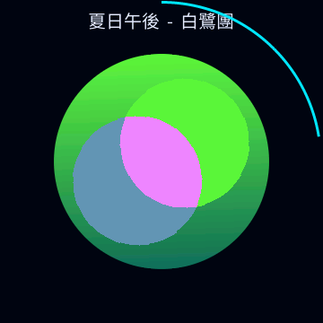

# JukeDial

*ESP32-S31 上的隨身音樂播放器與桌面小玩具；JukeDial 延續先前的 JukeChip 專案。*

[English](README.md) | **繁體中文** | [简体中文](README.zh-CN.md)

&nbsp;&nbsp;

 
<em>左：圓形主板（JC3636F118）。右：方形 Fake Pod Nano Pro（本專案簡稱 FakePod）。</em>

**JukeDial** 是一台跑在 **ESP32-S31** 上的隨身音樂播放器兼桌面小玩具，同一份程式支援兩塊板：**JC3636F118**（360 × 360 圓形觸控螢幕、旋鈕、震動馬達、LED 環）與 **Fake Pod Nano Pro**（460 × 460 方形螢幕、兩顆按鍵、AXP2101 電源晶片、CS43131 DAC）。它從 TF 卡播放音樂，輸出可以走有線 DAC、藍牙或 Auracast，也能聽網路電台，還有時鐘、小工具、遊戲、樂器與氛圍畫面。全部用手勢（快速滑、拖、按住）和旋鈕操作，不用鑽進層層選單。基於 ESP-IDF v6.1、LVGL 9.5 與 Bluedroid；介面有繁體中文、简体中文、English。

**實際畫面**（模擬器截圖，曲目與電台名稱都是虛構的）：

 

## 基本精神
JukeDial 的優先順序很明確：**盡量多支援格式、盡量好的音質、盡量多可能用得到的功能，並先確認做得到**。畫面流暢度（fps）和介面花俏程度排在後面。
- 只有真的滿了，也就是 flash 或內部 RAM 放不下、CPU 跑不動，才做取捨，並且說明原因。
- 其餘情況一律以最大相容、廣納各種需求為原則；還不夠成熟的功能放在預設關閉的「實驗性」設定裡，並老實說明風險。
- 前提是不違背隨身裝置與隨身音訊設備的本分：好帶、好用、音樂優先。
- 唯一的例外：**不做成 AI 用戶端**。

## 特色
- TF 卡本機音樂：封面、倍速（0.75 到 2 倍，音高不變）、淡入淡出、頻譜頁與音效 app。
- 有線高解析輸出最高 384 kHz（上限可選）；藍牙 SBC／AAC／aptX／aptX HD／LDAC（LDAC 會依連線品質在 990／660／492／330 kbps 間調整）；Auracast 廣播與收聽。
- 每個輸出各有自己的音量：有線一個、每支藍牙耳機各一個、喇叭模式一個。
- 網路電台支援 http 與 https，另有**廣播電台模式**，把電台用 Auracast 廣播出去。
- 時鐘、鬧鐘、番茄鐘、喝水提醒、習慣打卡；手動設定時間；白噪音、氛圍畫面、呼吸引導。
- 十五個遊戲與一組小工具，圓屏方屏都能玩（圓板的重力迷宮、FakePod 的傾斜迷宮）；樂器 app（鼓墊、循環錄音、晶片／FM 音色、取樣套組）。
- **外接模式：** 播放器變成 USB 隨身碟、USB 音效卡，以及 USB／藍牙媒體按鍵板；隨身碟模式有保護卡片的機制。
- **記憶卡診斷：** 量讀取速度與寫入讀回，告訴你這張卡跟得上哪些格式。
- **誠實的音訊輸出：**藍牙音訊與有線輸出設定頁，以及說明聲音被改了什麼、為什麼的詳細頁（導覽第 17 章）。FakePod：CS43131 硬體音量、32 到 384 kHz 直通、16 到 32 kHz 升頻。
- **十個配色主題**（五深五淺）以卡片檔提供，附自訂範本（導覽第 18 章）；每個選單格都有圖示。
- **開機畫面：**開機時顯示一張 360 × 360 的 JPEG，每種開機方式一張；卡片包附預設圖示，可在網頁工具關閉。
- 瀏覽器網頁工具（Chrome／Edge）：設定、電台清單、曲庫字型與**刷機**。

## 兩塊板的功能
「支援」是已實作並在實機上用過；「實驗性」預設關閉或有已知風險；「—」是這塊板沒有該硬體。FakePod 的支援比較新，實機上試過的項目比圓形板少。

| 功能 | 圓形（JC3636F118） | 方形（FakePod） |
|---|---|---|
| TF 卡音樂、封面、倍速、淡入淡出 | 支援 | 支援 |
| 有線輸出 | 支援（PCM5102A，軟體音量，最高 384 kHz） | 支援（CS43131，硬體音量，32 到 384 kHz 直通） |
| 輸出推力 1.0／1.41 V | — | 支援 |
| 輸出推力 1.73 V | — | 實驗性 |
| 藍牙耳機 SBC／AAC／aptX／aptX HD／LDAC | 支援 | 支援 |
| 藍牙喇叭模式（手機到播放器） | 支援 | 支援 |
| Auracast 廣播與收聽、廣播電台模式 | 支援 | 支援 |
| 網路電台（http／https） | 支援 | 支援 |
| 時鐘、鬧鐘、番茄鐘、手動設定時間 | 支援（關機後時間不保留） | 支援（內建時鐘，關機後保留） |
| 遊戲與小工具 | 支援（重力迷宮） | 支援（傾斜迷宮） |
| 樂器 app | 支援 | 支援 |
| 外接模式（隨身碟／音效卡／按鍵） | 支援 | 支援 |
| 記憶卡診斷 | 支援 | 支援 |
| 旋鈕、震動、LED 環 | 支援 | — |
| 兩顆按鍵、隱形九宮格點擊區、螢幕關著時的盲按 | — | 支援 |
| 電量顯示、自動關機、充電畫面 | —（只讀供電電壓） | 實驗性 |
| 耳機插孔偵測、線控 | — | 不支援 |
| 實驗性格式（部分 AdLib／tracker）、CPU 時脈切換 | 實驗性 | 實驗性 |
| 網頁工具刷機 | 支援 | 支援 |

## 支援的音訊
**檔案**（2 GiB 以上的檔案會被略過）：

| 類別 | 格式 |
|---|---|
| 常見 | MP3、FLAC、Ogg Vorbis／Opus、M4A（AAC）、Musepack（SV7／SV8）、TTA |
| PCM | WAV（PCM 16／24／32 位元、float32）、AIFF／AIFF-C（PCM） |
| 晶片、遊戲與 tracker 音樂 | HivelyTracker／AHX（.ahx、.hvl）、C64 SID（.sid）、DOS AdLib 音樂（RAD、HSC、IMF、DRO、CMF、A2M 等約 30 種）、PICO-8 卡帶（.p8、.p8.png）、ADX／VAG／BRSTM、Atari ST YM、tracker 模組（libxmp：MOD／XM／S3M／IT 加約 45 種格式，以及 ProWizard／PowerPacker 打包的 Amiga 模組） |

**取樣率與位元深度：**

| | |
|---|---|
| 取樣率 | 各處都支援 44.1／48 kHz；有線 DAC 另有 88.2／96／176.4／192 kHz，最高 384 kHz。上限是個設定：圓形板預設 48 kHz，要到「設定 → 有線輸出」調高，或跑取樣率測試；FakePod 預設 384 kHz（直通）。 |
| DAC 不吃的來源 | 會重取樣；低於 32 kHz 的來源在有線路徑上：圓形板原生播放，FakePod 16 到 32 kHz 升頻、低於 16 kHz 拒絕並說明原因。 |
| 位元深度 | 16／24／32 位元來源；USB 音效卡 16／24／32 位元。 |

## 輸出
- 有線高解析 DAC
- 藍牙耳機：SBC、AAC、aptX、aptX HD、LDAC（預設韌體就含全部）
  - aptX 與 LDAC 只在耳機模式（由 JukeDial 編碼送出），且只有 44.1／48 kHz；喇叭模式（手機到播放器）接收 SBC／AAC
  - LDAC 位元率會在 990／660／492／330 kbps 之間依連線品質調整；開著 Wi-Fi 時上限約 660 kbps
- 藍牙喇叭模式：獨佔的來源，要播放本機曲目時會先問是否離開（離開會重新開機）
- Auracast 廣播與收聽（完整播放器廣播時 Wi-Fi 關閉）
- 廣播電台模式
- 外接模式：USB 隨身碟、USB 音效卡、USB／BLE 按鍵

## TF 卡
FAT32 或 exFAT，分割表要是 **MBR**（GPT 卡掛載不了），單檔小於 2 GiB。你的內容放最上層（例如 `export/<專輯>/`），播放器自己產生的東西都在 `_player/`（設定、索引、字型、循環錄音、記錄）。詳見[導覽第 12 章](docs/guide/zh-TW/12-card.md)。現成的卡片範本：`make card-zip`。開機畫面是 `_player/splash/<模式>.jpg` 或 `_player/splash.jpg`（360 × 360 JPEG）。

## 快速上手
1. 把音樂放進卡、插入，用 USB-C 供電。
2. 選語言，做一分鐘的手勢教學。
3. 快速往下滑是快捷面板，快速往上滑是該頁選單，按住 3 秒回首頁。FakePod 的播放頁用隱形九宮格（第一下點螢幕顯示九個標籤，第二下才執行）。
4. 電台、Wi-Fi 網路檔、電台清單與字型，請用網頁工具：用 Chrome 或 Edge 開啟託管網頁（在 GitHub Pages，網址在 Releases 頁面）並按「連線」。連不上時，可用 `jukedial-<版本>-webtool.zip` 在本機執行（`serve.sh` 或 `serve.bat`，再開 `http://localhost:8000`；直接雙擊 `index.html` 不行）。主要設定也可以不用網頁工具，直接編輯卡上的文字檔（見[導覽第 12 章](docs/guide/zh-TW/12-card.md)）。
5. 先看[硬體章](docs/guide/zh-TW/00-hardware.md)認識兩塊板。
6. 刷機：從 Releases 下載你的板子的合併映像，開啟託管網頁工具，進「刷機」分頁，選你的板子、選檔案，按「連線並檢查」，再按「開始寫入」；更新會保留設定與配對（只有勾「原廠重設」才會清掉）。沒有託管網頁時：用本機網頁工具，或一行 esptool 指令，見[導覽第 13 章](docs/guide/zh-TW/13-web-tool.md)。也可以從原始碼建置（下一節）。

## 從原始碼建置與刷機
完整步驟在[導覽第 20 章](docs/guide/zh-TW/20-build-flash.md)，這裡是大綱：
1. **前置：** ESP-IDF **v6.1**（ESP32-S31 目前是預覽目標，所有 `idf.py` 都帶 `--preview`；Makefile 預期用 `$HOME/.espressif/tools/activate_idf_v6.1.sh` 啟用）、Python 3、CMake 與 C 編譯器；模擬器另需 SDL2。建置時 IDF 元件管理員會自動下載 `app/managed_components/`（要網路）。
2. **不在 git 裡的東西：** 字型分割區映像（`make fontpak`；發佈的映像已經含字型）、修補過的 Bluedroid（`make build` 自動產生）、卡片內容包（`make card-zip`）。
3. **第一次刷圓形板：** 在 `.local/board.mk` 設定 `PORT`（見 `.local/board.mk.example`）→ `make backup`（Makefile 沒有備份就拒絕刷機）→ `make flash-all` → `make flash-fonts`。
4. **FakePod：** 用 esptool 手動寫四個位址（0x2000、0x8000、0x10000、0xC00000），結尾加 `--after watchdog-reset`；下載模式是兩鍵同按再通電。（發佈的映像是一個合併檔、從位址 0 寫入：導覽第 13 章。）
5. **模擬器與測試：** `make sim-run`（桌面模擬器）、`make test`、`make sim-test`。

## 導覽
[閱讀導覽](docs/guide/zh-TW/01-first-boot.md)：0 [硬體](docs/guide/zh-TW/00-hardware.md)、1 第一次開機、2 手勢、3 音樂、4 電台、5 藍牙與 Auracast、6 時鐘、7 小工具與遊戲、8 樂器、9 氛圍、10 快捷面板、11 設定、12 卡片、13 網頁工具與刷機、14 外接模式、15 安全模式與救援、16 常見問題、17 [音訊輸出](docs/guide/zh-TW/17-audio-output.md)、18 [主題配色](docs/guide/zh-TW/18-themes.md)、19 [FakePod](docs/guide/zh-TW/19-fakepod.md)、20 [從原始碼建置與刷機](docs/guide/zh-TW/20-build-flash.md)。

## 已知限制
- FakePod：沒有耳機插孔偵測與線控；電量顯示、自動關機、低電量與充電畫面尚未在實機上完整驗證；96 kHz 以上暫停時最多丟掉約 250 ms；384 kHz 的 FLAC 若區塊大小是 32768（ffmpeg 預設）會被減半到 96 kHz；1.73 V 輸出推力是實驗性。
- 圓形板：沒有電量計（只讀供電電壓）、沒有內建時鐘、沒有硬體音量（軟體衰減，音量 100 ＝ 滿刻度）。
- USB 隨身碟模式對卡片的保護，以及三合一 USB 裝置在各作業系統上的相容度，還沒有在實機上完整驗證。
- Auracast：完整播放器廣播時 Wi-Fi 關閉（記憶體限制）。藍牙喇叭模式是獨佔來源。
- 檔案：2 GiB 以上不收、只支援 MBR 分割（GPT 卡掛不起來）；相簿不支援 progressive JPEG、PNG、HEIC。
- 網頁工具需要電腦版 Chrome 或 Edge（Web Serial）。
- 沒有的功能：AirPlay、歌單、.eq 匯入、WavPack／APE／CUE／DSD。
- 很多項目還在等長時間、多設備的實機驗證；較長的清單與每次改動見 [CHANGELOG.md](CHANGELOG.md)。

## 下載與發佈
發佈檔在專案的 GitHub 與 Gitee Releases 頁面（檔案相同）。版本是日期，例如 `2026.11.22`。每個版本有：
- `jukedial-<版本>-round.bin` 與 `jukedial-<版本>-fakepod.bin`：每塊板一個合併映像（bootloader、分割表、app 與字型）
- `jukedial-<版本>-card.zip`：TF 卡內容（解壓縮到卡的根目錄）
- `jukedial-<版本>-webtool.zip`：離線（本機）使用的網頁工具
- `SHA256SUMS` 與發佈說明
- GitHub（主要）：https://github.com/JokerCatz/JukeDial
- Gitee（鏡像）：https://gitee.com/jokercatz/JukeDial
- 網頁工具（設定與刷機，Chrome 或 Edge）：https://jokercatz.github.io/JukeDial/

裝置的說明頁會為 `_player/config/app.txt` 裡 `setup_url` 的每個網址顯示一個 QR（空白隔開、主要的放第一個、最多 4 個）。

## 授權
JukeDial 自己的程式以 **LGPL-2.1-or-later** 授權（`LICENSE`）；包含 LDAC（Apache-2.0）的韌體二進位實際上是在 LGPL-3 的條件下散布。完整說明見 [LICENSING.md](LICENSING.md)，第三方元件與版權聲明見 [THIRD_PARTY_NOTICES.md](THIRD_PARTY_NOTICES.md)。LDAC 與 aptX 是個人、非商品用途的支援，沒有 Sony 或 Qualcomm 的認證。字型用 Noto（OFL），不在儲存庫內；圖示：Tabler Icons（MIT）與 Material Symbols（Apache-2.0）。

## 給開發者
`docs/guide/zh-TW/00-hardware.md` 介紹兩塊板子，`sim/README.md` 說明主機模擬器，`docs/dev/` 是給開發者的筆記（功能地圖、測試方法、量測結果、字型、發版；英文）。圖片清單與截圖腳本：`docs/guide/shotlist.md`、`tools/simtools/guide_shots.py`。刷機與音訊相關的安全規則寫在 `Makefile` 的檢查裡：沒有備份、埠不是 `/dev/serial/by-id/*`，就不會刷。
