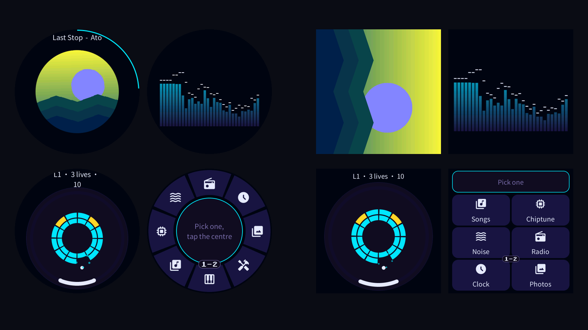

# 0. Hardware

JukeDial runs on two boards, both built around the **ESP32-S31** (dual-core RISC-V at 320 MHz, Wi-Fi 6, Bluetooth Classic + BLE 5.4, 16 MB flash). One firmware code base serves both; the image is built per board and the board is never guessed (a wrong-board image refuses to start).

## The round board: JC3636F118
A knob board with a 360 x 360 round touch display.
- **Display and input:** 360 x 360 round screen, capacitive touch, a rotary knob (turn and press), DRV2605L haptic driver (the knob clicks), and an LED ring around the screen.
- **Audio:** wired output through a **PCM5102A** DAC (the stock board ships PCM5100A; pin compatible, ours was swapped) to the 3.5 mm jack; a PDM microphone; a TF card slot (SD, 4-bit).
- **Memory:** 16 MB flash; PSRAM measured at 16 MB.
- **Power:** USB-C. There is no battery chip and no clock chip; the board can only read the supply voltage through an ADC, so there is no battery percentage, and the time is not kept while powered off (set it from the network or by hand after boot).
- **Motion sensing:** there is no usable motion sensor, so the gravity maze turns gravity with the knob.

## The square board: FakePod Nano Pro
A third-party open hardware design (credit: ZYFDroid; public repository: <https://gitee.com/ZYFDroid/night-player-fake-pod-nano>). JukeDial's firmware on it is our own code, written against the published schematic and notes.
- **Display and input:** 460 x 460 square AMOLED (CO5300 controller), CST820 capacitive touch, **two keys** (top key = "+1" and the power key, bottom key = "-1"), no knob.
- **Audio:** wired output through a **CS43131** DAC and headphone amplifier (3.5 mm jack); a PDM microphone; a TF card slot.
- **Power:** an **AXP2101** power chip with battery charging and a fuel gauge. The board has no battery connector in its schematic, so a battery is a wiring job; without one JukeDial reports USB power only.
- **Sensors:** QMI8658 motion sensor (used by the tilt maze; it calibrates its scale automatically and can be re-zeroed) and a PCF85063 real-time clock (the time is kept while powered off).
- **Memory:** 16 MB flash, plus PSRAM.
- **Not supported:** headphone-jack detection and inline remote (the board has no usable detect pin).
- **Download mode:** hold both keys while powering on (chapters 15 and 20).

More FakePod-specific operation (nine-grid, three now-playing styles, tilt maze, output drive) is in [chapter 19](19-fakepod.md).

## Comparison
| | Round (JC3636F118) | Square (FakePod Nano Pro) |
|---|---|---|
| Display | 360 x 360 round, backlit | 460 x 460 square AMOLED (CO5300) |
| Touch | yes | yes (CST820) |
| Input | knob (turn, press) + touch | two keys + touch |
| Wired DAC | PCM5102A, up to 384 kHz | CS43131, 32 to 384 kHz passthrough, 16 to 32 kHz upsampled, below 16 kHz refused; volume in the DAC hardware |
| Battery / power | USB-C, voltage by ADC only | AXP2101: battery %, charging, USB / battery shown |
| Real-time clock | none (time is not kept while powered off) | yes (RTC chip, time kept while powered off) |
| Haptics | DRV2605L (knob clicks, feedback) | none |
| LEDs | LED ring | none |
| Motion sensor | none | QMI8658 (tilt maze) |
| Microphone | PDM | PDM |
| TF card | yes | yes |

## What differs in use
- **Navigation.** On the round board the knob scrolls and sets the volume, and any control with three or more values is set by tapping it, then turning. On FakePod the two keys do the same steps: top key up / "+1", bottom key down / "-1"; hold a key to repeat (about 2.5 s at most, because a long top-key press is the hardware power-off). Pressing both keys together turns the screen off and on. Touch and the gestures of chapter 2 work on both.
- **Feel.** Haptic clicks and the LED ring are round-board features; on FakePod they are simply absent and their settings do nothing.
- **Sound.** Both boards play 44.1 / 48 kHz and the hi-res rates up to their DAC's limit (see the table and chapter 17); the output ceiling is a setting (chapter 11). On FakePod the device volume is set in the CS43131 itself.
- **Power.** FakePod shows "USB" or the battery level in quick settings (chapter 10); the round board shows neither.
- **Power policy (FakePod only).** Settings > Auto power-off (off / 10 / 30 / 60 min, default 30) powers the unit off when nothing plays and nothing is touched; it never fires on USB power. A low-battery warning appears at 15 %, and at 5 % for a minute (or 2 % at start-up) the unit saves your place and powers off. Plugging in a cable while it is off shows a charge screen (percent, charging state) instead of starting the player; press the power key to start. The round board has none of this.
- **Screen always turns off (FakePod).** Its screen is OLED, which burns in if it stays lit, so it turns off after a while idle (also on USB power, where it is the screen that goes off, not the unit) and there is no always-on option; the round board's LCD has none of this.
- **Screen shape.** Ring and round layouts are drawn for the circle; on the square screen the same content uses the larger area.

Next: [First boot](01-first-boot.md).
