# 1. First boot

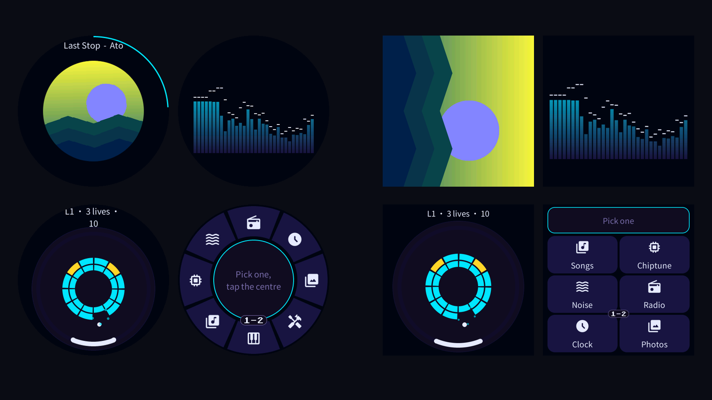

**What you need:** a JukeDial board (round JC3636F118 or FakePod), a USB-C cable, and a TF card (see chapter 12). The card is optional for a first look, but music, radio lists and the full font set live on it.

1. **Power on.** Plug in USB-C power. The first boot takes a few seconds.
2. **Pick a language.** On a card with no saved language you get the language picker: 繁體中文 / 简体中文 / English. Tap one. It is stored as `lang` in `_player/config/app.txt` and can be changed later in Settings (chapter 11).
   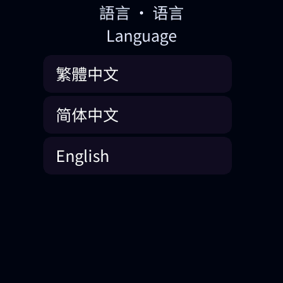
3. **Gesture tour.** Right after the language, a short tour teaches the four gestures one at a time: flick up, flick down, flick left and right, then hold for 3 seconds. You must really do each gesture to move on. Tap "Skip" (small text, bottom right) if you do not want it. The tour is shown once (`tour_done`); Settings has an entry to watch it again. On both boards "Skip" is the same small button below the middle of the screen (no key is needed).
   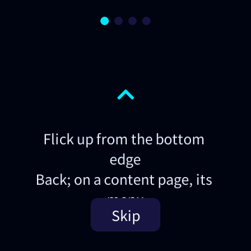 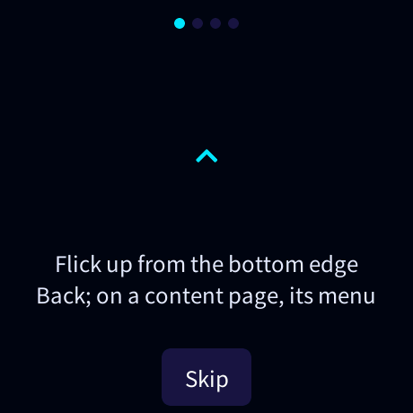
   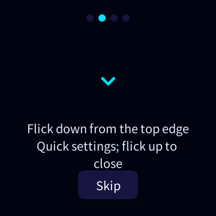 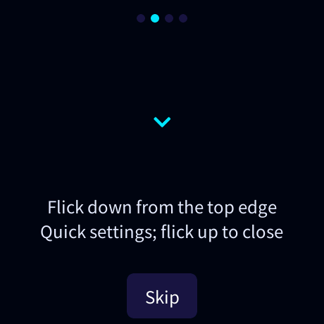
   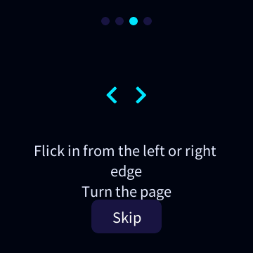 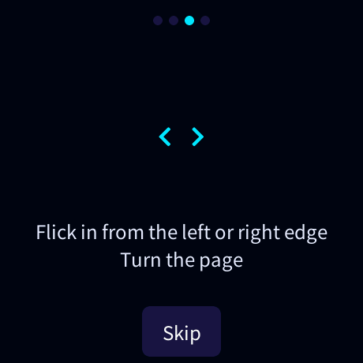
   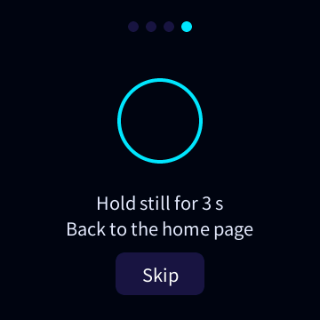 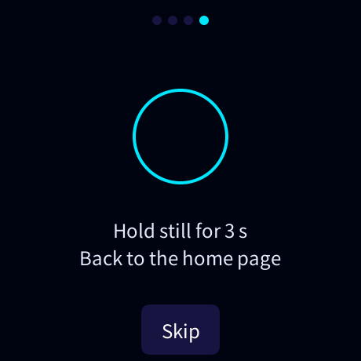
4. **Home.** You land on the home menu.
   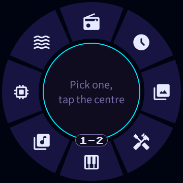
   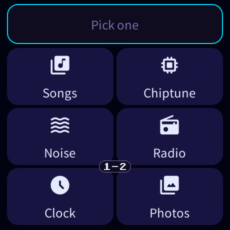

**Round board vs FakePod.** The round board has a touch screen and a knob (turn = scroll / volume, press = select). FakePod has a 460 x 460 square screen and only two keys: the top key is "+1" (also the power key), the bottom key is "-1". Everything you can do with the knob you can do with those two keys plus touch, except where noted.

Next: [Gestures](02-gestures.md).
