# 2. Gestures and controls

One set of gestures works on every page and on both boards. The recogniser is shared, so a page never invents its own.

| Gesture | How | What it does |
|---|---|---|
| Flick up | a quick upward flick | On a content page (now playing, a game...): opens that page's popup menu. On a list or sub page: go back one level. On Home: nothing. If the quick-settings panel is open: close it. |
| Flick down | a quick downward flick | Opens the quick-settings panel (chapter 10). In a game it also pauses the game. |
| Flick left / right | a quick sideways flick | Next / previous page of a ring, grid or list. If there is no further page, nothing happens. |
| Slow drag | slower than a flick | Scrolls long content (help pages, long lists) 1:1, with no inertia. It never turns a page. |
| Hold | keep a finger down anywhere | After 3 seconds (setting: 2, 3 or 4 s) you go Home. This is the escape hatch from any page. |
| Tap | tap | Select. Unchanged. |

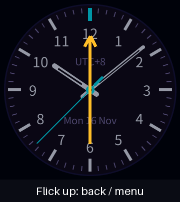 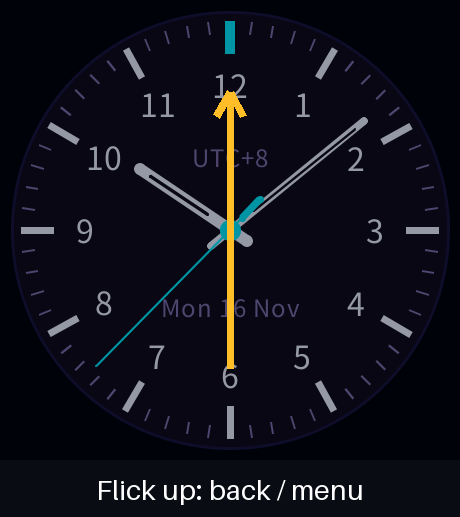
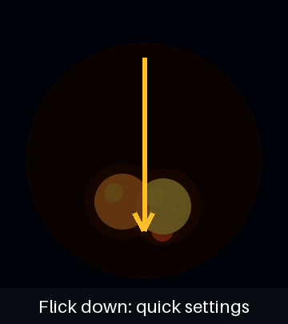 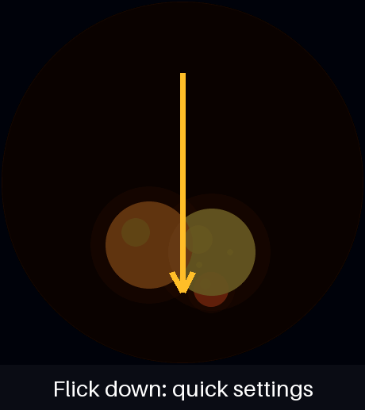
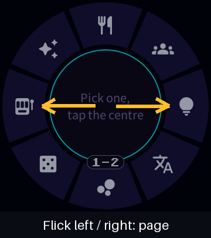 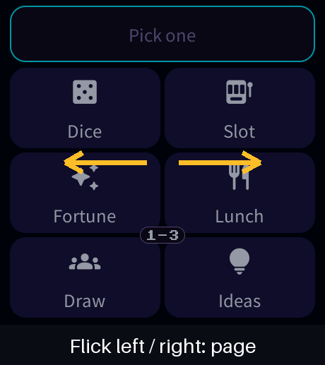
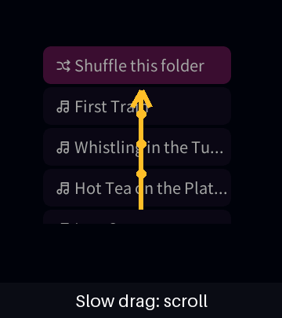 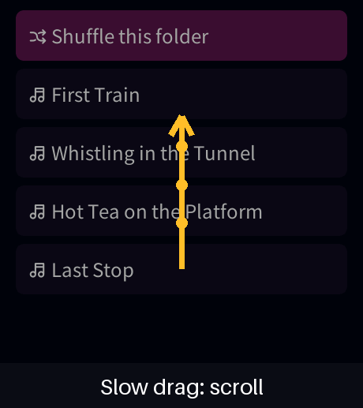
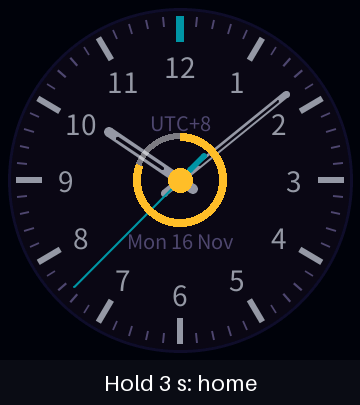 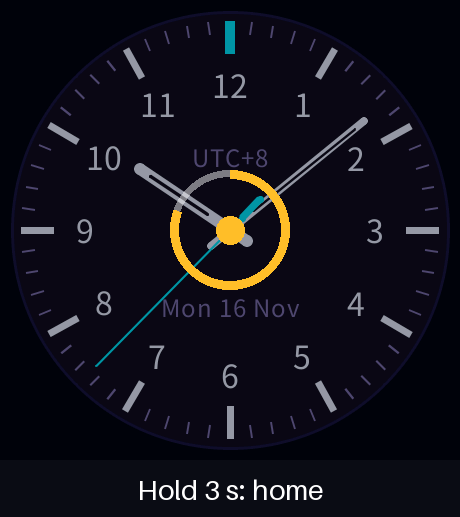

**Page bubble.** When a ring or list has more than one page, a tiny, non-tappable bubble such as "2/3" shows where you are. On the round board it sits in the gap between the bottom of the ring and the centre circle; on FakePod it sits where the four lower cells meet. There is no Back button and no Next-page button any more: flick instead.

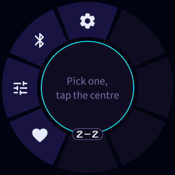 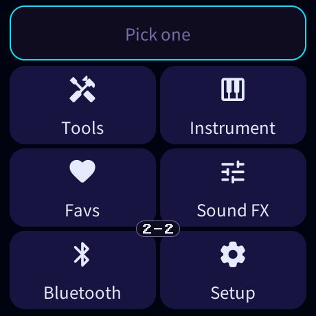

**The knob ring.** Controls with three or more values (speed, equaliser band, brightness...) use the "borrowed knob" pattern: tap the control, then turn the knob both ways to change it; after 4 seconds without input it lets go. FakePod uses the two keys for the same thing.

**FakePod keys.** Top key = +1 (next / up / louder), bottom key = -1. A press shorter than about 70 ms is ignored.

**FakePod nine-grid.** The FakePod's now-playing and spectrum pages have no on-screen buttons; the whole page is split into 3 x 3 invisible tap zones. The first tap anywhere only shows the nine labels; a second tap on a zone runs it (while the labels are hidden a tap does nothing). Details in [chapter 19](19-fakepod.md).

**Games and drag.** A flick still works inside a game (games use taps and the knob). If a game ever needs dragging it says so, and then only the 3-second hold works.

**Popup card.** Flick up on a content page (or tap / turn, depending on the page) and the page's menu opens as one solid rounded card in the middle of the screen: the page title, its items and a last row "Close | Leave" (Close only closes the card; Leave leaves the page). The content behind is not dimmed. The same card is used for game pause menus and exit prompts.

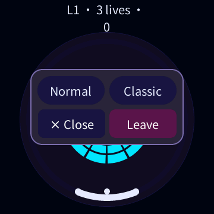 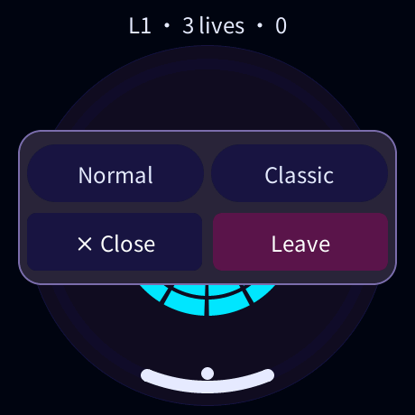

**Menu icons.** Menu rings and grids show an icon per cell. On the round board a cell holds only the icon and the name appears in the centre after the first tap (the second tap opens it); on FakePod the cell shows the icon with a short name below and one tap opens it. Settings rows, list rows, the quick-settings status lines and the Details page carry a small inline icon in front of the text. The help cell is always the question mark in the second accent colour.

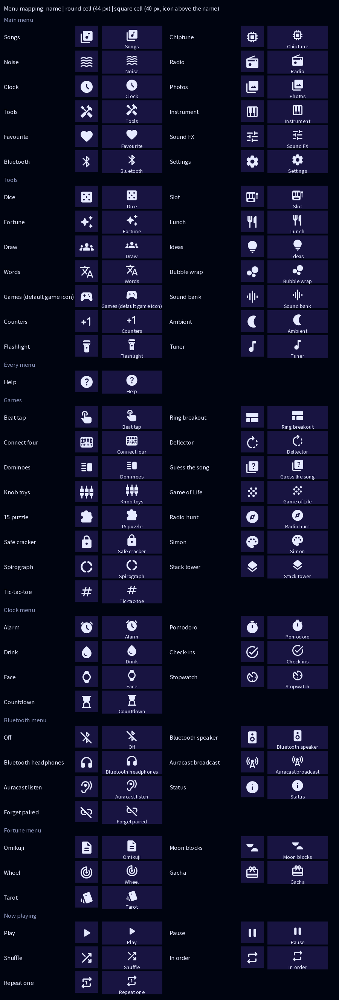

Next: [Playing music](03-music.md).
