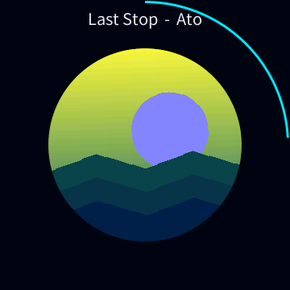
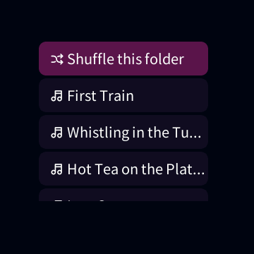
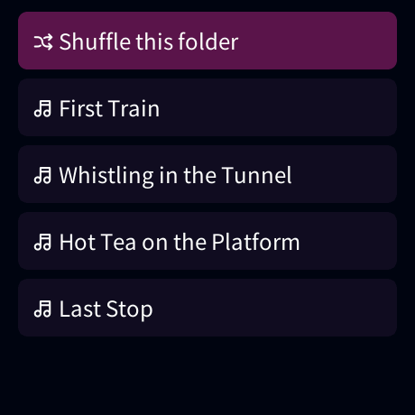
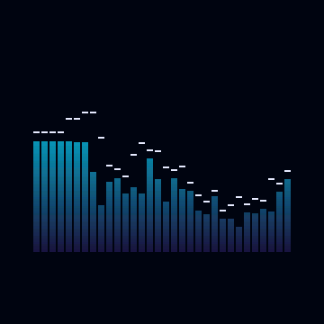
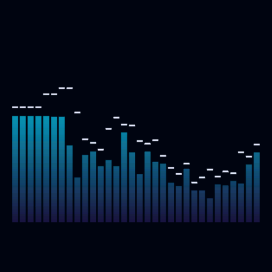
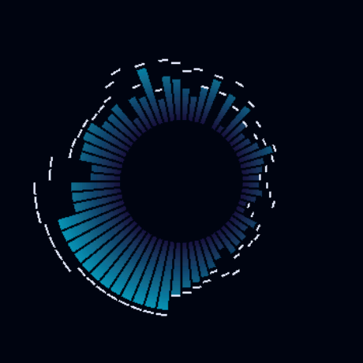

# 3. Playing music

 

**Library.** Put music on the TF card (chapter 12). JukeDial scans it on first use and caches the index in `_player/index/library.bin`; scanning does not stop playback. Pages: all tracks, folders / albums, favourites, covers, and a re-scan.

 

**Folders as a tree.** The scan reads sub-folders up to 8 levels deep (the device's own `_player` folder and folders starting with a dot are skipped; a folder with no playable file anywhere below it is not listed). The music page shows the top level: the first row is "Shuffle all", then the songs that lie directly in the music folder, then the folders, and "Rescan library" last. Tap a folder to open its level in the same page: the first row "Shuffle this folder" plays the folder *including* all its sub-folders, then its own songs, then its sub-folders (the same order as playing in sequence). Flick up (or Back) goes up one level; from the top level it leaves the page. Shuffle, including the weighted shuffle (newer files and favourites weigh more), draws from the whole library or from the chosen folder with its sub-folders, and stays fast with tens of thousands of songs. An index written by an older firmware is simply rescanned once.

**Long lists are paged.** A folder level or song list shows 40 rows a page. Flick left / right turns the page (it wraps), a small bubble such as "2-5" says which page you are on, and turning the knob past the last (first) row of a page goes on to the next (previous) one. A list opens on the page that holds the playing song.

**Formats the library accepts:** MP3, FLAC, Ogg Vorbis / Opus (`.ogg`, `.oga`, `.opus`), M4A (AAC), WAV (PCM 16 / 24 / 32 bit integer and 32-bit float), and tracker modules (libxmp: `.mod` `.xm` `.s3m` `.it` `.stm` `.669` `.far` `.mtm` `.ptm` `.okt` `.ult` `.mdl` `.stx` `.pt3` `.sfx` `.st` `.stk` `.m15` `.nt` `.flx` `.wow` `.ice` `.mtn` `.liq` `.psm` `.ps16` `.j2b` `.amf` `.gdm` `.med` `.mmd0`–`.mmd3` `.rtm` `.mgt` `.dsym` `.digi` `.dbm` `.emod` `.umx` `.hmn` `.stim` `.coco` `.fnk` `.abk` `.xmf`; also ProWizard-packed Amiga modules and PowerPacker / XPK / Pack-Ice / ARC / LZX / MMCMP-packed ones under those suffixes; the Amiga Paula emulation is not used; AdLib S3M, Ogg-sample XM not played as tracker files; `.imf` / `.dtm` / `.ims` are claimed by both players: the player tries them as AdLib music first and, if that refuses, as tracker modules).

**Also plays:** AIFF / AIFF-C, Musepack (`.mpc`), TTA, HivelyTracker / AHX (`.ahx`, `.hvl`, with sub-songs), Commodore 64 SID tunes (`.sid`, PSID and RSID, up to 4 SIDs, sub-tunes; every tune plays 3 minutes with a fade; BASIC RSIDs are refused with a reason), DOS AdLib / OPL music (`.rad`, `.hsc`, `.imf`, `.wlf`, `.dro`, `.cmf`, `.a2m`, `.a2t`, `.d00`, `.sop`, `.xad`, `.amd`, `.bam`, `.lds`, `.rol`, `.ksm`, `.mus`, `.ims`, `.mdi`, `.sci`, `.laa`, `.mtr`, `.mkj`, `.cff`, `.dmo`, `.dtm`, `.sat`, `.sa2`, `.plx`, `.msc`, `.rix`, `.got`, `.hsq` and relatives, `.sng` and a few more; OPL2 sound, a second chip becomes the right channel; songs that need OPL3 four-operator voices, Westwood ADL and aPlib-packed A2M files are refused with a reason), PICO-8 carts (`.p8`, `.p8.png`; music only, never the code), game streams ADX, VAG, BRSTM (`.adx`, `.vag`, `.brstm`; played once, loops ignored), Atari ST YM (`.ym`, plain or LHA-packed; MIX1 and tracker variants are refused with a reason).

**Format tiers: experimental formats.** Some readers are less mature: the DOS AdLib `.a2m` `.a2t` `.d00` `.hsq` `.sqx` `.sdb` `.agd` `.ha2` `.lds` `.sa2` `.dtm` `.plx` `.rix` `.xms` `.mtr` `.sat` `.dfm` `.mad` `.laa` `.sci` `.cmf` `.mdi` `.pis` and the tracker `.ice`. They are **off** by default (Settings → Experimental formats): while off, the library scan **does not read these files at all** (the file name only, so the title is the name), they stay in the lists, and opening one says "Experimental formats are off (Settings → Experimental formats)". To turn them on, tap twice (the first tap says why: these readers are less mature, and a damaged file may reboot the player); rescan the library afterwards to read their tags. Every other format is unaffected.

**Amiga tone.** Settings has an Amiga tone row (Off / A500 / A500 + LED / A1200): for Amiga-family `.mod` files (ProTracker, Soundtracker, Noisetracker, ProWizard packs) the Paula simulator recreates the hardware sound; the A500 is duller (fixed filter), the A1200 brighter, and a playing module switches within a block. It costs more CPU: the heaviest 4-channel `.mod` takes about 55 % of the audio core; 6- and 8-channel `.mod` files are not touched, nor are other formats.

**Crash protection (all formats).** While a song plays, the track being decoded is noted in memory that survives a reboot. If the player crashes and restarts, that song (both songs, if it crashed while preparing the next one) is marked "Crashed last time it played, skipped": next, shuffle and resume-after-restart no longer pick it by themselves; tapping it yourself in a list plays it and clears the mark (another crash marks it again). The marks are kept on the card in `_player/config/crashed.txt`.

**Sample rates and bit depth.**
- Wired output goes through the DAC at 44.1 / 48 kHz and, on the high-resolution path, 88.2 / 96 / 176.4 / 192 / 352.8 / 384 kHz. Which levels are on is the setting `dac_max_rate` (four steps): the round board defaults to 48 kHz (raise it in Settings > Wired output, or let "Rate test" find the highest level your DAC and cable accept); the FakePod defaults to 384 kHz (passthrough). A rate the DAC does not take is resampled; sources it cannot play at all (below 32 kHz on the wired path) are refused with a visible reason.
- Bluetooth output is limited by the codec (chapter 5); JukeDial resamples between 44.1 and 48 kHz as needed.
- FLAC decodes natively up to 192 kHz; 352.8 / 384 kHz FLAC is limited by block size, and a source whose blocks are too large for the output is halved (up to three steps) and the status page shows why.
- Files of 2 GiB or more are skipped (see chapter 12).

**Now-playing page.** On the round board it is a rotating cover disc; tap the centre for the playback ring. The FakePod has three styles under Settings > Display > Now playing: full cover (default), cover plus info, and menu grid (the rotating disc); they are operated through the invisible nine-grid ([chapter 19](19-fakepod.md)).

**Now-playing ring.** Tap the centre area to open the ring: play/pause, previous/next, shuffle/repeat, favourite, speed, details, visualiser, effects. With many cells the ring has two pages: flick left/right.

**Speed and crossfade (Track B).**
- *Speed* (library files only): 0.75x, 1.00x, 1.25x, 1.50x, 2.00x with pitch kept (WSOLA). Tap the speed cell, turn the knob.
- *Crossfade*: Settings entry "Crossfade", seconds between songs, equal-power; it **only works when the two songs have the same sample rate** (the next song is already prepared). With different rates (for example 44.1 and 48 kHz) or when you skip by hand, the song simply changes; the screen reminds you of this when you turn crossfade on.
- Both switch themselves off, with the reason shown, when you use aptX, LDAC, Auracast or any pipeline rate above 48 kHz (88.2 kHz and up). Crossfade steps are off / 2 / 4 / 6 s.

**Covers.** Album art comes from `cover.jpg` or tags and is cached in one pack file (`_player/index/thumbs.pak`). Above 96 kHz the cover is not decoded, and when internal RAM is tight the default picture is used instead. Over Bluetooth in speaker mode the phone's title and cover are shown (AVRCP 1.6).

**Visualiser, spectrum and effects.** A spectrum page with several styles (bars, ring...) and a set of effects (EQ, reverb, widener, crossfeed, loudness, limiter...). Heavy effects pause automatically when the CPU is busy (aptX, LDAC, broadcast, high-res) and the effects page shows why.

 
 

**More visualiser kinds.** Tap the visualiser page to open the style ring; its "Type" cell also reaches these:

- **Voice rows and piano roll** (only while a chip tune or tracker file plays): the rows show one line per voice with its name, a key-on lamp, a level bar, the note name and the pan; the piano roll draws the last 6 seconds of pitch, one colour per voice. On either one, the "Voices" cell of the ring picks a voice and the "State" cell steps it through on, mute and solo: solo hears only that voice, and a track change puts every voice back on.
- **Lyrics**: the `.lrc` file next to the song (`song.mp3` with `song.lrc`) is read; the current line is large with one or two dimmer lines either side, following the playing position through seeks, pauses and track changes. The file must be UTF-8 (GBK and Big5 are not converted and say so); with no file it shows "No lyrics". Limits: the first 64 KB of the file, 400 lines, 160 bytes per line.
- **Size** (square panel only): Zoomed or Original; Original is sharper.

The last cell of the ring is Help, with the full description.

**Sleep timer and alarms** are in the clock apps (chapter 6).

Next: [Internet radio](04-radio.md).
