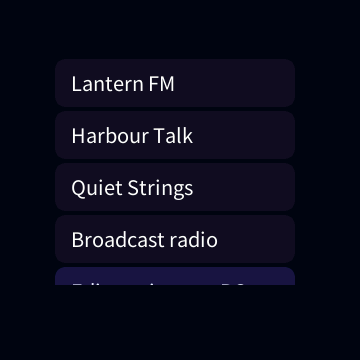
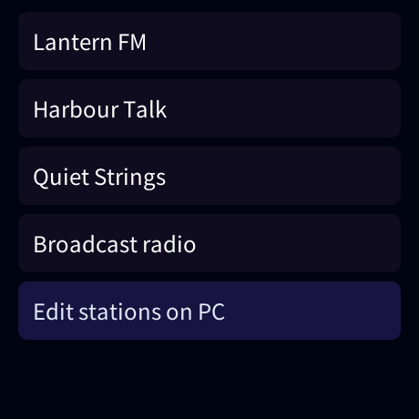

# 4. Internet radio

 

Radio needs Wi-Fi. JukeDial never asks for credentials on screen; the network details come from `_player/config/wifi.txt` on the card (chapter 12); the web tool can also write it (Wi-Fi section: network name and password). Wi-Fi is switched on only when needed (radio, clock sync) and is allowed or forbidden in quick settings.

- **Station lists** are plain text on the card: `_player/config/radio.txt`, `radio_cn.txt`, and your own `radio_<name>.txt`, one `Name|URL` per line. A default list is written on first use. The last row of the radio list opens the "edit on a computer" help.
- **http first.** Plain http streams play directly. https streams also work: the TLS stack runs in PSRAM with a certificate bundle, and a station that is only listed as https is first tried through its http twin. Each TLS connection costs about 31 KB of PSRAM; if internal RAM is too low the page tells you it refused https.
- **Stream types:** MP3, AAC, Ogg/Opus, and HLS with TS/AAC segments (BBC, many Taiwan stations). HLS with fMP4 segments is not supported.
- **Sound:** radio goes through the same output as music: wired, Bluetooth (headphone mode keeps playing, but the headphones drop for about half a second when Wi-Fi connects), not during Auracast broadcast from the full player (use the broadcast-radio mode, chapter 5).
- **Browsing stations:** the web tool has a station finder (radio-browser.info) and an editor that writes your lists to the device.
- **Radio hunt** is a game: tune a dial to find stations (chapter 7).

Next: [Bluetooth, Auracast and broadcast radio](05-bluetooth-cast.md).
