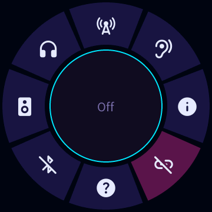
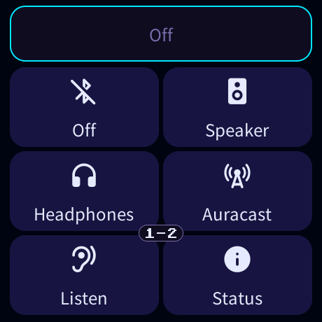
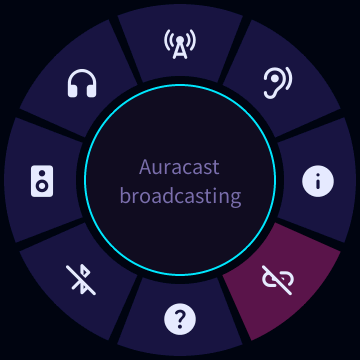
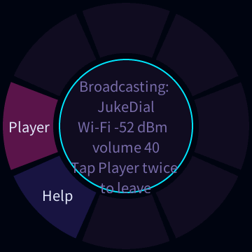

# 5. Bluetooth, Auracast and broadcast-radio mode

 

Bluetooth modes are chosen in the Bluetooth page. **Changing mode reboots JukeDial** (about 10 s) and playback resumes where it was. After an abnormal reboot (crash, watchdog, brown-out) or safe mode the mode goes back to the default and Bluetooth is off.

**Headphone mode (player to headphones, A2DP source).** Pair from the pairing page (a ring shows the 6-digit code). The default firmware includes every codec: SBC, AAC, aptX, aptX HD and LDAC. aptX and LDAC are encoded by JukeDial, so they exist only in headphone mode and only at 44.1 / 48 kHz. LDAC adapts its bit rate to the link quality between 990 / 660 / 492 / 330 kbps and climbs back when the link recovers; while Wi-Fi is on it tops out near 660 kbps. If the link is poor JukeDial also steps aptX HD to aptX to SBC and tries to climb back after 2 minutes of quiet. Headset keys (play/pause, next/previous, volume) work. Heavy effects pause on aptX / LDAC; the effects list says so.

**A volume for every output.** The wired output has one volume; each Bluetooth headset keeps its own, by its address, starting at about one third (33) the first time it connects; speaker mode has its own volume (default 60). Switching output never makes the sound louder than the new output's own setting, so changing outputs does not give you a sudden loud surprise.

**Speaker mode (phone to player, A2DP sink).** The phone plays through JukeDial's wired output (SBC or AAC is received); JukeDial shows the phone's title, artist and cover (AVRCP 1.6). Speaker mode is an **exclusive source**: if you pick a local track while in it, the screen asks "Leave speaker mode and play?"; leaving restarts the device, then the track plays.

**Auracast.**
- *Broadcast:* JukeDial sends 48 kHz stereo to any Auracast receiver. While broadcasting from the full player **Wi-Fi is off** (memory limit), and effects are reduced to EQ plus limiter.
- *Listen:* JukeDial receives a broadcast. Wi-Fi may stay on (packet loss rises from about 0.6 % to 1.6 %, compensated).

**Broadcast-radio mode.** A separate boot mode: Wi-Fi first, then Auracast, so you can **broadcast an internet radio station** to Auracast receivers. It is a reboot mode with a lean load list. Leaving it needs the armed "back to player" cell tapped twice; holding the screen does not reboot out of it. Long-run stability has not been fully verified.

**Not offered:** a Bluetooth settings page on the phone side, LE Audio unicast, MIDI.

**Audio settings.** Codec, rate, bit-depth and channel limits and the LDAC maximum bit rate live in Settings > Sound > Bluetooth audio; the page shows what the headset offers and what was negotiated (chapter 17). **Names.** JukeDial shows up as "JukeDial" over Bluetooth and Auracast, "JukeDial MIDI" for BLE MIDI and "JukeDial Keys" for the BLE keypad. If you paired it under the old name (JC Player / JC MIDI / JC Keypad), remove the old entry on the phone or computer and pair again.

Next: [Clock, alarm and habits](06-clock.md).
