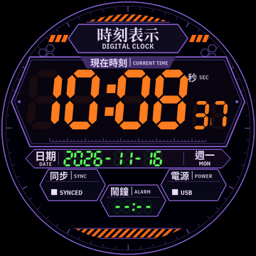
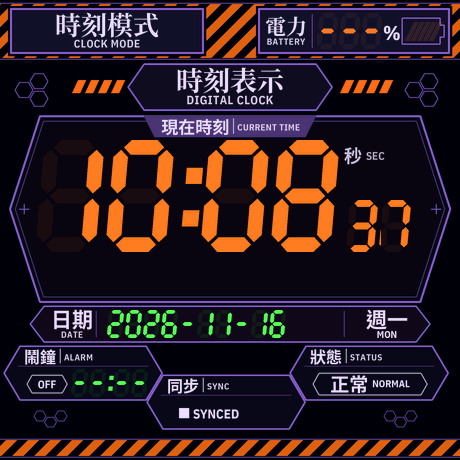
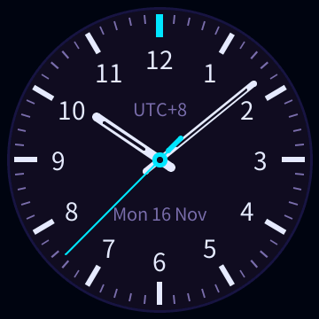
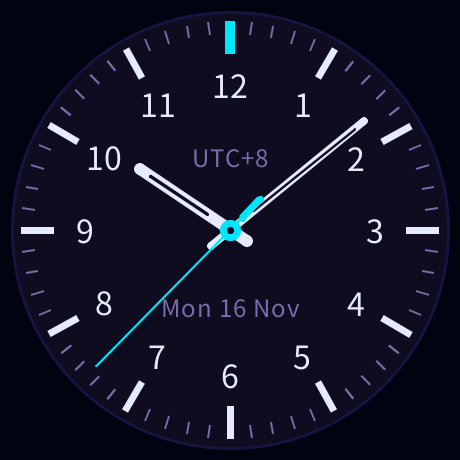
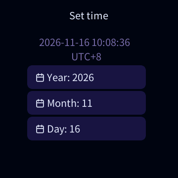
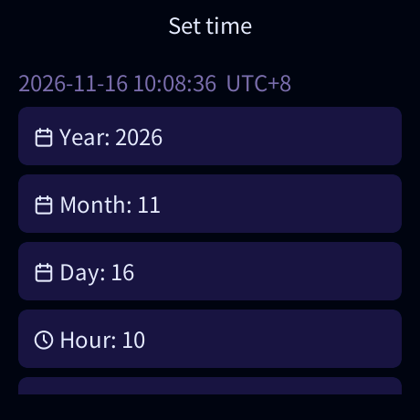
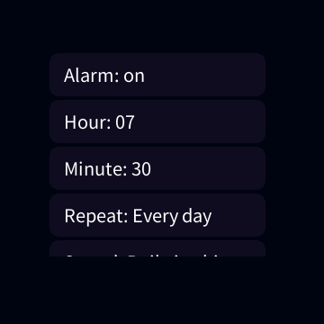
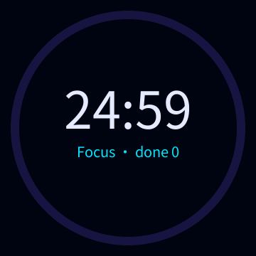
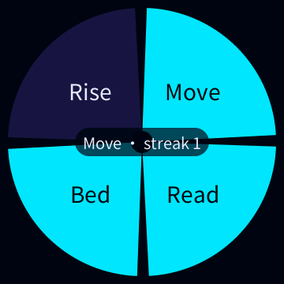
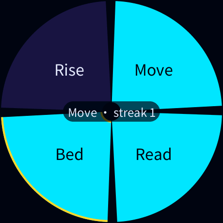

# 6. Clock, alarm, pomodoro, drinking water and habits

 

- **Clock.** Several faces and a few fonts; the default is the HUD designed face (purple frame, orange digits; it needs `_player/faces.zip` from the card pack, without it the info face is used). Another face, for example the classic hands:
   
  Time is set by Wi-Fi (NTP) or by hand. The round board has **no battery clock**: after power is fully lost the time is wrong until the next sync or manual set (a soft reboot keeps it). The FakePod has a built-in clock chip that keeps the time while powered off. Time zone and sunrise location are set in the web tool only.
- **Setting the time by hand.** Settings > System > Set time (also the last cell of the clock menu). The top shows the current date, time and time zone; below are five rows: year, month, day, hour, minute. Tap a row to step it up, or turn the knob (FakePod: the two keys); values wrap around (the year runs 2025 to 2040) and the day follows the month length. What you enter is local time in the time zone you set; nothing changes until you tap Apply, and the seconds start at zero. The last row, "Sync over Wi-Fi", syncs from this page (a successful Wi-Fi sync replaces the manual time). The line at the bottom says whether the time survives power-off.
   
- **Alarm.** Always rings. The tone is a built-in chime or one MP3 you choose (radio cannot be the alarm sound). The alarm page is reachable with the knob.
  
- **Pomodoro.** A ring timer. While music is playing it only vibrates (round board, haptics) and does not interrupt the song.
  
- **Drink water** and **habit check-in**: reminders and a daily tick list, stored on the card.
   

FakePod has no haptic motor; reminders use sound and screen only (its board has no haptic driver).

Next: [Toys and games](07-toys-games.md).
