# 7. Toys and games

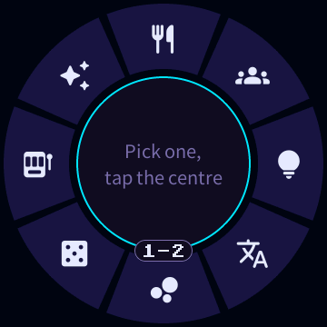 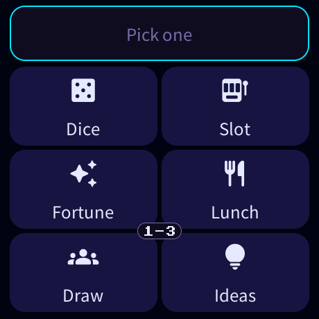

Toys live in the Tools menu and can be used while music plays. Their sounds are tiny chiptune synths mixed in before the volume, so they stay as quiet as the music.

**Toys (one line each):** dice; slot machine (the page explains what wins); lunch / pick-a-person / idea lists; fortune sticks (omikuji) and a wheel (text can be overridden from the card); bubble wrap; counters; sound bank (browse the chip voices); photos; vocabulary flash cards; tuner (Listen uses the microphone to name the note and show how many cents off it is, the A4 reference is adjustable 430-450 Hz, music pauses while listening and goes on after you leave; Play a note sounds a note C2-C6 as a sine, square, triangle or saw, with the guitar open strings); flashlight (the whole screen pure white at full brightness, no text; flick up, hold to go home, screen sleep or opening quick settings all bring back your own brightness).

**Games** (all playable on round 360 and square 460, taps + knob, no drag needed): Beat tap, Ring breakout, Connect four, Deflector, Dominoes, Guess the song, Knob toys (maze, wind-up, fishing), Game of Life, 15 puzzle, Radio hunt, Safe cracker, Simon, Spirograph, Stack tower, Tic-tac-toe. Most have rule variants, art styles and a high-score save. Flick down pauses a game and opens quick settings.

**Knob toys and the maze.** This game has six ways to play. On the round board the first one is the **gravity maze**: the marble starts in the centre, the knob turns the direction of gravity (a small arc on the rim marks where down is), roll it to a gap in a ring and let it fall through; the outer exit is the goal. Repel and attract variants follow. The FakePod has a motion sensor, so its first one is the **tilt maze** ([chapter 19](19-fakepod.md)): tilt the machine to roll the marble; a hole sends it back to the start.

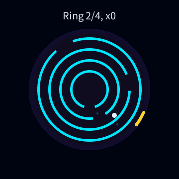

Showcase demos:
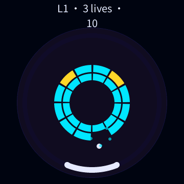 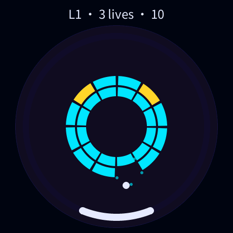
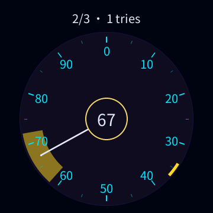 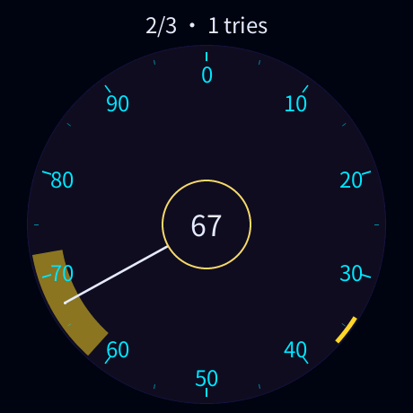
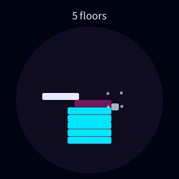 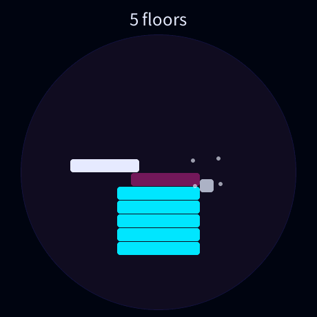
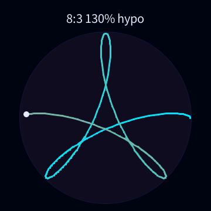 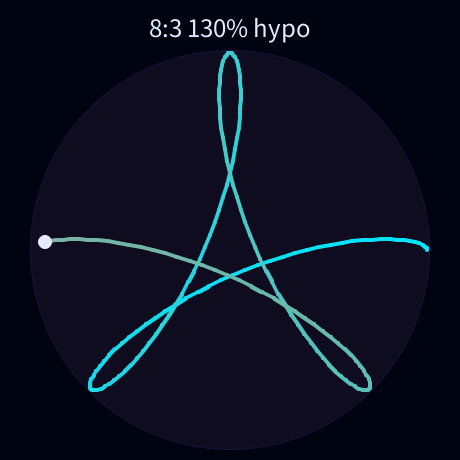

Next: [Instruments](08-instruments.md).
