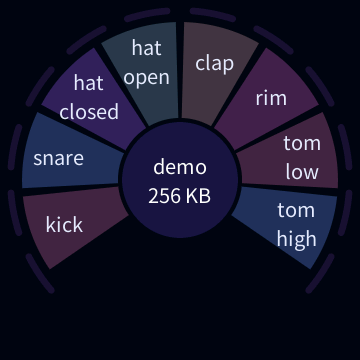
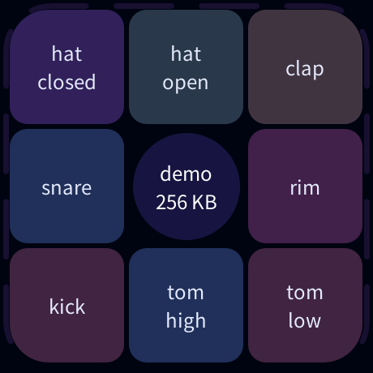

# 8. Instruments

 

The instrument app is its own boot mode (reboot to enter, an armed cell plus a second tap to leave). It uses the same ring UI as JukeDial. Contents: drum pads, metronome / beat, a loop recorder (loops are stored as `_player/loops/loop_NNN.jcl`), chip and FM voices, and sample kits.

Kits go in `instrument/kits/<name>/` with a `kit.txt` and WAV or SFZ files; a demo kit can be generated with `tools/gen/make_demo_kit.py`. Playing is by tapping the pads; the knob changes the selected parameter.

The instrument app also advertises as a Bluetooth LE MIDI device named "JukeDial MIDI": connect a phone or computer MIDI app to play it, and it sends MIDI clock back.

Next: [Ambient, white noise and breathing](09-ambient.md).
