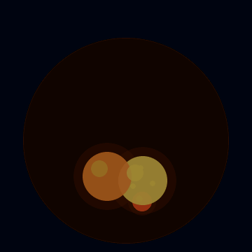
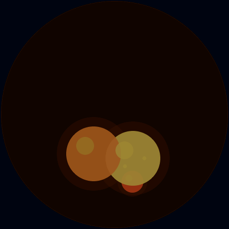
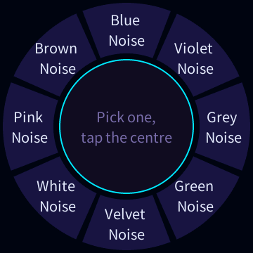
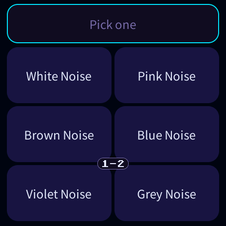
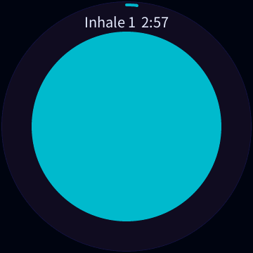
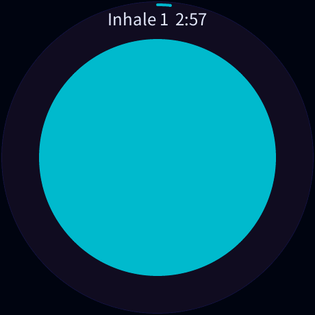

# 9. Ambient scenes, white noise and breathing

- **Ambient pages:** lava lamp, fish tank, campfire, night light. Calm moving pictures; the screen can stay on while music plays.
   
- **White noise:** synthesised noise colours (white, pink, brown...) plus scenes (rain, ...) from the sleep pack `_player/sleep/library.muk` (our own synthesised pack: `make noise-pack`). You can build your own scenes.
   
- **Breathing:** a guided breathing circle, with a breathing sound option.
   

Next: [Quick settings](10-quick-settings.md).
