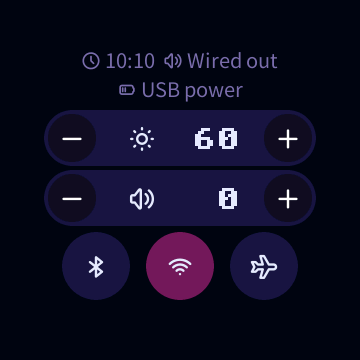
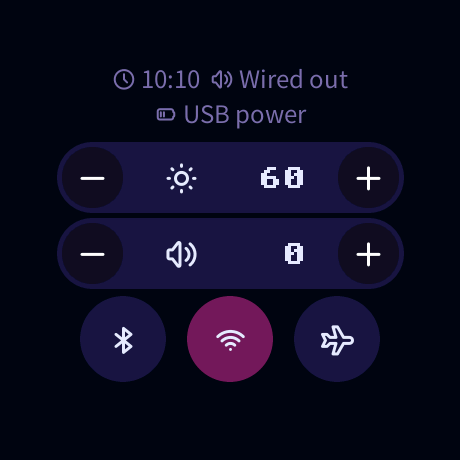
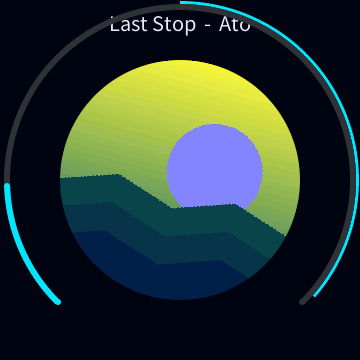
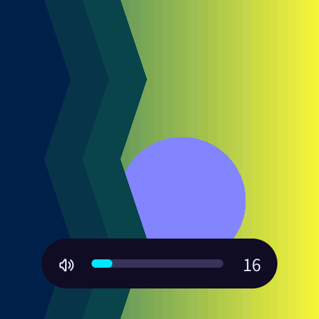

# 10. Quick settings

Flick down from anywhere (including inside a game, which pauses). Flick up, tap outside the panel, or wait 4 seconds to close.

 

- **Status line:** time, battery (FakePod: AXP2101 percentage; round board: no battery gauge, it shows only the power source: USB or battery), current output (speaker / wired / Bluetooth name).
- **Brightness** (sun icon) and **volume** (speaker icon): one capsule each, - at the left end, + at the right, the icon and the number in the middle (brightness steps of 10, volume steps of 1, capped by the volume limit). The knob still sets volume. Volume is **remembered per output**: one for wired, one for each Bluetooth headset, one for speaker mode; you are adjusting the current output's (chapter 5).
- **Volume indicator:** turning the knob (FakePod: the up/down keys) shows an arc at the screen edge on the round board and a capsule near the bottom on the FakePod (speaker icon, bar, number); it disappears after a few seconds.

 

- Three round switches, left to right: **Bluetooth**, **Wi-Fi allowed**, **Airplane** (Bluetooth off and Wi-Fi not allowed in one tap). Lit = on. A switch that needs a reboot turns into a power icon on the first tap, with "Takes effect after reboot" below it; tap again to go ahead.
- Options that cannot work in the current boot mode (for example Wi-Fi during Auracast broadcast) are greyed out with a one-line reason.

Next: [Settings](11-settings.md).
