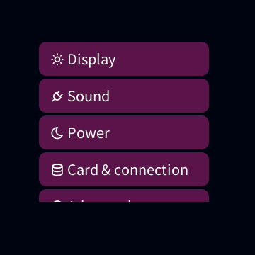
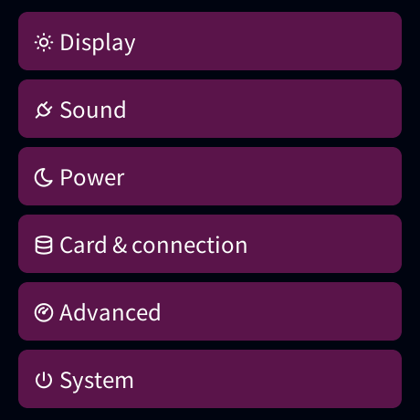
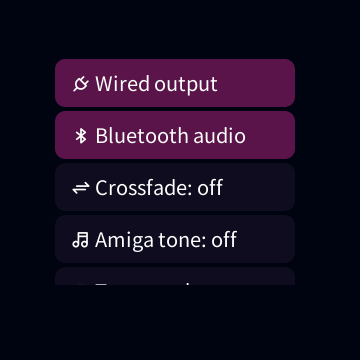
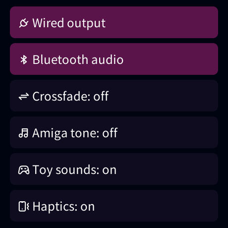
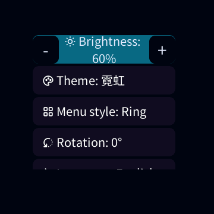
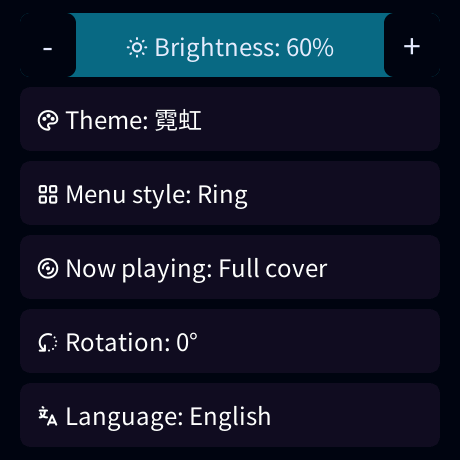

# 11. Settings

 

The device only carries the everyday settings; the details live in the web tool (chapter 13): time zone, sunrise location, effect presets, station lists, wired details.

## Six categories
The top of Settings is **six category pages** (Display, Sound, Power, Card & connection, Advanced, System) plus Help; rows that open another page have their own background colour. Each category holds:

| Category | Contents |
|---|---|
| Display | Brightness, colour scheme, menu style, now-playing style (FakePod only), screen rotation (0 or 180 degrees), language (Traditional Chinese / Simplified Chinese / English) |
| Sound | Wired output, Bluetooth audio, crossfade (off / 2 / 4 / 6 s; only works between songs of the same sample rate), Amiga tone, tool sounds, haptics (round board only) |
| Power | Sleep timer, auto power-off (FakePod only: off / 10 / 30 / 60 min) |
| Card & connection | Rescan library, cover cache, card diagnostics (chapter 12), USB drive mode (chapter 14), Wi-Fi (it only shows whether it is set up; the credentials are entered in the web tool) |
| Advanced | Rate test, experimental formats (off by default; two taps turn it on, see chapter 3), CPU clock (experimental) |
| System | Set time (chapter 6), gesture tour (watch again), reboot |

Rows that need a reboot say so. Playback speed (0.75x to 2x) is on the playback ring, not here.

 

## How value rows work
The first tap on a value row only selects it: a "-" appears at the left end and a "+" at the right. Once it is selected, tap the **left half to step down and the right half to step up**; it stops at the ends (colour scheme and language wrap around). You can also turn the knob (FakePod: the up/down keys).

 

The web tool's Advanced area has the same "experimental formats" item.

Only in the web tool (chapter 13): volume limit, the time for hold-to-home (2 / 3 / 4 s), haptic strength and length, Bluetooth headset connection options, ReplayGain, wired word length, font source and other advanced items.

There is also a Status page that shows the real output sample rate and bit rate, the underrun count, and the reason when a feature is paused.

**Wired and Bluetooth ceilings.** The wired sample-rate settings are in Settings > Sound > Wired output; the codec ceiling and the LDAC maximum bit rate are in Settings > Sound > Bluetooth audio (chapter 17). Themes are in chapter 18; the help page shows one QR code for each address in `setup_url`.

Next: [Card setup and config files](12-card.md).
