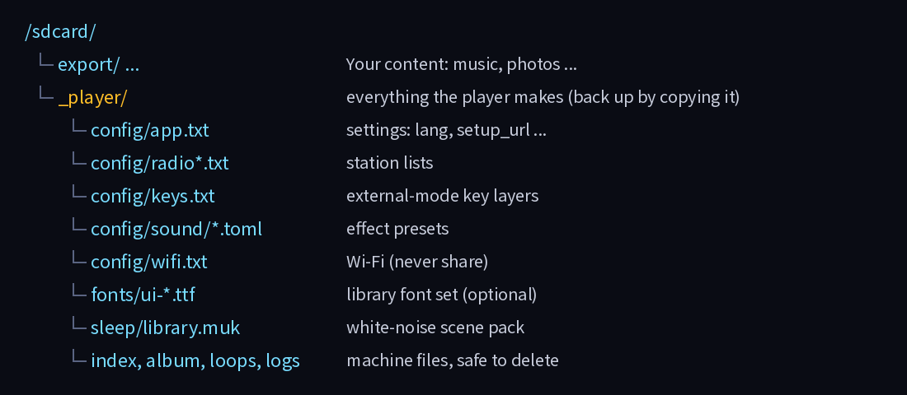
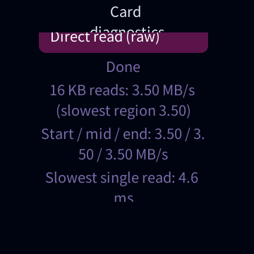
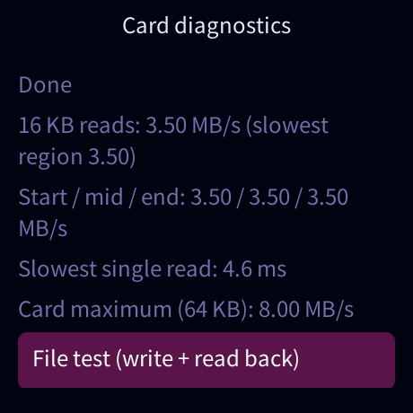
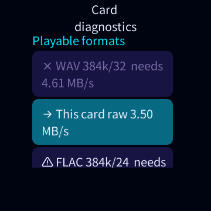
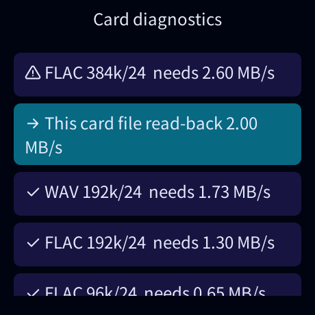

# 12. Card setup and config files


- **Card pack.** Download `jukedial-<version>-card.zip` from the Releases page and unzip it into the card root. It contains `_player/pack.txt`; the Status page shows the pack version and warns when the pack is missing or older than the firmware needs.

- **Card:** FAT32 or exFAT (large cards formatted exFAT work), **MBR** partition table with one partition (or none). A GPT card fails to mount ("sd mount failed reason=gpt"). Files of **2 GiB or more are skipped.** The device only formats a card after a failed mount, behind a warning, a series of taps and a final armed tap. Never remove the card while it plays.
- **Layout.** Your content is at the top level; everything JukeDial makes is inside `_player/` (back up by copying it).

| Path | What |
|---|---|
| `export/<album>/*.mp3 cover.jpg` | your music: only `export/` is scanned, one folder level (one folder = one album); MP3, FLAC, Ogg / Opus, M4A, WAV and tracker files; files of 2 GiB or more are skipped |
| `lists/*.zip`, `vocab/*.zip` | flash-card lists made with `tools/gen/make_lists.py`, `tools/gen/make_vocab.py`, uploaded from the web tool |
| `photos/*.jpg` | photo viewer |
| `chiptune/<system>.zip` | chip music |
| `fortune/omikuji.txt`, `wheel.txt` | override the built-in fortune and wheel text |
| `instrument/kits/<name>/` | sample kits |
| `_player/config/app.txt` | settings: `lang`, `setup_url` (space-separated list of up to 4 addresses, first is primary; the help page shows one QR per address) ... |
| `_player/config/radio*.txt` | station lists |
| `_player/config/keys.txt` | external-mode key layers (an `.example` ships with the card zip) |
| `_player/config/sound/*.toml` | effect presets (import / export) |
| `_player/config/wifi.txt` | Wi-Fi network. Never share this file or commit it. two lines, `ssid=...` and `pass=...`; JukeDial never shows or logs it |
| `_player/fonts/ui-tc.ttf, ui-sc.ttf, ui-ext.ttf` | library font set (optional; without it the font in flash is used) |
| `_player/faces.zip` | the HUD faces of the clock, stopwatch, countdown and pomodoro (one uncompressed zip, in the card template; without it the HUD choice is not offered and those features use their plain faces) |
| `_player/themes/<name>.txt` | colour themes (ten ship with the card template, plus `template.txt`; chapter 18) |
| `_player/splash/<mode>.jpg`, `_player/splash.jpg` | the boot picture (see below) |
| `_player/sleep/library.muk` | white-noise scene pack |
| `_player/index`, `album`, `loops`, `logs` | machine files; safe to delete (rebuilt) |

## Settings files you can edit without the web tool

These plain text files can be changed with any editor: use a card reader, or let a computer reach the card through the device's USB drive mode (chapter 14). Use UTF-8 and ordinary line breaks. Lines that start with `#` are comments.

| Path on the card | What it controls | Format | When it takes effect |
|---|---|---|---|
| `_player/config/app.txt` | Device settings (language, brightness, volume limit and so on) | One `key=value` per line; spaces around them are trimmed | Next boot. The device rewrites the whole file when it changes a setting itself, so edit it with the device off or with the card in a computer |
| `_player/config/wifi.txt` | The Wi-Fi network (for radio and time sync) | Two lines, `ssid=...` and `pass=...`; an empty `pass` means an open network | The next time Wi-Fi connects (it only connects when needed). Never share this file |
| `_player/config/radio.txt`, `radio_<name>.txt` | Station lists (`<name>`: lowercase letters, digits, `_` and `-` only) | One station per line: `Station name\|address`, plus up to two backup addresses separated by `\|` | The next time you open the radio page |
| `_player/config/keys.txt` | The key layers of external mode | Copy `keys.txt.example` from the card pack and edit it; the format is explained on the external-mode help page | When external mode starts, and again after the computer ejects the card. If any line is wrong the whole file is ignored and the default media layer is used |
| `fortune/omikuji.txt` | The fortune slips | One slip per line: `rank\|verse`, rank is one of 大吉, 吉, 中吉, 小吉, 末吉, 凶 or `*` (any); a line without `\|` is a verse for any rank; a `/` in a verse is a line break; up to 64 verses | The next time you open the fortune tool |
| `fortune/wheel.txt` | The wheel's choices | One choice per line, up to 12 | The next time you open the wheel |

The keys in `app.txt` that are safe to edit by hand (for the others, use the on-device settings or the web tool; do not guess):

| Key | Meaning |
|---|---|
| `lang` | UI language: `0` Traditional Chinese, `1` Simplified Chinese, `2` English |
| `brightness` | Brightness in percent (default 60) |
| `volume_max` | Volume limit (default 100) |
| `splash` | `0` turns the boot picture off (default on) |
| `home_hold_ms` | Hold-to-home time: `2000`, `3000` or `4000` ms (default 3000) |
| `tz` | Time zone, POSIX format, for example `CST-8` |
| `setup_url` | Addresses for the help page's QR codes, space-separated, at most 4 |

Examples (all values are invented):

```
# _player/config/app.txt
lang=2
brightness=70
splash=0
tz=CST-8

# _player/config/wifi.txt
ssid=MyNetwork
pass=password123

# _player/config/radio.txt
Sample FM|http://example.com/stream.mp3
Sample News|http://example.com/news.aac|http://backup.example.com/news.aac

# fortune/omikuji.txt
大吉|Fine weather and a good song/the whole road is a tailwind
*|Today the playlist is yours

# fortune/wheel.txt
Pizza
Noodles
Salad
```

Word and vocabulary card lists are uploaded by the web tool (you can also make them with `tools/gen/make_lists.py` and `tools/gen/make_vocab.py`); every other setting can only be changed on the device screen or in the web tool.

## Card diagnostics

Settings > Card & connection > Card diagnostics tells you which formats this card can keep up with (high-rate FLAC and WAV need a sustained read speed; a slow card stutters). Playback stops during the test, and leaving the page aborts it.

 

- **Two scores that are never merged.** *Raw read* only reads, without going through files: it reads a short stretch in each of three regions (start, middle, end of the card) and reports the average, the slowest region and the slowest single read (the headline number is the 16 KB read the decoder uses; a 64 KB read shows the card's limit). The *file test (write + read back)* writes a 4 MB temporary file, reads it back, compares and deletes it; it takes two taps to start (the first says it will write), and needs at least 8 MB free.
- **The format ladder.** Seven formats from heaviest to lightest, each with a verdict icon: fine, marginal, too slow. The required speed is **1.5 times** the format's stream byte rate (headroom for seeks, the file allocation table and a busy card; FLAC counts as 75 % of its uncompressed size); reaching it is "fine", reaching 75 % of it is "marginal", anything less is "too slow".

  | Format | Required speed (about) |
  |---|---|
  | MP3 / AAC / Opus 320k | 0.06 MB/s |
  | FLAC / WAV 44.1k/16 | 0.27 MB/s |
  | FLAC 96k/24 | 0.65 MB/s |
  | FLAC 192k/24 | 1.3 MB/s |
  | WAV 192k/24 | 1.7 MB/s |
  | FLAC 384k/24 | 2.6 MB/s |
  | WAV 384k/32 | 4.6 MB/s |

  The verdict for each format follows the file read-back speed; the raw read is used only when no file test has been run.

   
- **Disclosure.** These thresholds are estimates, not guarantees: they were calibrated on a single card, and only three regions are read for a few seconds each, so the card can still have slow spots elsewhere. The page repeats this at the bottom. The latest result is saved in `_player/cardtest.txt`, only the newest one, and only valid for the same card.

## Boot picture

JukeDial can show one picture when it powers on, with a single slow fade-in and fade-out of the backlight, and then starts as usual.

- **Files.** One picture per way of starting: `_player/splash/player.jpg` (normal start), `usb.jpg` (USB drive / keyboard / sound-card modes), `inst.jpg` (instruments), `cast.jpg` (radio broadcast) and, on the FakePod only, `charge.jpg` (charging screen). If a mode has no file of its own, `_player/splash.jpg` is used for it; if neither exists there is no picture and boot is as fast as before.
- **Recommended image.** A **360 x 360 baseline JPEG** (not progressive), black background, the artwork inside the inscribed circle: the round panel shows exactly that circle, and the FakePod's square panel shows the same picture centred with a black margin. At most 1 MiB. Nothing is scaled, so other sizes are shown 1:1 and cropped by the screen.
- **Default pictures.** The card pack already contains one per mode in `_player/splash/`: a large icon (the wordmark "JukeDial" under the music icon for `player`). Replace a file to change it; delete it to fall back to `splash.jpg` or to no picture.
- **Turn it off.** Web tool, Device tab (Screen group), "Boot picture": Off (takes effect at the next boot). Or put `splash=0` in `_player/config/app.txt`.
- **Cost.** With a picture, the first screen and the first sound come about **2 seconds** later. A boot after a crash never shows the picture.

A ready-made card template is produced by `make card-zip`.

Next: [The web tool and flashing](13-web-tool.md).
