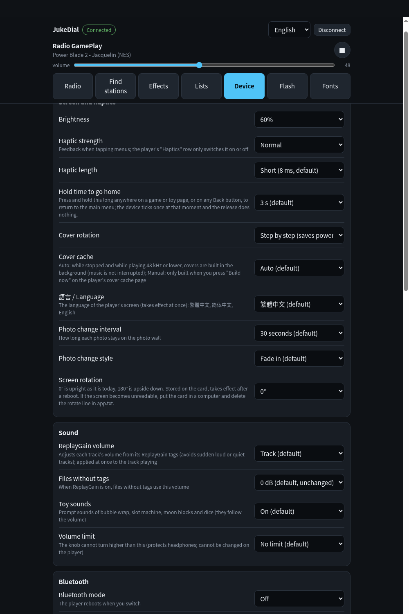
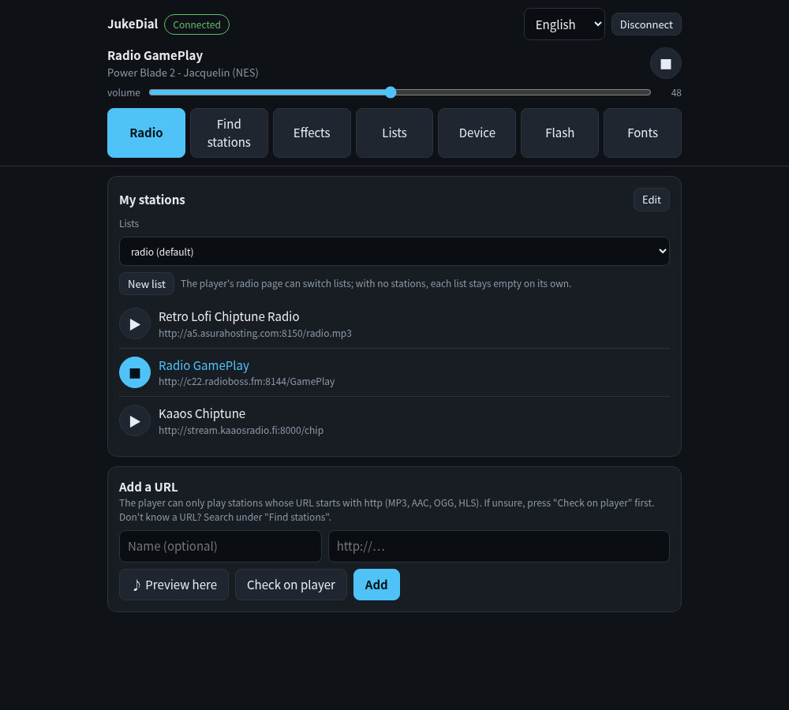
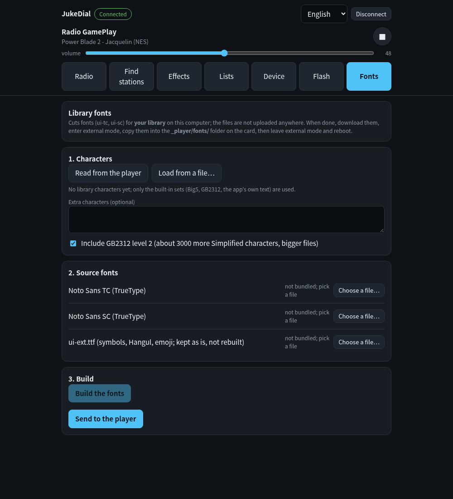
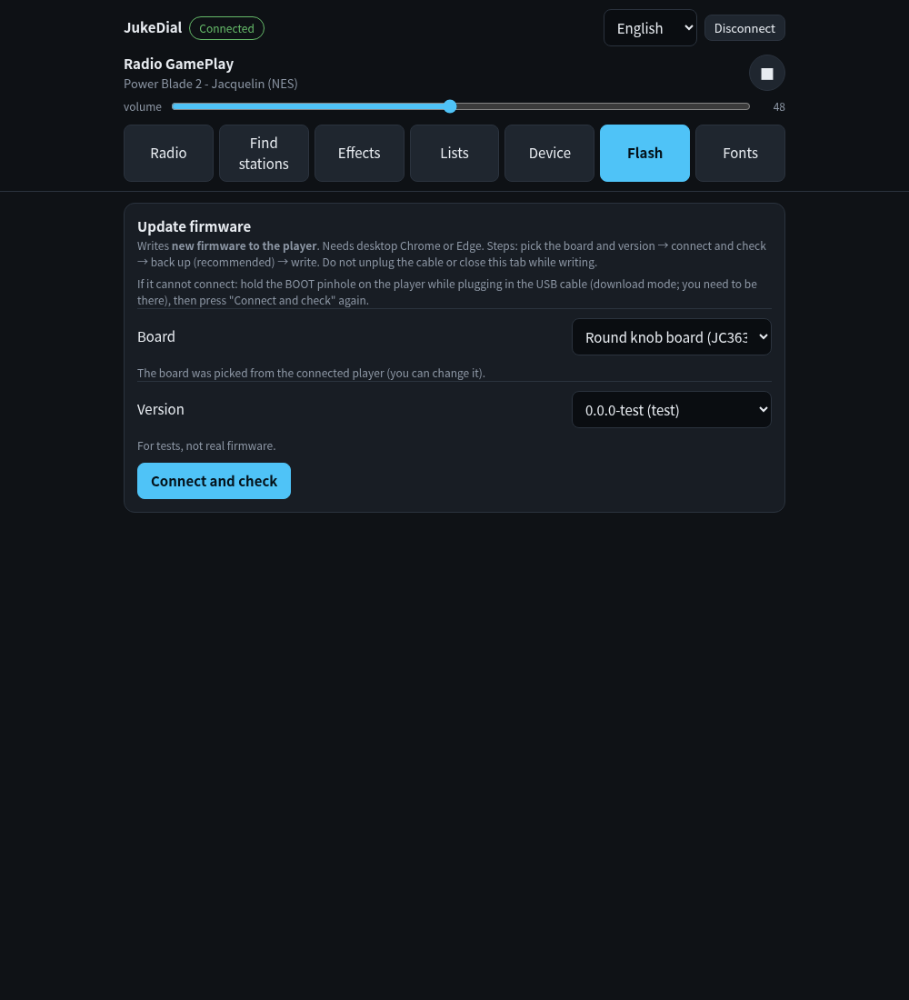
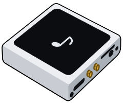

# 13. The web tool: settings, station list, fonts and flashing



A single static web page (`tools/web/`, three languages) talks to JukeDial over USB serial. **Use Chrome or Edge on a computer**: it needs Web Serial (not Firefox or Safari, not phones). The page is hosted on GitHub Pages; its address is on the project's Releases page. If the hosted page cannot be reached you can run it locally (see "Without the hosted page" below).

Cable note: the USB-C plug fits both ways round; if the Espressif serial/JTAG port (vendor 0x303a) does not show up in the port list, flip the plug and try again. Press Connect and pick that port.

**Tabs**
- **Radio / Find stations:** edit your lists, search radio-browser.info, preview, save to the card.
- **Effects:** edit effect apps and chains, import / export TOML presets.
- **Lists:** upload vocabulary and flash-card lists.
- **Device:** wired settings and detailed settings that are not on the device (time zone, sunrise place, wired rate).
  
- **Fonts:** build the library font set in the browser (subset of Noto Sans TC / SC / extra, all in the browser, nothing uploaded), check it fits the 4 MB font partition, then send it by serial or download the three files to copy through external mode (chapter 14).
  
- **Flash:** firmware flashing in the browser with esptool-js.
  
- **Card pack:** download `jukedial-<version>-card.zip` from the Releases page (folders, settings templates, HUD faces, fonts, the white-noise pack) and unzip it into the card's root. The Status page shows the pack version and warns when it is older than the firmware needs.

## Flashing in the browser

Each version on the Releases page (GitHub and Gitee, the same files) has these files: `jukedial-<version>-round.bin` and `jukedial-<version>-fakepod.bin` (one merged image per board: bootloader, partition table, app and fonts; no per-partition files are published), `jukedial-<version>-card.zip` (the TF card contents), `jukedial-<version>-webtool.zip` (the web tool for offline use), `SHA256SUMS` and the release notes. Versions are dates, for example `2026.11.22`.

To flash with the hosted page (Chrome or Edge on a computer; you do not need to press the page's top-right Connect first):
1. Download the merged image for your board from Releases. The page has a link "Open the Releases page" only once the project's Releases address is configured in it; until then it just tells you to download the release file.
2. Open the hosted page and go to the **Flash** tab.
3. In **Board** choose "Round knob board (JC3636F118)" or "FakePod (square screen, two keys)". The menu starts at "Pick a board…"; there is no default. The page then shows the picture of that board and how to enter download mode on it.
4. Press "Choose a file…" (or drop the file on the box) and pick the file you downloaded. It is read in your browser only; nothing is uploaded. The page shows the file name and size, the firmware version, the board inside the file, its SHA-256 (compare with `SHA256SUMS`) and "File checks passed". A damaged file, or a file for the other board, is refused with the reason and nothing is written.
5. Press "Connect and check" and pick the Espressif serial port. The page checks the chip (ESP32-S31) and the flash size, and lists what will be written and what is kept. Leave "Back up the whole flash first" ticked (recommended: the page downloads a backup file and asks you to confirm it is on your computer before writing).
6. Press "Start writing", read the confirmation (board, firmware version, sections) and confirm. Keep the cable connected until the page says it is done. The first boot afterwards shows the language picker.
7. FakePod only: the page ends with a watchdog reset so the board leaves download mode, but a browser cannot confirm that. If the screen stays dark, unplug USB and the battery power and plug back in (press no key).

An update keeps your settings and Bluetooth pairings; ticking "Factory reset: also erase settings and Bluetooth pairings" erases them too.

 

**Entering download mode.** Round board: hold the BOOT pin-hole beside the USB-C while plugging in USB. FakePod: hold both keys while powering on.

## Without the hosted page

There are two ways if the hosted page cannot be reached.

### Way 1: run the web tool locally
Download `jukedial-<version>-webtool.zip` from Releases (or use `tools/web/` in a clone), unzip it, then:
- Linux or macOS: run `serve.sh` (needs python3).
- Windows: run `serve.bat` (it uses Python if present, otherwise a bundled PowerShell script; nothing to install).

Then open `http://localhost:8000` in Chrome or Edge. Everything works there: settings, lists, fonts and flashing. Opening `index.html` by double-click is **not supported**: it must be served from localhost.

### Way 2: flash by hand with esptool
Write the merged image at offset 0 by hand. Use an esptool that supports the ESP32-S31 (the one that comes with ESP-IDF v6.1). The command for the round board (FakePod below):

```
python -m esptool --chip esp32s31 --port <port> --baud 460800 --no-stub \
  --before default-reset --after hard-reset \
  write-flash --flash-mode dio --flash-size 16MB --flash-freq 80m \
  0x0 jukedial-<version>-round.bin
```

- Older esptool (v4) spells the subcommand `write_flash`.
- If the round board is not found: hold the BOOT pin-hole beside the USB-C while plugging in USB.
- **FakePod:** first enter download mode by holding both keys while powering on, use `jukedial-<version>-fakepod.bin`, and change `--after hard-reset` to `--after watchdog-reset`: a normal reset stays in download mode, a watchdog reset leaves it.
- **Warning:** writing the merged image at offset 0 by hand **erases your settings and Bluetooth pairings** (the browser tool keeps them). Use the web tool if you want to keep them.

**For developers:** building from source, `make flash`, `make flash-all`, `make flash-fonts` and the FakePod esptool steps are in [chapter 20](20-build-flash.md).

**How long flashing takes (measured on the round board, USB, 460800 baud):** a full 16 MB backup about 1.5 min; everything (`flash-all`: bootloader + partition table + the 7.8 MB app) about 3.7 min; fonts (3.2 MB) about 1 min; **app + fonts about 4.6 min in total**, about 6 min with the backup. An app-only update (`make flash`) about 2.5 min (inferred from the 136 s app write). The web tool uses the same rate, so expect similar times. Keep the cable connected until it finishes.

Next: [External mode](14-external-mode.md).
