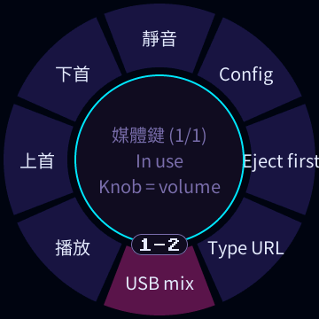
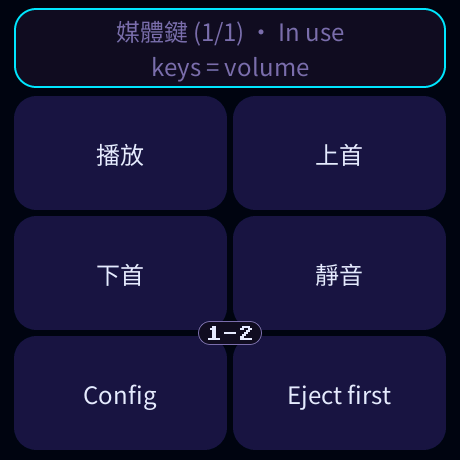
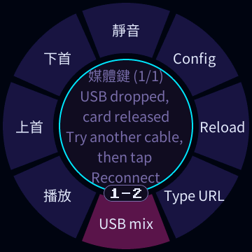

# 14. External mode: USB drive, sound card, keys

 

A reboot mode that turns JukeDial into a computer accessory. Enter it from the menu; leave with the armed exit cell (two taps), which restarts JukeDial.

- **USB drive (mass storage):** the TF card appears as a drive. Copy music, fonts or config files, eject, leave the mode.
- **USB sound card (UAC2):** the computer can play to JukeDial's DAC. Formats 16 / 24 / 32 bit; sample rates offered are those the DAC allows up to `dac_max_rate` (default 44.1 / 48 kHz). The knob (FakePod keys) sets the device volume. If a sample rate is too heavy the descriptor drops it and the screen says so. Compatibility across operating systems has not been fully verified.
- **USB keys (HID) and BLE keys (HOGP):** by default a media-key layer (play/pause, next/previous, mute). More layers come from `_player/config/keys.txt`; macros and text are ASCII only. USB and Bluetooth are never used at the same time: plugged in means USB, unplugged means BLE (Just Works pairing).
- If one operating system refuses the three-in-one USB device, the fallback is a two-in-one (drive plus keys, or sound card plus keys): the function cell in the mode steps through three-in-one, drive plus keys, sound card plus keys, asks a second tap, and restarts the mode. Which systems need it has not been fully verified.

## Drive mode and card protection
The drive mode can also be entered from Settings > Card & connection > USB drive mode. While a computer writes to the card as a disk, the player cannot use it, so there are protections:

- **Every way out returns the card to the player.** Leaving on the screen, changing the function mix, or the computer suddenly disappearing all wait for pending writes to finish and then release the card.
- **A missing computer releases the card at once.** Unplugging, power loss, or the computer sleeping for about 2 seconds shows "USB dropped, card released" with "Try another cable, then tap Reconnect" (when the computer sleeps: "When the computer is awake, tap Reconnect"). Change the cable or wake the computer, then tap **Reconnect**; you can always leave the mode. If the computer first ejects the disk and then you unplug, that is a normal safe removal and the screen says "Ejected, unplug".

  
- **A card that does not respond is explained, with what to do.** A rough unplug can occasionally leave the card stuck in an internal state, and the next mount fails. The first line in Settings then says the card is unusable; open it for the reason. For "Card not responding properly": on the round board switch the device off and on with the power switch; on the FakePod re-insert the card, or power it fully off and on. Having no card or an unreadable card has its own text. A format option only appears for file-system problems (GPT, an unknown format), never when the card does not respond.

**Names.** The USB device and the drive show as "JukeDial" ("JukeDial Card", "JukeDial Keys", "JukeDial Sound" for the functions) and the TF volume label is JUKEDIAL; the BLE keypad is "JukeDial Keys". A computer or phone that remembered the old name may need the old entry removed (and the BLE keypad paired again).

Next: [Safe mode and recovery](15-safe-recovery.md).
