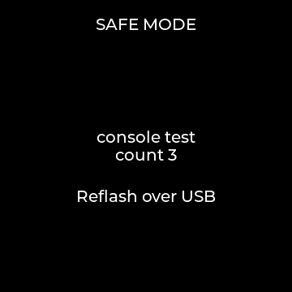

# 15. Safe mode and recovery

- **Boot-loop guard.** Crashes are counted across reboots. After three in a row JukeDial starts a static **SAFE MODE** screen (black, three lines of English, brightness 40 %, DAC muted, no touch or knob). It does not touch the card, Bluetooth or Wi-Fi. Re-flash over USB to get out (chapter 13).
- **After any crash** (panic, watchdog, brown-out) the next boot starts in the normal player with the Bluetooth mode reset to the default (Bluetooth off).
- **The song that was playing at a crash is marked and skipped.** After the next boot it shows "Crashed last time it played, skipped" in the lists and is no longer picked by itself; tapping it plays it and clears the mark (chapter 3).
- **Wrong image.** A FakePod image refuses to run on the round board and the other way round (prints "WRONG BOARD" and waits).
- **If it will not boot or flash:** the chips always allow download mode through USB. Round board: hold the BOOT pin-hole (the small hole next to the USB-C port) with a thin pin while plugging in USB. FakePod: hold both keys together while powering on (or plugging in USB). then flash from the web tool or with `make flash-all`. Keep your backup: the first flash from the web tool offers a full backup of the original firmware..
- **Low battery (FakePod):** a brown-out boot shows no safe screen to avoid a brown-out loop.
- Never burn eFuses or use deep sleep on your own; they can lock you out.

Next: [Troubleshooting and FAQ](16-faq.md).
