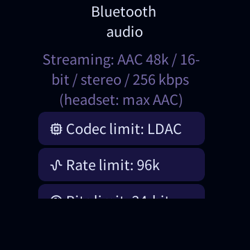
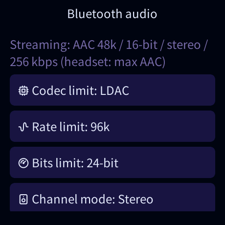
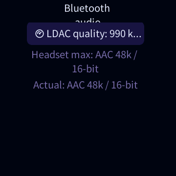
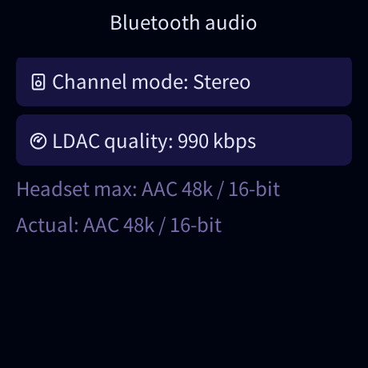
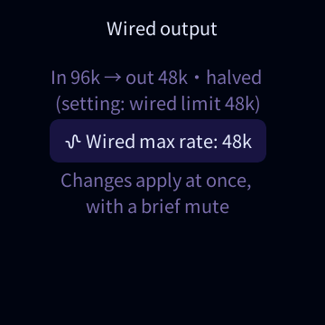
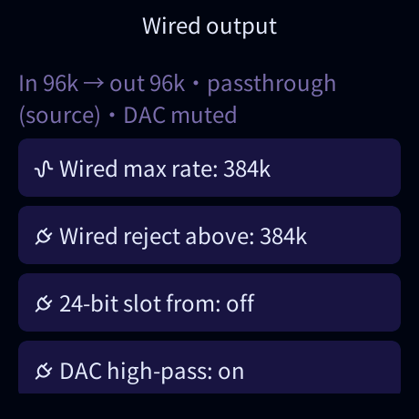
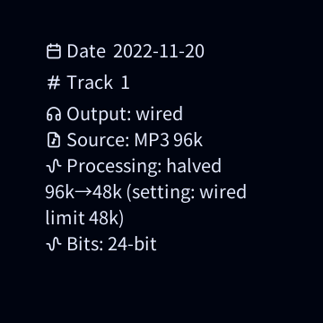
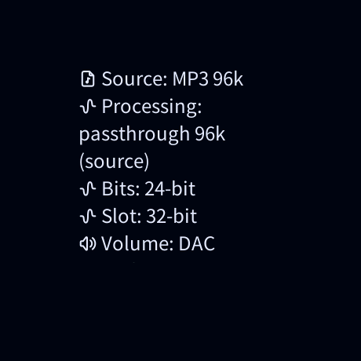
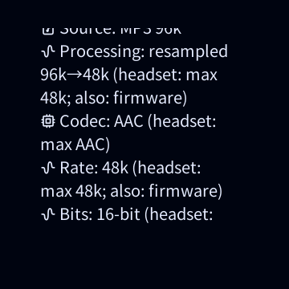
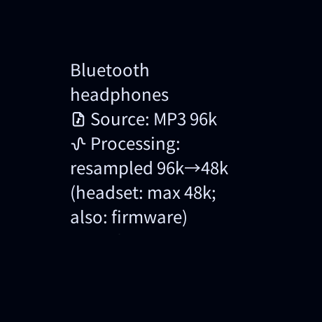

# 17. Audio output: Bluetooth audio, wired output and what the screen tells you

JukeDial does not hide what it is doing to the sound. Two settings pages choose the limits, and two places report the real result.

## Bluetooth audio (Settings > Sound > Bluetooth audio)
 
- **Live line:** the codec, rate, bit depth, channel mode and bitrate of the running link (for example "AAC 48k / 16-bit / stereo / 256 kbps").
- **Rows:** codec limit, rate limit, bit-depth limit, channel mode and LDAC maximum bit rate (990 / 660 / 492 / 330 kbps; the actual bit rate adapts to the link quality within the ceiling). What you pick is a **ceiling**, not a promise: the headset and the build can only lower it. Nothing is greyed out.
- **Info lines at the end:** "Headset max: ..." is the best the connected headset offers; "Actual: ..." is what was negotiated. Not connected shows "not connected".
- Changing a row is stored; **one reconnect happens when you leave the page**. It never reboots JukeDial and never touches the Bluetooth mode.

 

## Wired output (Settings > Sound > Wired output)
 
- The top line is live: input rate, output rate and the reason when they differ (the shot shows a 96 kHz file halved to 48 kHz because the wired limit is 48k).
- **Wired max rate** is the "halve" threshold: files above it are played at half (or a quarter) of their rate if the family fits. Default 48 kHz on the round board, 384 kHz on FakePod.
- FakePod only: **Wired reject above** (a hard limit: files above it are refused before opening, the playing track is never stopped; it takes effect from the next source), **24-bit slot from** (off by default; sends the DAC a 24-bit slot from a chosen rate, not yet verified on the hardware), **DAC high-pass**, and **Output drive** (1.0 / 1.41 / 1.73 V, see [chapter 19](19-fakepod.md)). If both the hard limit and the halve threshold are 384k, everything passes straight through.
- Changes apply at once with a brief mute (rows with three or more values are drafts, applied when you release the control or leave the page).

## What each board's DAC does
| | Round (PCM5102A) | FakePod (CS43131) |
|---|---|---|
| Native rates | 1 to 48 kHz and 88.2 / 96 / 176.4 / 192 / 352.8 / 384 kHz | 32 to 384 kHz passthrough |
| 16 to under 32 kHz | played natively | **upsampled** to the same family (22.05 to 44.1, 24 to 32, 16 to 32) |
| Under 16 kHz | played natively | **refused**, with the reason on screen |
| Volume | digital | **in the DAC hardware** (the audio path stays at unity until the DAC); a read-back checks it |

Bluetooth and Auracast always keep a digital volume. The wired output always uses the wired output's own volume; a remote Bluetooth volume never affects it. The FakePod's wired path is unity gain on the digital side, and the DAC chip attenuates in hardware.

## Honest disclosure
- **Details page, Output block** (open Details from the now-playing ring, scroll to the end): one line per fact, each with an icon: output (wired / Bluetooth / Auracast), source (format and rate), processing, bits, slot, volume. It refreshes once a second.
 
 
- **Reason tags.** Every line that differs from the file says why, naming who decided with a tag: `source` (nothing changed it), `file`, `setting`, `headset`, `DAC`, `firmware`, `signal`, `busy` or `mode` (a `battery` tag exists but nothing sets it yet). The status line shows the tightest reason; the Details page shows all of them. A heavy effect that pauses says so instead of silently stopping.
- **Pass-through** is stated when it happens ("passthrough (source)"), and so is speed or an effect that forces processing.

Next: [Themes](18-themes.md).
