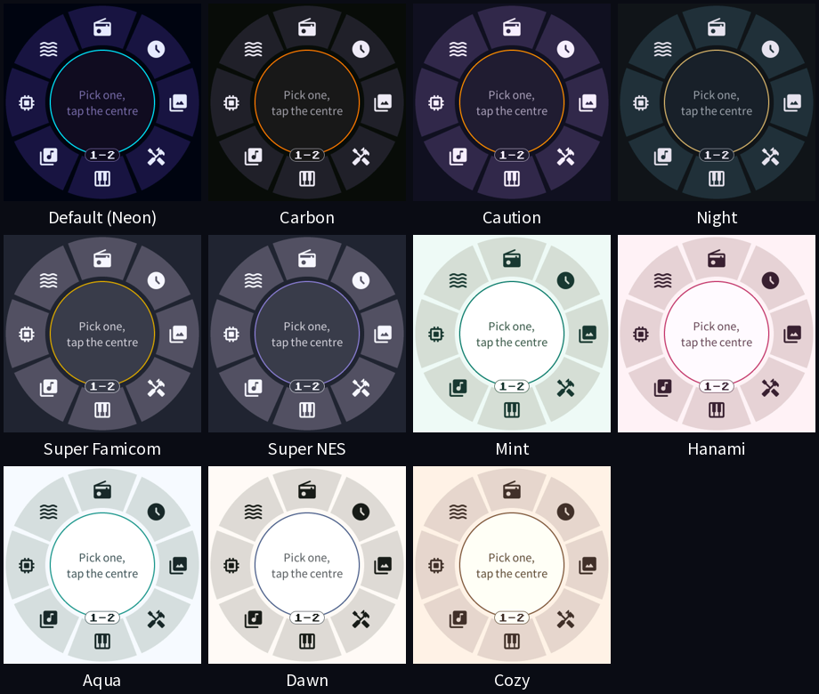
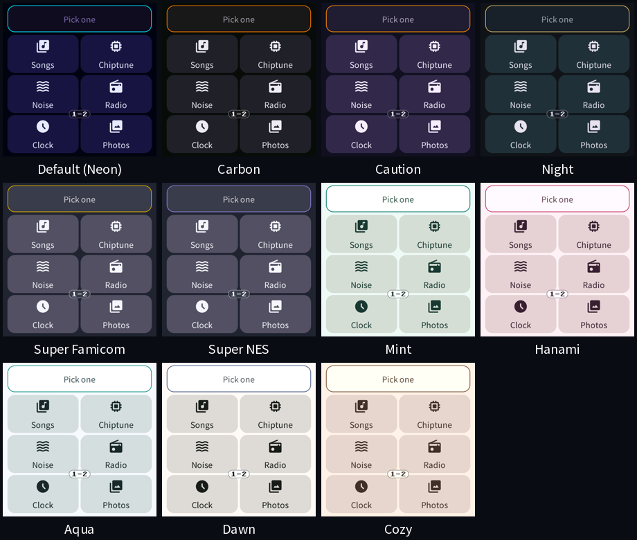

# 18. Themes

Settings > Display > Theme steps through the looks. There are the built-in themes (the default neon first) and **ten card themes**: Carbon, Caution, Night, Super Famicom, Super NES (dark) and Mint, Hanami, Aqua, Dawn, Cozy (light). The row shows the theme's name in your language. Light themes switch LVGL to light mode; game boards stay readable on every theme. Every theme passes a contrast check (body text at least 4.5:1, glyphs at least 3:1).

## Theme files
- Card themes live in `/sdcard/_player/themes/<name>.txt`; `theme=<name>` in `_player/config/app.txt` selects one (the row does this for you). The card template (`make card-zip`) carries the ten themes and `template.txt`.
- A file is plain text: one `key = #RRGGBB` per line, `#` or `;` starts a comment, `base = <built-in theme>` sets the starting point (default neon), palette entries are `key.index`, and `name_tc` / `name_sc` / `name_en` give the display names.
- `template.txt` lists every colour token with its default and a purpose note in Chinese and English: copy it, rename it, change a few lines.
- A bad line, an unknown key or a bad value is skipped and counted; a missing file or an unsafe name (only letters, digits, `_` and `-`, up to 23 characters) falls back to the default look. It never crashes.
- Built-in theme names win over files of the same name.

Next: [FakePod](19-fakepod.md).
