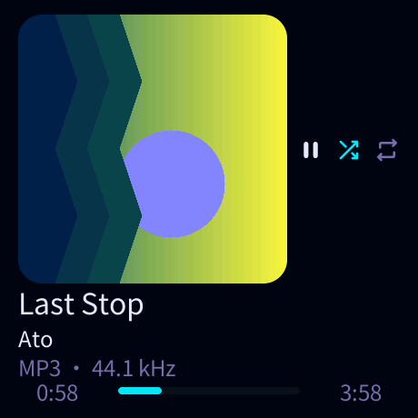
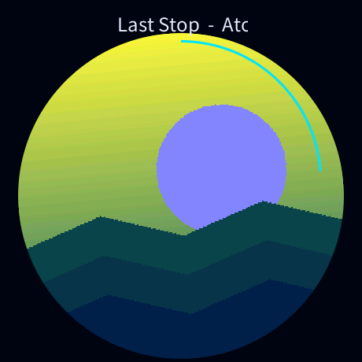
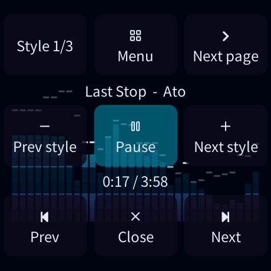
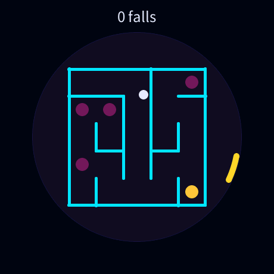

# 19. Fake Pod Nano Pro (FakePod): board-specific operation

The FakePod has a 460 x 460 square screen, no knob, and just two keys (the top key = "+1" and also the power key, the bottom key = "-1") plus touch. This chapter collects what differs from the round board; everything else works as in the earlier chapters. Hardware differences are in [chapter 0](00-hardware.md).

## Three now-playing styles
Settings > Display > Now playing, three values; the change applies the next time you open the now-playing page.

| Style | Screen |
|---|---|
| Full cover (default) | The whole screen is the cover, with no buttons; you operate it through the invisible nine-grid |
| Cover plus info | The cover at the top left, then title, artist, format line and progress bar below; three icons on the right show state only (play / pause, shuffle, repeat) and cannot be tapped |
| Menu grid | The same rotating disc as the round board; tap once to open the playback ring |

  

The progress bar only shows the position; you cannot tap it to jump, because the player has no "seek to position" function.

## The nine-grid tap zones
The full-cover, cover-plus-info and spectrum pages draw no on-screen buttons; the whole page is split into 3 x 3 invisible zones of equal size. **The first tap anywhere only shows the nine zone labels; a second tap on a zone runs it.** While the labels are hidden a tap does nothing; the labels hide again after about 4 seconds without a touch, and the "Close" zone (bottom middle) hides them at once. While the labels are shown, the spectrum, the rotating cover and album photos pause (the progress bar and time keep running).

 

Zone map:

| | Left | Middle | Right |
|---|---|---|---|
| Top row | Switch set | Menu | Next page |
| Middle row | Left function | Play / pause | Right function |
| Bottom row | Previous | Close | Next |

- **Switch set** shows "name i/n" and rotates which functions the left and right middle zones have (each page's choice is remembered until the next boot). The cover page has just the "play mode" set: the left zone is shuffle (on / off), the right zone is repeat (all / one). The spectrum page has three sets: style (previous / next style), colours, and play mode.
- **Next page** goes cover, then spectrum page, then lyrics (only when a `.lrc` file with the same name sits next to the track), then back to the cover.
- **Menu** opens the page's usual menu (the playback ring and so on).

## The spectrum page
The spectrum page's style, colours and play mode are the sets above, operated through the nine-grid; the kinds and advanced options are in [chapter 3](03-music.md).

## Lists, volume and keys
- **Larger lists.** List rows and buttons are bigger and easier to hit, six rows per page.
- **Volume pill.** Pressing the up/down keys to change the volume shows a capsule near the bottom (speaker icon, bar, number) that disappears after a few seconds (chapter 10).
- **Waking a dark screen.** While the screen is off, **pressing both keys together** lights it; touching the screen does not wake it (so a pocket cannot wake it by accident). The screen always turns off after being idle (an OLED would burn in if left on).
- **Blind keys with the screen off.** While something is playing: one press of the top key = volume up, one press of the bottom key = volume down (hold to repeat); double-press the top key = next track, double-press the bottom key = play / pause. A single press therefore takes effect about 0.3 s late. With nothing playing, any key lights the screen.

## The tilt maze and the motion sensor
On the FakePod the first way to play the "Knob toys" game is the tilt maze: tilt the machine and the marble rolls that way; a hole sends it back to the start; roll it to the exit to win. The motion sensor calibrates its scale by itself whenever the machine is still; entering the maze takes the current posture as neutral automatically, and if you cannot hold it steady the screen says "Hold steady or lay it flat, then tap Re-zero"; **Re-zero** in the rules ring resets the neutral posture at any time.

## Clock
The FakePod has a built-in real-time clock: after you set the time (chapter 6) or sync it over Wi-Fi, the time is kept through power-off.

## Output drive
Settings > Sound > Wired output > Output drive, three levels: **1.0 V**, **1.41 V**, **1.73 V**. 1.73 V is an **experimental** high-voltage mode: about 4.8 dB louder than 1.0 V, the chip maker only guarantees it for headphones of 600 ohms or more, and low-impedance in-ear headphones get little gain and may distort. Going from 1.41 V to 1.73 V, the first tap only shows a warning and the second tap applies it. Whenever the drive is raised and the volume is above 20, the volume is lowered to 20. The line under the row shows the drive the chip actually uses.

## Not supported
- Headphone-jack detection and inline remote: not supported (the board has no usable detect pin).
- On-screen round buttons: replaced by the nine-grid.

## Download mode and flashing
Hold **both keys while powering on** to enter download mode. Flash with the hosted web tool (chapter 13: Flash tab, board "FakePod (square screen, two keys)"; the page resets the board with a watchdog when it is done, and if the screen stays dark you unplug USB and the battery power and plug back in, pressing no key), or write the merged image by hand with esptool (chapter 13; end with a watchdog reset so the board leaves download mode). Building from source is in [chapter 20](20-build-flash.md).

Next: [Building and flashing from source](20-build-flash.md).
