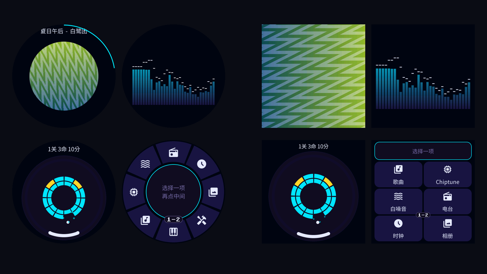

# 0. 硬件

JukeDial 跑在两块板子上，都以 **ESP32-S31**（双核 RISC-V、320 MHz、Wi-Fi 6、蓝牙 Classic + BLE 5.4、16 MB flash）为核心。同一套代码服务两块板；镜像按板子分别构建，绝不自动猜板（刷错板的镜像会拒绝启动）。

## 圆形主板：JC3636F118
带旋钮、360 × 360 圆形触控屏的板子。
- **显示与输入：** 360 × 360 圆形屏、电容触控、旋钮（转动与按下）、DRV2605L 振动驱动（旋钮有段落感）、屏幕外围的 LED 灯环。
- **音频：** 有线输出走 **PCM5102A** DAC（原厂板配 PCM5100A，引脚兼容；本机已换成 PCM5102A）到 3.5 mm 耳机孔；PDM 麦克风；TF 卡槽（4 位 SD）。
- **内存：** 16 MB flash；PSRAM 实测 16 MB。
- **电源：** USB-C。没有电池芯片，也没有时钟芯片；只能用 ADC 读供电电压，所以没有电量百分比，关机后时间不保留（开机后靠网络校时或手动设置）。
- **运动传感：** 没有可用的运动传感器，所以重力迷宫是用旋钮转重力。

## 方形主板：Fake Pod Nano Pro

这块板的全名是 Fake Pod Nano Pro（ESP32-S31）。它不是较早的 Fake Pod Nano（用 ESP32-S3，本项目不支持）。本说明以下简称 FakePod。
第三方的开源硬件设计（作者：ZYFDroid；公开仓库：<https://gitee.com/ZYFDroid/night-player-fake-pod-nano>）。JukeDial 在它上面的固件是我们自己写的，依照公开的原理图和笔记实现。
- **显示与输入：** 460 × 460 方形 AMOLED（CO5300 控制器）、CST820 电容触控、**两个按键**（上键＝“＋1”兼电源键，下键＝“－1”），没有旋钮。
- **音频：** 有线输出走 **CS43131** DAC 兼耳机放大器（3.5 mm 耳机孔）；PDM 麦克风；TF 卡槽。
- **电源：** **AXP2101** 电源芯片，带电池充电和电量计。原理图上没有电池接头，所以接电池要自己动手；没接电池时 JukeDial 只显示 USB 供电。
- **传感器：** QMI8658 运动传感器（倾斜迷宫用，会自动校正比例，并可“重新归零”）与 PCF85063 实时时钟（关机后时间仍会保留）。
- **内存：** 16 MB flash，另有 PSRAM。
- **不支持：** 耳机插孔检测与线控（板上没有接到可用的检测脚）。
- **下载模式：** 两个按键同时按住再上电（第 15 章、第 20 章）。

更多 FakePod 专属的操作（九宫格、三种播放页、倾斜迷宫、输出推力）在[第 19 章](19-fakepod.md)。

## 比较
| | 圆形（JC3636F118） | 方形（Fake Pod Nano Pro） |
|---|---|---|
| 屏幕 | 360 × 360 圆形、背光 | 460 × 460 方形 AMOLED（CO5300） |
| 触控 | 有 | 有（CST820） |
| 输入 | 旋钮（转、按）＋触控 | 两个按键＋触控 |
| 有线 DAC | PCM5102A，最高 384 kHz | CS43131，32 到 384 kHz 直通，16 到 32 kHz 升频，低于 16 kHz 拒绝；音量在 DAC 硬件内调整 |
| 电池／电源 | USB-C，只用 ADC 读电压 | AXP2101：电量 %、充电、显示 USB／电池 |
| 实时时钟 | 无（关机后时间不保留） | 有（RTC 芯片，关机后时间保留） |
| 触觉 | DRV2605L（旋钮段落感、反馈） | 无 |
| LED | LED 灯环 | 无 |
| 运动传感 | 无 | QMI8658（倾斜迷宫） |
| 麦克风 | PDM | PDM |
| TF 卡 | 有 | 有 |

## 使用上的差别
- **操作。** 圆形板用旋钮滚动和调音量，三个值以上的控件是先点一下再转旋钮。FakePod 用两个按键做同样的步进：上键往上／“＋1”，下键往下／“－1”；按住会连续（最多约 2.5 秒，因为长按上键是硬件关机）。两键同时按是屏幕开关。触控和第 2 章的手势两块板都能用。
- **手感。** 触觉反馈和 LED 灯环是圆形板的功能；FakePod 上没有，对应的设置也不会有作用。
- **声音。** 两块板都播 44.1／48 kHz 和 DAC 能力内的高解析采样率（见表）；输出上限是设置（第 11 章）。
- **电源。** FakePod 在快速设置显示“USB”或电池电量（第 10 章）；圆形板两者都不显示。
- **电源规则（只有 FakePod）。** 设置→自动关机（关／10／30／60 分，默认 30）：没有播放、也没有触碰时自动关机；接着 USB 电源时不会关。电量 15 % 会警告，低于 5 % 满一分钟（或开机时低于 2 %）会记住播放位置后关机。关机时插上线会显示充电画面（百分比、充电状态），不会启动播放器；按电源键才开机。圆形板没有这些。
- **屏幕一定会关（只有 FakePod）。** 它的屏幕是 OLED，久亮会烧屏，所以闲置一段时间后一定关屏幕（接着 USB 电源时关的是屏幕、不是整机），没有“常亮”选项；圆形主板的 LCD 不受影响。
- **屏幕形状。** 环形和圆形版面是为圆屏画的；方形屏幕上同样的内容使用更大的面积。

下一章：[第一次开机](01-first-boot.md)。
