# 1. 第一次开机

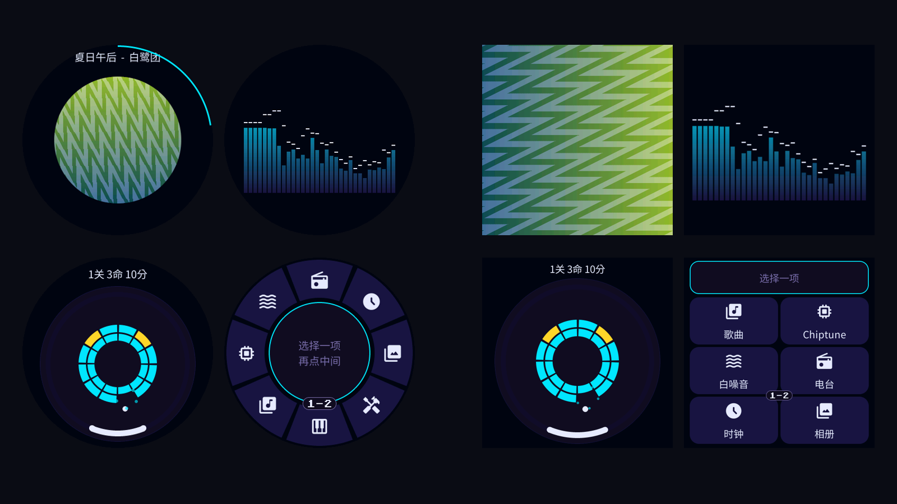

**准备：** JukeDial 主板（圆形 JC3636F118 或 FakePod）、一条 USB-C 线、一张 TF 卡（见第 12 章）。没有卡也能先看看画面，但音乐、电台列表和完整字体都放在卡上。

1. **接上电源。** 插上 USB-C，第一次开机要几秒钟。
2. **选语言。** 卡上还没有语言设置时会出现语言菜单：繁体中文／简体中文／English。点一下就好，结果存在 `_player/config/app.txt` 的 `lang`，之后可在设置里改（第 11 章）。
   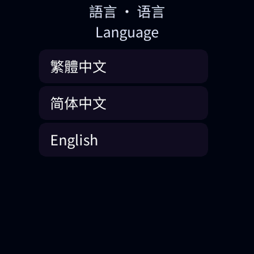
3. **手势教学。** 选完语言后，会一步一步教你四种手势：快速往上滑、快速往下滑、左右快速滑，最后是按住 3 秒。要真的做出手势才会进到下一步；不想看就点屏幕中央下方的小按钮“略过”。教学只出现一次（`tour_done`），设置里有一格可以重看。两块板的“略过”是同一个按钮，不需要按键。
   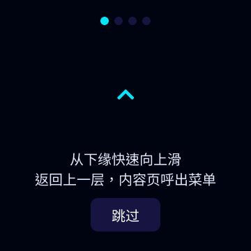 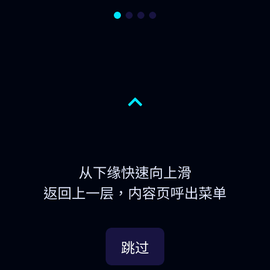
   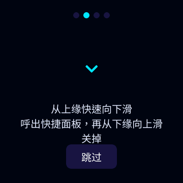 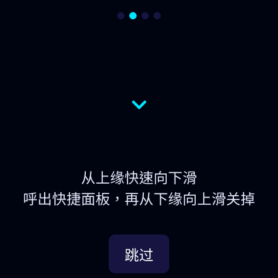
   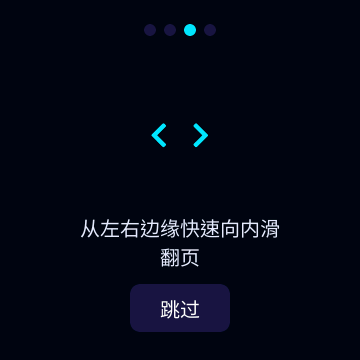 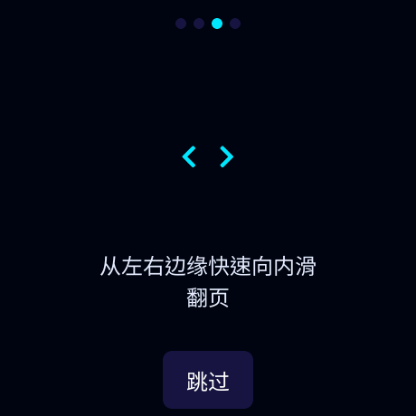
   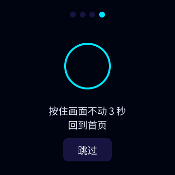 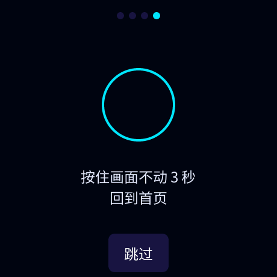
4. **首页。** 教学结束后进入首页。
   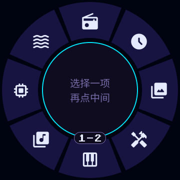
   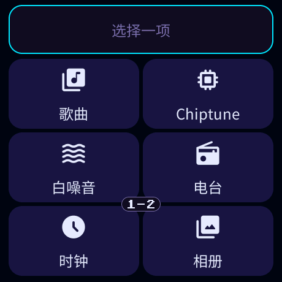

**圆形主板与 FakePod 的差别：** 圆形主板有触控屏幕和旋钮（转动：滚动／音量，按下：确认）。FakePod 是 460 × 460 方形屏幕，只有两颗按键：上键是“+1”（同时是电源键），下键是“-1”。旋钮做得到的事，在 FakePod 上用这两颗键加触控来做，例外会特别帮助。

下一章：[手势与操作](02-gestures.md)。
