# 2. 手势与操作

两块板、每一页都用同一套手势。识别器是共用的，页面不会自己发明手势。

| 手势 | 怎么做 | 效果 |
|---|---|---|
| 快速往上滑 | 快速往上滑 | 内容页（播放中、游戏…）：调出该页的菜单。列表或子页面：返回上一层。首页：没有动作。快捷面板开着时：关闭面板。 |
| 快速往下滑 | 快速往下滑 | 调出快捷面板（第 10 章）。在游戏里同时会暂停游戏。 |
| 往左／往右快速滑 | 快速横向滑 | 环、格子、列表的下一页／上一页；没有下一页就不动。 |
| 慢拖 | 比快速滑慢 | 1:1 滚动长内容（帮助页、长列表），没有惯性，不会翻页。 |
| 按住 | 手指在任何地方按着不放 | 3 秒后回首页（设置可选 2、3、4 秒）。这是任何页面的紧急出口。 |
| 点一下 | 点 | 确认，没有改变。 |

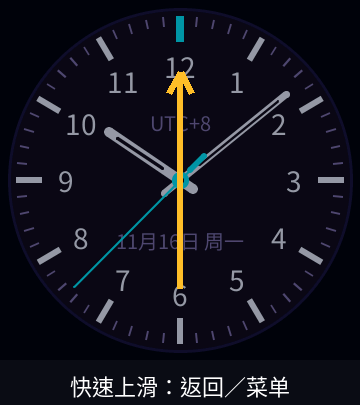 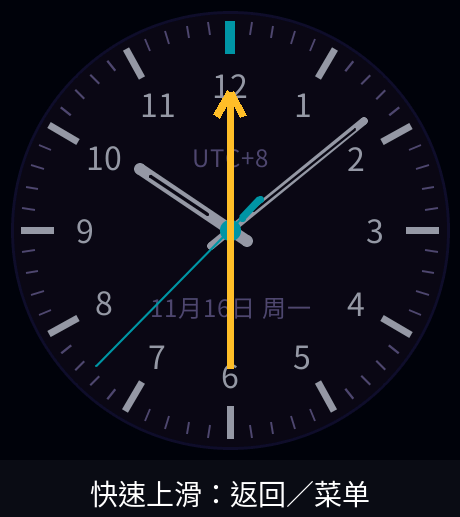
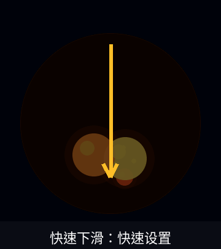 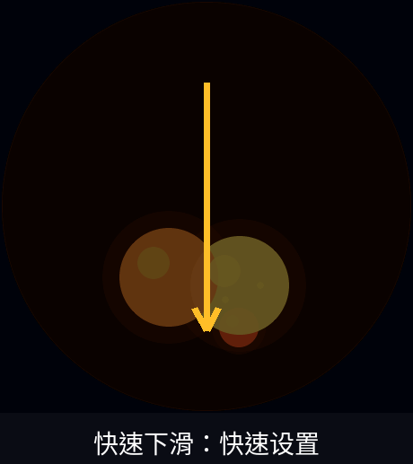
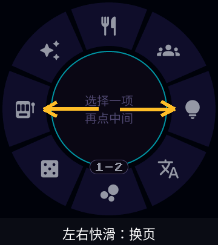 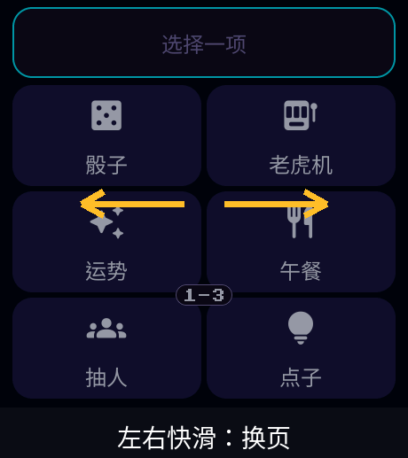
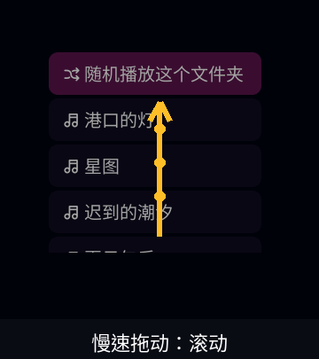 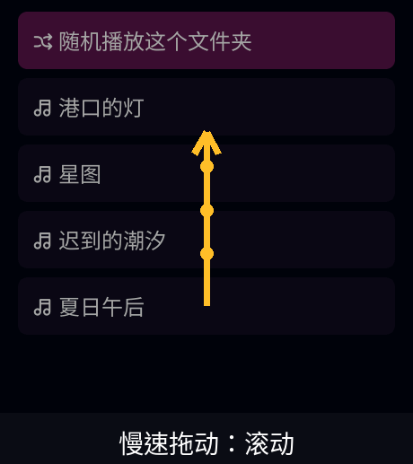
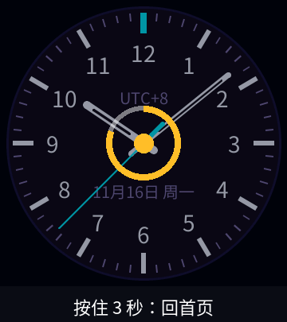 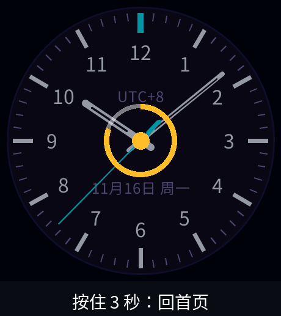

**页数气泡。** 环或列表超过一页时，会出现一个很小、点不了的气泡，例如“2/3”。圆屏上它跨在环最下方与中央圆之间的缝上；FakePod 上在下方四格交会处。现在没有“返回”和“下一页”按钮，用快速滑的就行。

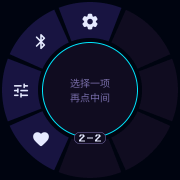 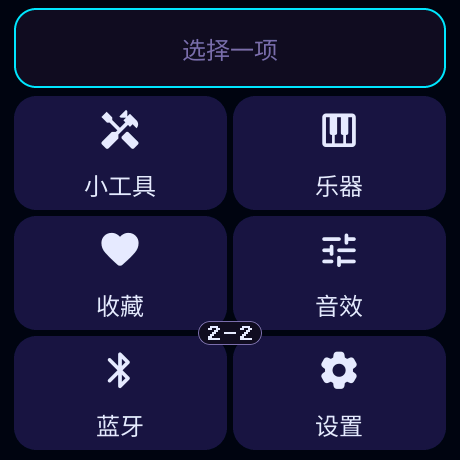

**旋钮环。** 三个值以上的控制项（倍速、均衡器频段、亮度…）用“借旋钮”的方式：点一下该控制项，再左右转旋钮改值；4 秒没动作就自动放开。FakePod 用两颗键做同样的事。

**FakePod 按键。** 上键：+1（下一个／往上／加大声），下键：-1。短于约 70 毫秒的按压会被忽略。

**FakePod 的九宫格。** FakePod 的播放页与频谱页没有屏幕上的按钮，而是整页分成 3 × 3 的隐形点击区：第一下点屏幕只会显示九个格子的标签，第二下点某一格才执行（没显示时点不会执行任何动作）。细节在[第 19 章](19-fakepod.md)。

**游戏与拖曳。** 游戏里照样可以快速滑（游戏用点击和旋钮）。如果某个游戏需要拖曳，它会说明，那时只有按住 3 秒回首页有效。

**弹出卡片。**在内容页上快速上滑（或按页面点一下、转旋钮），该页的菜单会以一张实心圆角卡片出现在屏幕中央：页面标题、各项目与最后一行“关闭｜离开”（关闭只收卡片，离开才离开该页）。背后的内容不会变暗。游戏暂停菜单与退出提示也用同一张卡片。

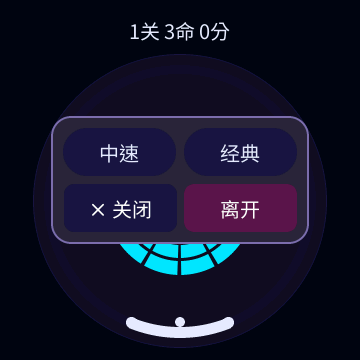 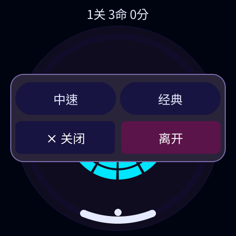

**菜单图标。**菜单环与格子每格有一个图标。圆屏的格子里只有图标，名字在第一下点选后显示在中央（第二下才打开）；FakePod 的格子是图标加下方短名，点一下即打开。设置行、列表行、快速设置状态行与详细页的文字前面有小型行内图标。说明格一律是第二主色的问号。

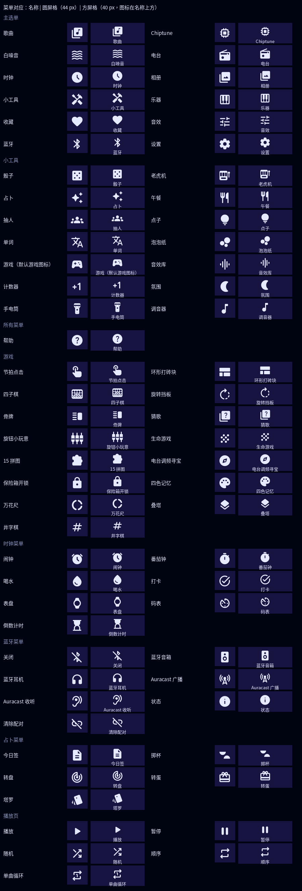

下一章：[播放音乐](03-music.md)。
