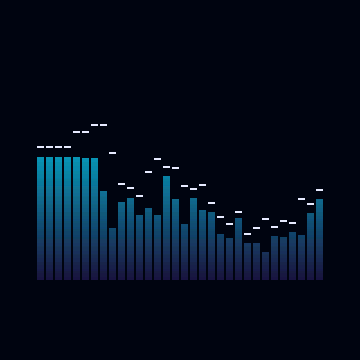
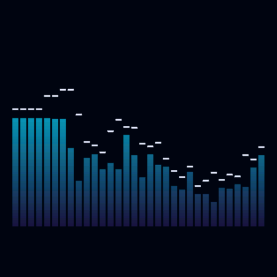

# 3. 播放音乐

 

**曲库。** 把音乐放进 TF 卡（第 12 章）。JukeDial第一次使用时会扫描，索引缓存在 `_player/index/library.bin`；扫描不会中断播放。页面有：全部曲目、文件夹／专辑、收藏、封面、重新扫描。

 

**文件夹成树状。** 扫描会读到 8 层子文件夹（设备自己的 `_player` 文件夹和以点开头的文件夹会跳过；下面完全没有可播放文件的文件夹不列出）。音乐页显示最上层：第一行“全部随机”，接着是直接放在音乐文件夹里的歌，再是各文件夹，最后是“重新扫描曲库”。点一个文件夹，就在同一页打开它那一层：第一行“随机播放这个文件夹”会连同所有子文件夹一起播，然后是这一层自己的歌，最后是子文件夹（和顺序播放的顺序一致）。快速向上滑（或按返回）回到上一层；在最上层就离开本页。随机播放（含加权随机：新文件、收藏权重更高）从整个曲库或选定文件夹（含子文件夹）抽歌，几万首歌也不会卡。旧版固件写的索引会自动重新扫描一次。

**长列表分页。** 文件夹层或歌曲列表每页 40 行。左右快速滑翻页（会绕回），小气泡（例如“2-5”）显示第几页；旋钮转过一页的最后（最前）一行，会接着进入下一页（上一页）。打开列表时，会停在正在播放那首歌所在的页。

**曲库接受的格式：** MP3、FLAC、Ogg Vorbis／Opus（`.ogg`、`.oga`、`.opus`）、M4A（AAC）、WAV（PCM 16／24／32 位整数与 32 位浮点），以及 tracker 模组（libxmp：`.mod` `.xm` `.s3m` `.it` `.stm` `.669` `.far` `.mtm` `.ptm` `.okt` `.ult` `.mdl` `.stx` `.pt3` `.sfx` `.st` `.stk` `.m15` `.nt` `.flx` `.wow` `.ice` `.mtn` `.liq` `.psm` `.ps16` `.j2b` `.amf` `.gdm` `.med` `.mmd0`–`.mmd3` `.rtm` `.mgt` `.dsym` `.digi` `.dbm` `.emod` `.umx` `.hmn` `.stim` `.coco` `.fnk` `.abk` `.xmf`；也包含 ProWizard 打包的 Amiga 模组，以及 PowerPacker／XPK／Pack-Ice／ARC／LZX／MMCMP 压缩的文件；不使用 Amiga Paula 模拟；含 AdLib 音色的 S3M、内嵌 Ogg 采样的 XM，不以 tracker 播放；`.imf`／`.dtm`／`.ims` 两种播放器都认，先当 AdLib 音乐试，不是的话再当 tracker 模组试）。

**另外还能播放：**AIFF／AIFF-C、Musepack（`.mpc`）、TTA、HivelyTracker／AHX（`.ahx`、`.hvl`，含子曲目）、Commodore 64 SID（`.sid`，PSID 与 RSID，最多 4 颗 SID，含子曲目；每首播放 3 分钟并淡出；BASIC 类 RSID 会注明原因后拒绝）、DOS AdLib／OPL 音乐（`.rad`、`.hsc`、`.imf`、`.wlf`、`.dro`、`.cmf`、`.a2m`、`.a2t`、`.d00`、`.sop`、`.xad`、`.amd`、`.bam`、`.lds`、`.rol`、`.ksm`、`.mus`、`.ims`、`.mdi`、`.sci`、`.laa`、`.mtr`、`.mkj`、`.cff`、`.dmo`、`.dtm`、`.sat`、`.sa2`、`.plx`、`.msc`、`.rix`、`.got`、`.hsq` 等，另有 `.sng` 等；OPL2 音色，第二颗芯片成为右声道；需要 OPL3 四运算子音色的曲子、Westwood ADL、aPlib 压缩的 A2M 会注明原因后拒绝）、PICO-8 卡带（`.p8`、`.p8.png`，只播音乐，不读代码）、游戏串流 ADX、VAG、BRSTM（`.adx`、`.vag`、`.brstm`；只播一遍，忽略循环）、Atari ST YM（`.ym`，明文或 LHA 压缩；数字混音与追踪变体会被拒绝并显示原因）。

**格式分级：实验性格式。** 有些播放器比较不成熟：DOS AdLib 的 `.a2m` `.a2t` `.d00` `.hsq` `.sqx` `.sdb` `.agd` `.ha2` `.lds` `.sa2` `.dtm` `.plx` `.rix` `.xms` `.mtr` `.sat` `.dfm` `.mad` `.laa` `.sci` `.cmf` `.mdi` `.pis`，以及 tracker 的 `.ice`。它们默认**关闭**（设置 → 实验性格式）：关闭时扫描曲库**完全不读这些文件**（只用文件名，标题就是文件名），文件仍列在列表里，点开会显示“实验性格式未开启（设置 → 实验性格式）”。要开，点两下（第一下会说明：这些播放器较不成熟，损坏的文件可能让播放器重启）；开启后重新扫描曲库才会读到标签。其他格式不受影响。

**Amiga 音色。** 设置页有 Amiga 音色一行（关／A500／A500 + LED／A1200）：只对 Amiga 系的 `.mod`（ProTracker、Soundtracker、Noisetracker、ProWizard 压缩包），用 Paula 模拟器重现硬件的声音；A500 较闷（固定滤波），A1200 较亮，播放中的模块一个区块内就换。占用处理器较多：最重的 4 声道 `.mod` 约占音频核心 55 %；六、八声道的 `.mod` 不套用，其他格式也不受影响。

**死机保护（所有格式）。** 播放时，正在解码的曲目会记在重启也不会消失的存储里。如果播放器死机重启，那一首（若是在准备下一首时死机，则两首）会被标示“上次播放时死机，已跳过”：下一首、随机、重启后接续播放都不会再自动挑到它；你自己在列表点它就会播，标记随之消失（再死机会再标）。标记存在卡上的 `_player/config/crashed.txt`。

**采样率与位深。**
- 有线输出经 DAC，一般为 44.1／48 kHz；高解析路径可到 88.2／96／176.4／192／352.8／384 kHz。开到哪一档由设置 `dac_max_rate`（四段）决定：圆形板默认 48 kHz，到“设置 > 有线输出”调高，或用“采样率测试”找出 DAC 与线材吃得下的最高一档；FakePod 默认 384 kHz（直通）。DAC 不吃的采样率会自动重采样；低于 32 kHz 的来源在有线路径上会被拒绝并显示原因。
- 蓝牙输出受编码限制（第 5 章）；44.1 与 48 kHz 之间JukeDial会自己重采样。
- FLAC 原生解到 192 kHz；352.8／384 kHz 的 FLAC 受区块大小限制，来源的区块对输出太大时会减半（最多三级），并在状态页显示原因。
- 2 GiB 以上的文件会被略过（见第 12 章）。

**播放页。** 圆形板的播放页是旋转的封面圆盘，点中央打开播放环。FakePod 有三种风格，在“设置 > 显示 > 播放页样式”切换：满版封面（默认）、封面＋信息、菜单格（旋转圆盘）；操作靠隐形的九宫格（[第 19 章](19-fakepod.md)）。

**播放环。** 点中央区域打开环：播放／暂停、上一首／下一首、随机／重复、收藏、倍速、详细信息、可视化、音效。格子多时环有两页，左右快速滑翻页。

**倍速与淡入淡出（Track B）。**
- *倍速*（只有曲库文件）：0.75、1.00、1.25、1.50、2.00 倍，音高不变（WSOLA）。点倍速格，再转旋钮。
- *淡入淡出*：设置里的“淡入淡出”，歌与歌之间的秒数，等功率；**只在前后两首采样率相同时**才作用（下一首已预先开好）。采样率不同（例如 44.1 与 48 kHz）或你手动跳歌时，直接换歌；打开这个设置时，画面会提醒这一点。
- 使用 aptX、LDAC、Auracast，或管线采样率高于 48 kHz（88.2 kHz 以上）时，这两项会自己关掉并显示原因。淡入淡出可选 关／2／4／6 秒。

**封面。** 封面来自 `cover.jpg` 或标签，集中缓存在一个文件（`_player/index/thumbs.pak`）。96 kHz 以上不解封面；内部内存吃紧时改用默认图。蓝牙音箱模式会显示手机的歌名与封面（AVRCP 1.6）。

**频谱与音效。** 频谱页有多种样式（长条、环形…），音效有均衡器、混响、声场扩展、串音、响度、限幅器等。CPU 忙的时候（aptX、LDAC、广播、高解析）重的音效会自动暂停，音效页会写原因。

 
 

**可视化的进阶种类。** 在可视化页点一下打开设置环，“种类”可以换到下面这些：

- **声部列、钢琴卷帘**（播放芯片音乐或模块文件时才有）：声部列每个声部一列，有名称、发音灯、音量条、音名和声像；钢琴卷帘画最近 6 秒的音高，每个声部一种颜色。在这两种画面打开设置环，“声部”格选一个声部，“状态”格换“开、静音、独奏”：独奏是只听那一个声部，换曲就全部恢复。
- **歌词**：读歌曲旁边同名的 `.lrc` 文件（`song.mp3` 配 `song.lrc`），当前这句放大，前后各一两句较暗，跟着播放位置走，快进、暂停、换曲都会跟上。文件要是 UTF-8（GBK、Big5 不转换，会提示）；没有文件就显示“没有歌词”。上限是文件前 64 KB、400 行、每行 160 字节。
- **大小**（只有方屏）：放大或原尺寸。原尺寸比较锐利。

设置环的最后一格是“说明”，有完整的说明。

**睡眠定时与闹钟** 在时钟相关的 app（第 6 章）。

下一章：[网络电台](04-radio.md)。
