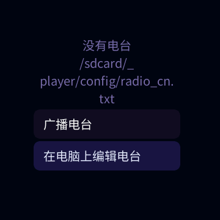
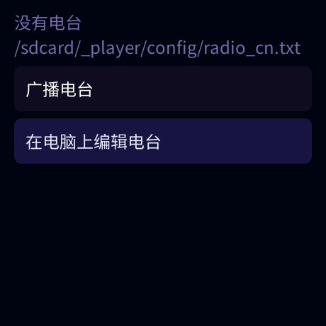

# 4. 网络电台

 

电台需要 Wi-Fi。JukeDial不会在屏幕上问你账号密码；网络信息从卡上的 `_player/config/wifi.txt` 读取（第 12 章）；网页工具也能写入（Wi-Fi 区：网络名称和密码）。Wi-Fi 只在需要时才开（电台、校时），可以在快捷面板允许或禁止。

- **电台列表**是卡上的纯文本：`_player/config/radio.txt`、`radio_cn.txt`，以及你自己的 `radio_<名称>.txt`，一行一个 `名称|网址`。第一次用会写入默认列表。电台列表最后一列是“在电脑上编辑”的帮助。
- **先试 http。** http 流直接播。https 也能播：TLS 放在 PSRAM、带证书包；只列 https 的电台会先试它的 http 孪生网址。每条 TLS 连接约吃 31 KB PSRAM；内部内存太低时会拒绝 https，并在页面告诉你。
- **流类型：** MP3、AAC、Ogg／Opus，以及 TS／AAC 分段的 HLS（BBC、许多台湾电台）。fMP4 分段的 HLS 不支持。
- **输出：** 电台和音乐走同一条输出：有线、蓝牙（耳机模式可边听边播，但 Wi-Fi 连接那一下耳机会断约半秒）。完整播放器在 Auracast 广播时不开 Wi-Fi，要广播电台请用广播电台模式（第 5 章）。
- **找电台：** 网页工具有电台搜索（radio-browser.info）和编辑器，可把列表写到设备。
- **电台调频寻宝**是个小游戏：转刻度盘找电台（第 7 章）。

下一章：[蓝牙、Auracast 与广播电台模式](05-bluetooth-cast.md)。
