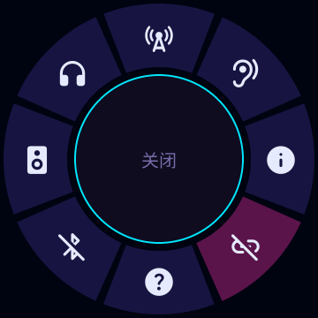
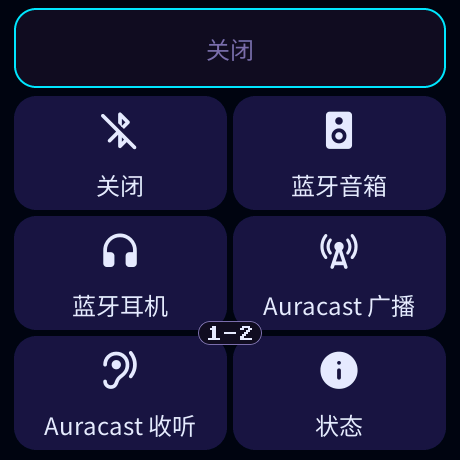
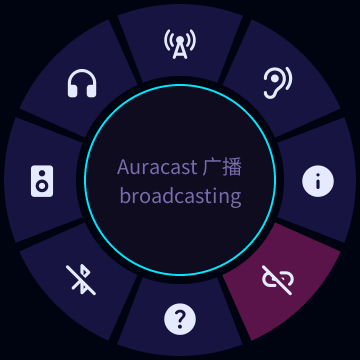
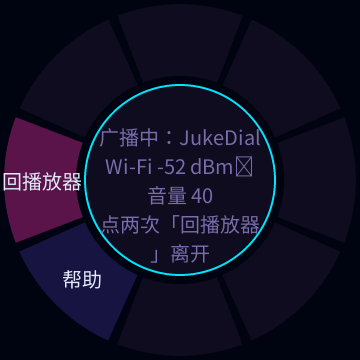

# 5. 蓝牙、Auracast 与广播电台模式

 

蓝牙模式在蓝牙页选择。**换模式会重启**（约 10 秒），重启后接着播。异常重启（死机、看门狗、欠压）或安全模式之后，模式会回到默认、蓝牙关闭。

**耳机模式（JukeDial → 耳机，A2DP 来源端）。** 在配对页配对（环上会显示 6 位数配对码）。默认固件就含全部编码：SBC、AAC、aptX、aptX HD、LDAC；aptX 与 LDAC 由 JukeDial 编码发送，所以只在耳机模式可用，而且只有 44.1／48 kHz。LDAC 会依连接质量在 990／660／492／330 kbps 之间调整，质量恢复后再升回；开着 Wi-Fi 时最高约 660 kbps。连接质量差时 aptX HD 会降到 aptX 再降到 SBC，安静 2 分钟后再试着升回。耳机按键（播放／暂停、上下首、音量）可用。aptX／LDAC 时重的音效会暂停，音效列表会说明。

**每个输出各自的音量。** 有线输出一个音量；每副蓝牙耳机依它的地址各记一个音量，新耳机第一次连接从约三分之一（33）开始；扬声器模式另有自己的音量（默认 60）。切换输出时音量不会比新输出原本的设置更大声，所以换到另一个输出不会突然变大声。

**扬声器模式（手机 → JukeDial，A2DP 接收端）。** 手机的声音从JukeDial的有线输出播出（接收 SBC 或 AAC），JukeDial会显示手机的歌名、艺人和封面（AVRCP 1.6）。扬声器模式是**独占的来源**：在这个模式下要播放本机曲目时，画面会问“离开蓝牙音箱模式并播放？”，选择离开会重新启动，然后开始播放。

**Auracast。**
- *广播：* JukeDial把 48 kHz 立体声送给任何 Auracast 接收器。完整播放器广播时**不开 Wi-Fi**（内存限制），音效降为 EQ 加限幅器。
- *收听：* JukeDial接收广播，Wi-Fi 可以开（丢包率从约 0.6% 升到 1.6%，有补偿）。

**广播电台模式。** 独立的开机模式：先开 Wi-Fi，再开 Auracast，把**网络电台广播**给 Auracast 接收器。它是精简加载的重启模式。离开要点两下“回JukeDial”确认格，按住屏幕不会重启离开。长时间运行的稳定度还没有完整验证。

**不提供：** 手机端的蓝牙设置页、LE Audio 单播连接、MIDI。

**音频设置。**编码、采样率、位深、声道的上限与 LDAC 最高码率在 设置 > 声音 > 蓝牙音频；该页显示耳机能提供什么、实际协商出什么（第 17 章）。**名称。**JukeDial 在蓝牙与 Auracast 上显示为“JukeDial”，BLE MIDI 是“JukeDial MIDI”，BLE 按键是“JukeDial Keys”。若你曾用旧名称（JC Player／JC MIDI／JC Keypad）配对过，请在手机或电脑上移除旧项目后重新配对。

下一章：[时钟、闹钟与习惯](06-clock.md)。
