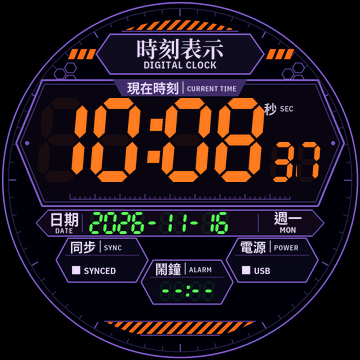
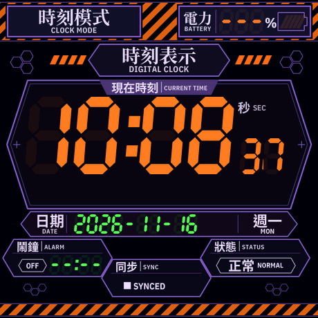
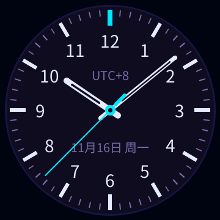
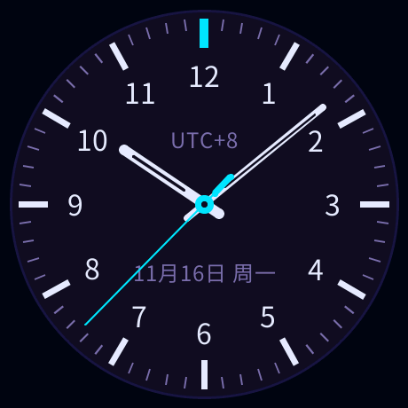
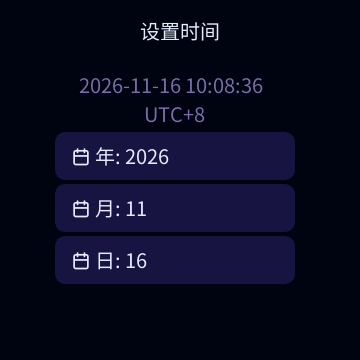
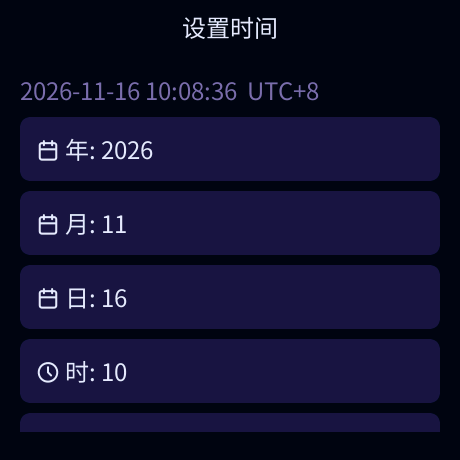
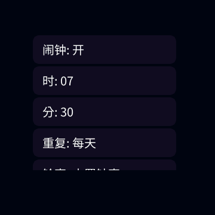
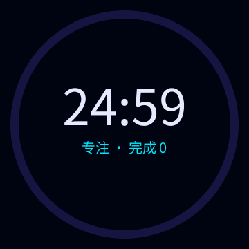
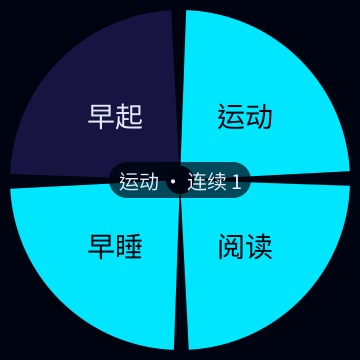
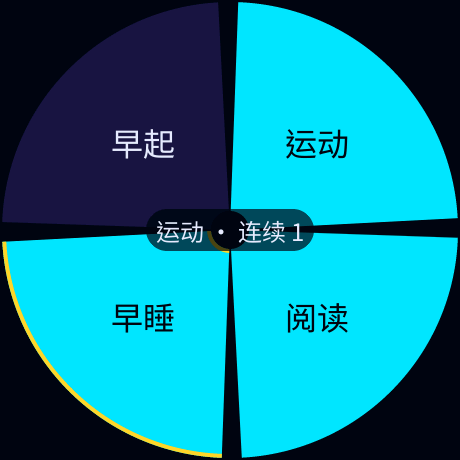

# 6. 时钟、闹钟、番茄钟、喝水与打卡

 

- **时钟。** 多种表盘与字体；默认表盘是 HUD 设计表盘（紫框、橙色数字，需要卡片内容包里的 `_player/faces.zip`，没有它就改用信息表盘）。其他表盘例如经典指针：
   
  时间靠 Wi-Fi 校时（NTP），也可手动设置。圆屏**没有电池时钟**：完全断电后要等下次校时或手动设置才会准（软件重启会保留）；FakePod 有内置时钟芯片，关机后时间仍会保留。时区与日出地点只能在网页工具设置。
- **手动设置时间。** 设置 > 系统 > 设置时间（时钟菜单最后一格也进得去）。页面上方是当前的日期时间与时区，下面是年、月、日、时、分五行：点一下该行加一，或转旋钮（FakePod 用两个按键）改值，到头会绕回（年份是 2025 到 2040），日数会跟着月份夹住。输入的是你设置的时区的当地时间，按“应用”才生效，秒数归零。最后一行“用 Wi-Fi 校时”直接在这一页校时（Wi-Fi 校时成功后会取代手动时间）。页面最下面一行说明时间关机后会不会保留。
   
- **闹钟。** 一定会响。铃声是内置铃声或你指定的一首 MP3（不能用电台）。闹钟页旋钮可以操作。
  
- **番茄钟。** 环形计时。正在放音乐时只振动（圆形主板的振动马达），不打断歌曲。
  
- **喝水**与**习惯打卡**：提醒与每日打勾列表，存在卡上。
   

FakePod 没有振动马达，提醒只用声音和画面（这块板没有振动驱动器）。

下一章：[小工具与游戏](07-toys-games.md)。
