# 7. 小工具与游戏

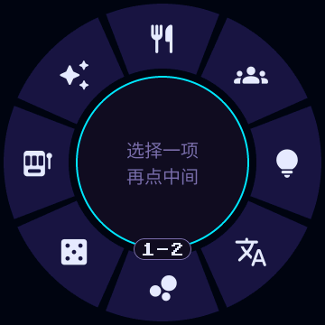 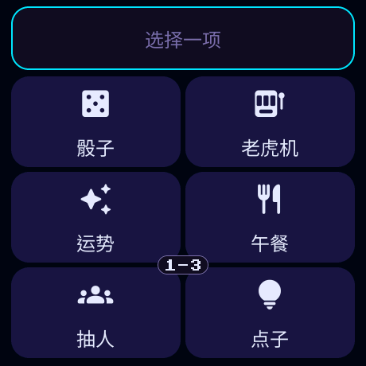

小工具在“工具”菜单里，音乐播放时也能用。它们的声音是很小的芯片音色合成，在音量之前混入，所以和音乐一样受音量控制。

**小工具（各一句）：** 骰子；老虎机（页面会说明赢在哪）；午餐／抽人／点子列表；签诗（御神签）与转盘（文字可由卡上文件覆盖）；捏气泡膜；计数器；音效库（试听芯片音色）；照片；单词卡；调音器（“聆听”用麦克风报出音名与偏差的音分，A4 基准 430–450 Hz 可调，聆听时音乐暂停、离开后接着播；“发音”播出 C2–C6 的指定音，正弦、方波、三角、锯齿可选，附吉他空弦）；手电筒（整个屏幕纯白、亮度开到最大，不显示任何文字；向上滑、长按回首页、屏幕休眠或打开快速设置都会还原你原本的亮度）。

**游戏**（圆屏 360 与方屏 460 都能玩，只用点击与旋钮，不需要拖曳）：节拍点击、环形打砖块、四子棋、旋转挡板、骨牌、猜歌、旋钮小玩意（迷宫、上发条、钓鱼）、生命游戏、15 拼图、电台调频寻宝、保险箱开锁、四色记忆、万花尺、叠塔、井字棋。多数有规则变体、画风与存档。快速往下滑会暂停游戏并开快捷面板。

**旋钮小玩意与迷宫。** 这个游戏一页有六种玩法。圆形板打开后的第一个是**重力迷宫**：弹珠从中心出发，旋钮转动重力的方向（边缘的小弧线标出“下”在哪），让它滚到环上的缺口、穿过去，最外面的出口就是终点；另有斥力与吸力两种变化。FakePod 有运动传感器，第一个是**倾斜迷宫**（[第 19 章](19-fakepod.md)）：把机器倾斜来滚动弹珠，掉进洞就回到起点。

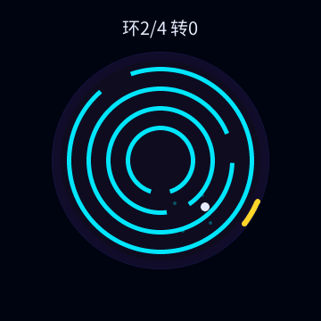

主力展示：
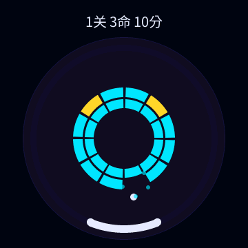 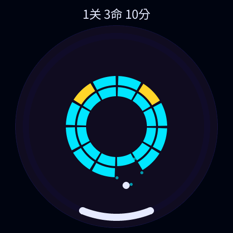
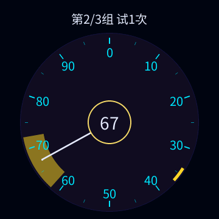 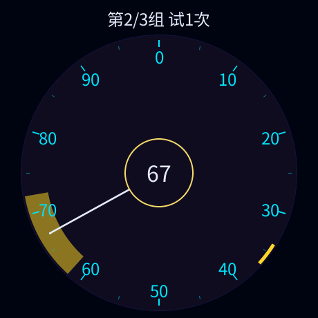
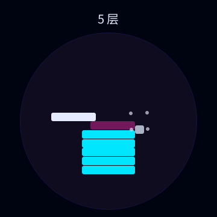 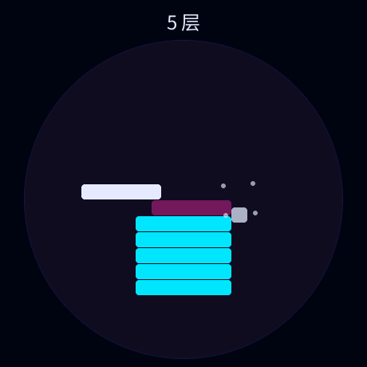
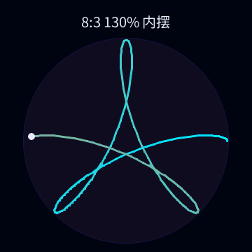 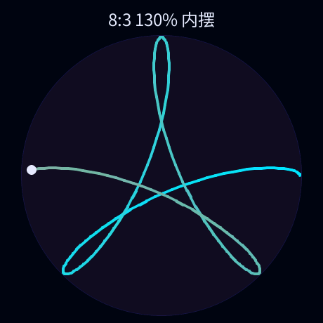

下一章：[乐器](08-instruments.md)。
