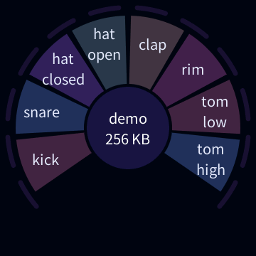
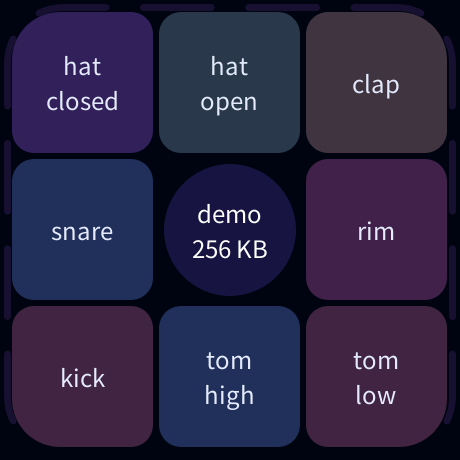

# 8. 乐器

 

乐器 app 是独立的开机模式（重启进入；离开要点确认格再点第二下），使用和JukeDial同一套环形界面。内容有：鼓垫、节拍器／节拍、循环录音（存成 `_player/loops/loop_NNN.jcl`）、芯片与 FM 音色、采样套件。

套件放在 `instrument/kits/<名称>/`，里面有 `kit.txt` 与 WAV 或 SFZ 文件；示例套件可用 `tools/gen/make_demo_kit.py` 生成。演奏方式是点鼓垫，旋钮改目前选的参数。

乐器 app 也会以蓝牙 LE MIDI 设备“JukeDial MIDI”广播：用手机或电脑的 MIDI app 连上就能演奏，它也会回传 MIDI 时钟。

下一章：[氛围、白噪声与呼吸](09-ambient.md)。
