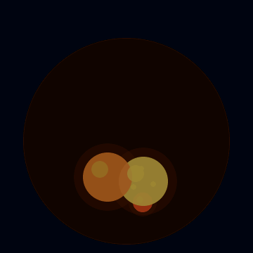
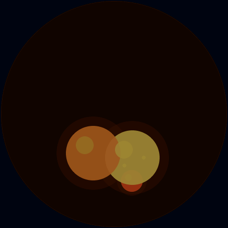
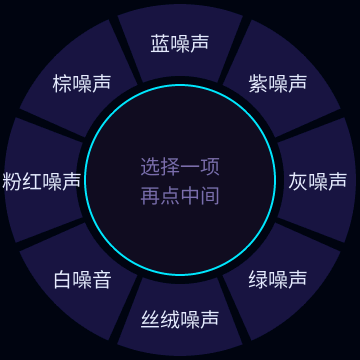
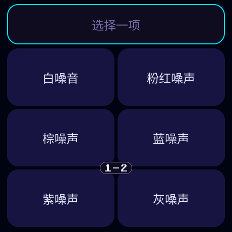
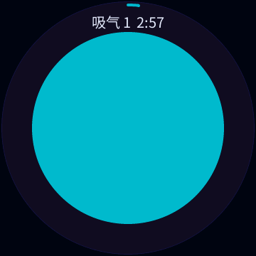
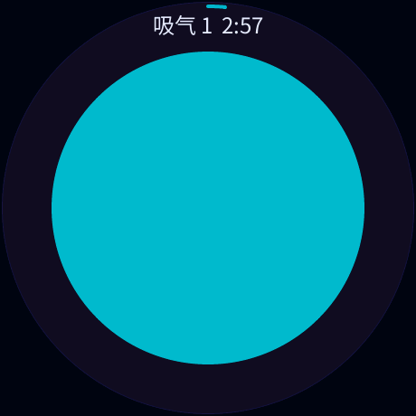

# 9. 氛围、白噪声与呼吸

- **氛围页：** 熔岩灯、鱼缸、篝火、夜灯。安静的动画，音乐播放时屏幕可以一直亮着。
   
- **白噪声：** 合成的噪声颜色（白、粉红、棕…）加上睡眠包 `_player/sleep/library.muk` 里的情境（雨声等；我们自己合成的包：`make noise-pack`）。也可以自己编情境。
   
- **呼吸：** 引导式呼吸圆环，可选呼吸音。
   

下一章：[快捷面板](10-quick-settings.md)。
