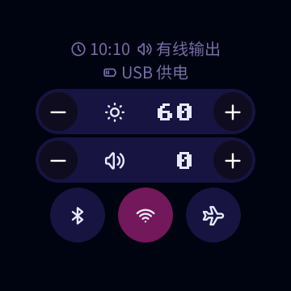
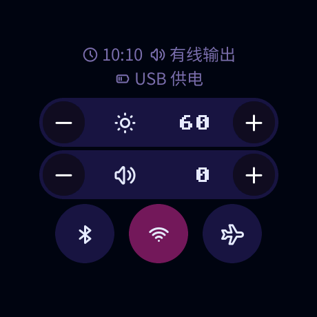
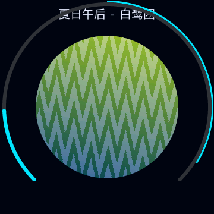
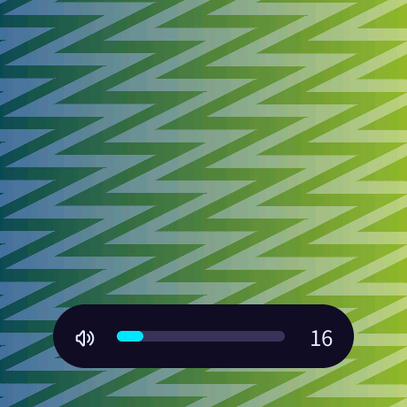

# 10. 快捷面板

在任何地方快速往下滑（游戏中也行，会暂停游戏）。快速往上滑、点面板外或 4 秒不动就会关闭。

 

- **状态栏：** 时间、电量（FakePod：AXP2101 百分比；圆形主板没有电量计，只显示电源来源：USB 或电池）、目前输出（扬声器／有线／蓝牙名称）。
- **亮度**（太阳图标）与**音量**（扬声器图标）：各一条胶囊，左端 −、右端 ＋，中间是图标和数字（亮度每次 10、音量每次 1，受音量上限限制）。旋钮照旧调音量。音量是**按输出各自记的**：有线一个、每副蓝牙耳机各一个、蓝牙扬声器模式一个，目前调的是当前输出的那一个（第 5 章）。
- **音量提示：** 转旋钮（FakePod 按上下键）调音量时，圆形板在屏幕边缘显示一道弧线，FakePod 在下方显示一个胶囊（扬声器图标、音量条与数字），几秒后自动消失。

 

- 三个圆形开关，从左到右：**蓝牙**、**允许 Wi-Fi**、**飞航模式**（一键关蓝牙并不允许 Wi-Fi）。亮色＝开。需要重新开机才生效的开关，第一下会变成电源图标、下面写「重启后生效」，再点一次才执行。
- 目前开机模式做不到的项目（例如 Auracast 广播时的 Wi-Fi）会变灰并附一行原因。

下一章：[设置](11-settings.md)。
