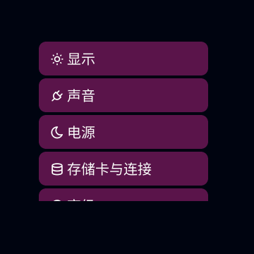
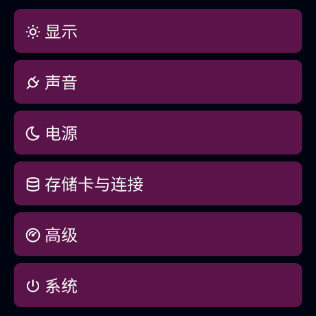
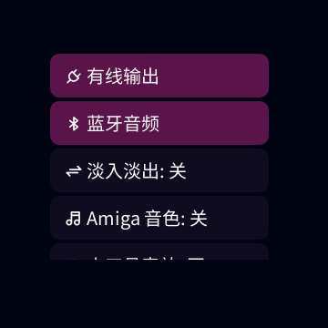
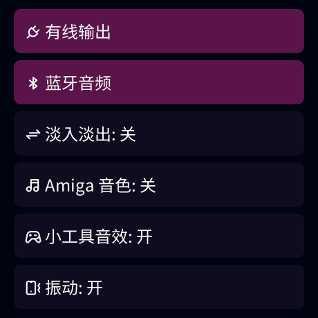
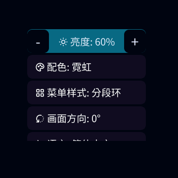
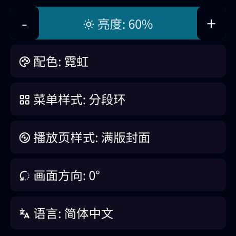

# 11. 设置

 

设备上只放常用设置，细项在网页工具（第 13 章）：时区、日出地点、音效预设、电台列表、有线细项。

## 六个类别
设置页顶层是**六个类别页**（显示、声音、电源、存储卡与连接、高级、系统）加说明；会打开另一页的行用自己的底色。每一类里有：

| 类别 | 内容 |
|---|---|
| 显示 | 亮度、配色、菜单样式、播放页样式（只有 FakePod）、画面方向（0° 或 180°）、语言（繁中／简中／English） |
| 声音 | 有线输出、蓝牙音频、淡入淡出（关／2／4／6 秒，只在前后两首采样率相同时作用）、Amiga 音色、小工具音效、振动（只有圆形板） |
| 电源 | 睡眠定时、自动关机（只有 FakePod：关／10／30／60 分） |
| 存储卡与连接 | 重新扫描曲库、封面缓存、存储卡诊断（第 12 章）、U 盘模式（第 14 章）、Wi-Fi（只显示设置好了没有，账号密码在网页工具输入） |
| 高级 | 采样率测试、实验性格式（默认关；点两下才开，说明见第 3 章）、CPU 时钟（实验性） |
| 系统 | 设置时间（第 6 章）、手势教学（重看）、重启 |

需要重启的项目会注明。播放倍速（0.75x 到 2x）在播放环上，不在这里。

 

## 值行怎么用
值行第一下只选中：左端出现“-”、右端出现“+”小标。选中后再点**左半边减一格、右半边加一格**，到头就停（配色与语言是循环）；也可以转旋钮（FakePod 按上下键）。

 

网页工具的高级区也有“实验性格式”同一项。

只在网页工具里（第 13 章）：音量上限、按住回首页的时间（2／3／4 秒）、振动强度与长度、蓝牙耳机连接选项、ReplayGain、有线字长、字体来源等高级项目。

另有现况页，显示实际输出采样率与码率、underrun 次数，以及某功能被暂停时的原因。

**有线与蓝牙的上限。**有线采样率相关设置在 设置 > 声音 > 有线输出；编码上限与 LDAC 最高码率在 设置 > 声音 > 蓝牙音频（第 17 章）。主题配色见第 18 章；说明页会为 `setup_url` 的每个网址各显示一个 QR。

下一章：[存储卡设置与设置文件](12-card.md)。
