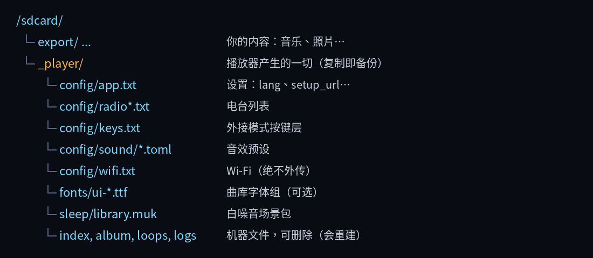
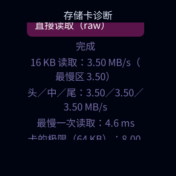
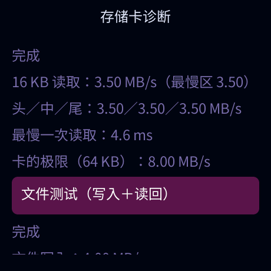
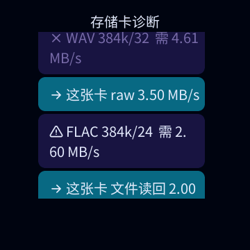
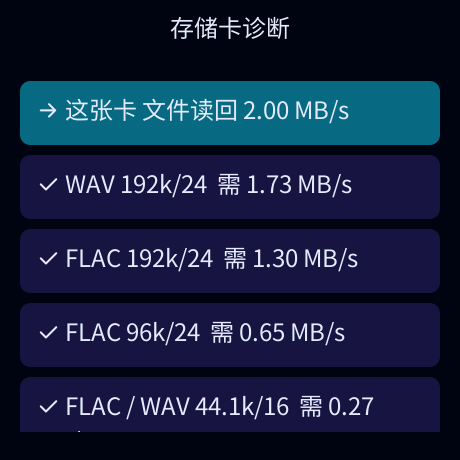

# 12. 存储卡设置与设置文件


- **卡内容包。** 从 Releases 页面下载 `jukedial-<版本>-card.zip`，解压缩到卡的根目录。里面有 `_player/pack.txt`；“现况”页会显示内容包版本，内容包缺少或比固件要求的旧时会警告。

- **卡：** FAT32 或 exFAT（大容量 exFAT 出厂卡可用），分区表必须是 **MBR**、一个分区（或没有分区表）。GPT 的卡挂载失败（“sd mount failed reason=gpt”）。**2 GiB 以上的文件会被略过。** 设备只有在挂载失败之后才会格式化，而且要看警告、连点几下、最后再点一个确认格。播放中不要拔卡。
- **文件夹。** 你的内容放最上层；JukeDial自己生成的东西都在 `_player/` 里（备份：复制它）。

| 路径 | 内容 |
|---|---|
| `export/<专辑>/*.mp3 cover.jpg` | 你的音乐：只扫描 `export/`，一层文件夹（一个文件夹＝一张专辑）；支持 MP3、FLAC、Ogg／Opus、M4A、WAV 和模块音乐；2 GiB 以上的文件会跳过 |
| `lists/*.zip`、`vocab/*.zip` | 单词卡列表，用 `tools/gen/make_lists.py`、`tools/gen/make_vocab.py` 制作，由网页工具上传 |
| `photos/*.jpg` | 照片 |
| `chiptune/<系统>.zip` | 芯片音乐 |
| `fortune/omikuji.txt`、`wheel.txt` | 覆盖内置的签诗与转盘文字 |
| `instrument/kits/<名称>/` | 采样套件 |
| `_player/config/app.txt` | 设置：`lang`、`setup_url`（空白隔开、最多 4 个网址，第一个为主；帮助页每个网址一个 QR）… |
| `_player/config/radio*.txt` | 电台列表 |
| `_player/config/keys.txt` | 外接模式的按键层（存储卡模板附 `.example`） |
| `_player/config/sound/*.toml` | 音效预设（导入／导出） |
| `_player/config/wifi.txt` | Wi-Fi 网络。这个文件绝不要分享或放进代码仓库。两行：`ssid=...` 和 `pass=...`；JukeDial不会显示或记录它 |
| `_player/fonts/ui-tc.ttf、ui-sc.ttf、ui-ext.ttf` | 曲库字体组（可选；没有就用闪存里的字体） |
| `_player/faces.zip` | 时钟、码表、倒数、番茄钟的 HUD 表盘（一个不压缩的 zip，在卡模板里；没有它就不提供 HUD 选项，这些功能用普通表盘） |
| `_player/themes/<名称>.txt` | 主题配色（卡片模板附十个，另有 `template.txt`；第 18 章） |
| `_player/splash/<模式>.jpg`、`_player/splash.jpg` | 开机画面（见下） |
| `_player/sleep/library.muk` | 白噪声情境包 |
| `_player/index`、`album`、`loops`、`logs` | 机器文件，可以删（会重建） |

## 不用网页工具也能改的设置文件

下面这些纯文本文件可以用任何编辑器修改：用读卡器，或让电脑通过设备的 U 盘模式（第 14 章）。编码用 UTF-8，换行用一般的换行字符。以 `#` 开头的行是注释。

| 卡上的路径 | 控制什么 | 格式 | 何时生效 |
|---|---|---|---|
| `_player/config/app.txt` | 设备设置（语言、亮度、音量上限等） | 每行 `键=值`，前后空白会被去掉 | 下次开机。设备自己改设置时会重写整个文件，所以请在设备关机、或卡在电脑上时修改 |
| `_player/config/wifi.txt` | Wi-Fi 网络（电台、校时用） | 两行 `ssid=…` 与 `pass=…`；`pass` 留空代表开放网络 | 下次连 Wi-Fi 时（需要时才连接）。这个文件绝不要分享 |
| `_player/config/radio.txt`、`radio_<名称>.txt` | 电台列表（`<名称>` 只能用小写英文、数字、`_`、`-`） | 每行一台：`电台名称\|地址`，最多再加两个以 `\|` 分隔的备用地址 | 下次打开电台页 |
| `_player/config/keys.txt` | 外接模式的按键层 | 从卡片包的 `keys.txt.example` 复制后修改；格式说明在外接模式画面的说明页 | 进入外接模式时，以及电脑弹出卡之后重读。任何一行有错，整个文件都不采用，改用默认的媒体键层 |
| `fortune/omikuji.txt` | 签诗的内容 | 每行一支签：`等级\|诗句`，等级是 大吉、吉、中吉、小吉、末吉、凶，或 `*`（任何等级）；没有 `\|` 的行当作任何等级的诗句；诗句里的 `/` 是换行；最多 64 句 | 下次打开签诗 |
| `fortune/wheel.txt` | 转盘的选项 | 每行一个选项，最多 12 个 | 下次打开转盘 |

`app.txt` 里确定可以手动改的键（其他键请用设备上的设置画面或网页工具，不要猜）：

| 键 | 意义 |
|---|---|
| `lang` | 界面语言：`0` 繁体中文、`1` 简体中文、`2` English |
| `brightness` | 亮度百分比（默认 60） |
| `volume_max` | 音量上限（默认 100） |
| `splash` | `0` 关闭开机画面（默认开） |
| `home_hold_ms` | 按住回首页的时间：`2000`、`3000` 或 `4000` 毫秒（默认 3000） |
| `tz` | 时区，POSIX 格式，例如 `CST-8` |
| `setup_url` | 说明页 QR 的网址，空格隔开，最多 4 个 |

示例（数值都是虚构的）：

```
# _player/config/app.txt
lang=2
brightness=70
splash=0
tz=CST-8

# _player/config/wifi.txt
ssid=MyNetwork
pass=password123

# _player/config/radio.txt
Sample FM|http://example.com/stream.mp3
Sample News|http://example.com/news.aac|http://backup.example.com/news.aac

# fortune/omikuji.txt
大吉|晴天配好歌/一路都顺风
*|今天的歌单由你决定

# fortune/wheel.txt
Pizza
Noodles
Salad
```

单词与单词卡列表由网页工具上传（用 `tools/gen/make_lists.py`、`tools/gen/make_vocab.py` 也能自己做）；其余的设置只能在设备画面或网页工具里改。

## 存储卡诊断

设置 > 存储卡与连接 > 存储卡诊断，告诉你这张卡跟得上哪些格式（高采样率的 FLAC、WAV 需要持续的读取速度，慢卡会卡顿）。测试期间播放会停止，离开页面就中止。

 

- **两个互不合并的分数。** *直接读取*只读、不经过文件：在卡的开头、中间与尾端三个区域各读一小段，报平均、最慢区与最慢一次读取（头条数字是解码器用的 16 KB 读法，另有 64 KB 读的卡极限）。*文件测试（写入＋读回）*会在卡上写一个 4 MB 临时文件、读回比对、删除；要点两下才开始，第一下说明会写入，剩余空间要至少 8 MB。
- **格式天梯。** 依需求由重到轻列出七种格式，各有判定图标：可以、勉强、不够。需求速度是该格式码流每秒字节数的 **1.5 倍**（留给定位、文件分配表与忙碌的卡；FLAC 以未压缩大小的 75 % 计）；速度达到需求是“可以”，达到需求的 75 % 是“勉强”，其余“不够”。

  | 格式 | 需求速度（约） |
  |---|---|
  | MP3／AAC／Opus 320k | 0.06 MB/s |
  | FLAC／WAV 44.1k/16 | 0.27 MB/s |
  | FLAC 96k/24 | 0.65 MB/s |
  | FLAC 192k/24 | 1.3 MB/s |
  | WAV 192k/24 | 1.7 MB/s |
  | FLAC 384k/24 | 2.6 MB/s |
  | WAV 384k/32 | 4.6 MB/s |

  各格式的判定看文件读回的速度；没做文件测试时才看直接读取。

   
- **揭露。** 这些门槛是估计值，不是保证：只用一张卡校准、只读三个区域各几秒，卡的其他位置仍可能有慢点。页面底下有同样的说明。最近一次的结果存在 `_player/cardtest.txt`，只留最新一次、只对同一张卡有效。

## 开机画面

开机时可以先显示一张图，背光缓缓亮起、变暗、再亮回来一次，然后照常开机。

- **文件名。** 每种开机方式一张：`_player/splash/player.jpg`（普通开机）、`usb.jpg`（USB U 盘／键盘／声卡模式）、`inst.jpg`（乐器）、`cast.jpg`（广播电台），只有 FakePod 另有 `charge.jpg`（充电画面）。某个模式没有自己的文件，就用 `_player/splash.jpg`；两个都没有就不显示，开机跟以前一样快。
- **建议的图。** **360 × 360 的 baseline JPEG**（不要 progressive），黑底，图案放在内切圆里：圆屏正好显示这个圆，FakePod 的方屏把同一张居中、四周留黑边。文件不超过 1 MiB。不会缩放，其他尺寸会 1:1 显示、超出屏幕的部分被裁掉。
- **默认图。** 存储卡包的 `_player/splash/` 已经附每个模式一张：一个大图标（`player` 是音乐图标加字标“JukeDial”）。想换就覆盖该文件；删掉则改用 `splash.jpg`，再没有就不显示。
- **关闭。** 网页工具“设备”页（屏幕组）的“开机画面”选“关”（下次开机生效），或在 `_player/config/app.txt` 加一行 `splash=0`。
- **代价。** 有图时，第一个画面与第一个声音约晚 **2 秒**。崩溃后的那一次开机不会显示。

现成的存储卡模板用 `make card-zip` 生成。

下一章：[网页工具与刷机](13-web-tool.md)。
