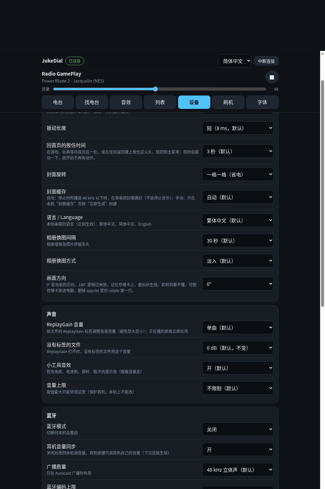
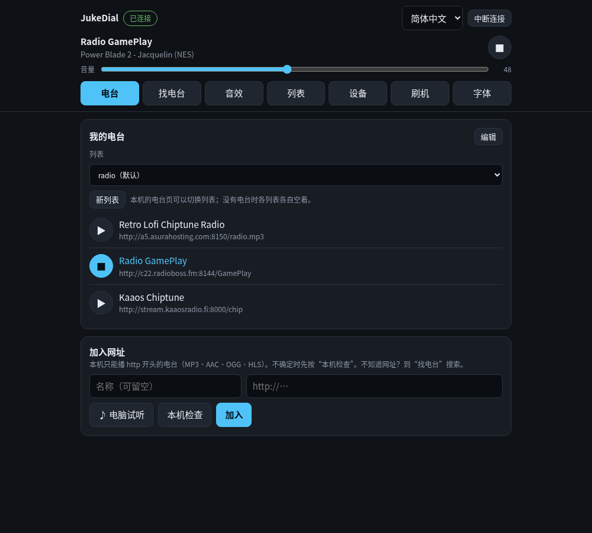
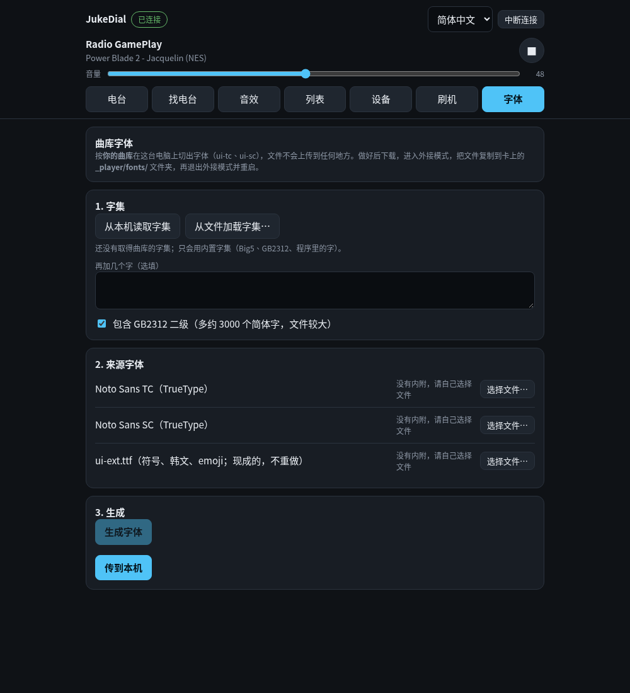
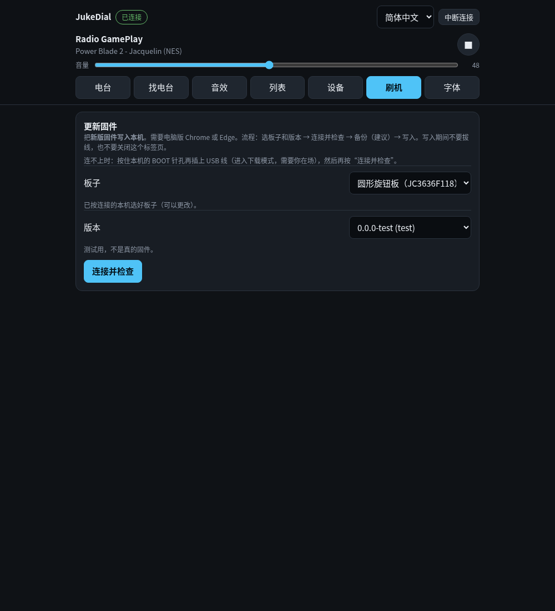

# 13. 网页工具：设置、电台列表、字体与刷机



一个静态网页（`tools/web/`，三种语言），经 USB 串口和JukeDial沟通。**请用电脑上的 Chrome 或 Edge**：需要 Web Serial（Firefox、Safari、手机都不行）。网页托管在 GitHub Pages，网址会写在项目的 Releases 页面；连不上托管网页时，可以在本机运行（见下面“没有托管网页时”）。

接线提示：USB-C 插头有正反两面，如果选端口时看不到 Espressif 的串口／JTAG 端口（厂商码 0x303a），把插头翻面再试。按“连接”，选那个端口。

**分页**
- **电台／找电台：** 编辑列表、搜索 radio-browser.info、试听、存到卡上。
- **音效：** 编辑音效 app 与串联、导入／导出 TOML 默认。
- **列表：** 上传单词与单词卡列表。
- **设备：** 有线设置与设备上没有的细项设置（时区、日出地点、有线采样率）。
  
- **字体：** 在浏览器里为你的曲库建字体组（从 Noto Sans TC／SC／补充字体切子集，全程在浏览器内，不上传），检查是否放得进 4 MB 字体分区，再经串口送出，或下载三个文件、用外接模式复制（第 14 章）。
  
- **刷机：** 用 esptool-js 在浏览器内刷固件。
  
- **卡内容包：** 从 Releases 页面下载 `jukedial-<版本>-card.zip`（文件夹、设置模板、HUD 表盘、字体、白噪音包），解压缩到卡的根目录。“现况”页显示内容包版本，比固件要求的旧时会警告。

## 在浏览器刷机

Releases 页面（GitHub 与 Gitee，文件相同）每个版本有这些文件：`jukedial-<版本>-round.bin` 与 `jukedial-<版本>-fakepod.bin`（每块板一个合并镜像：bootloader、分区表、app 与字体，不另外提供分开的文件）、`jukedial-<版本>-card.zip`（TF 卡内容）、`jukedial-<版本>-webtool.zip`（离线用的网页工具）、`SHA256SUMS` 与发布说明。版本是日期，例如 `2026.11.22`。

用托管网页刷机（电脑上的 Chrome 或 Edge；不必先点页面右上角的“连接”）：
1. 从 Releases 下载你的板子的合并镜像。页面只有在项目的 Releases 地址设置好之后才会出现“打开 Releases 页面”链接；在那之前只会写“到 Releases 页面下载”。
2. 打开托管网页，进“刷机”标签页。
3. 在“板子”选“圆形旋钮板（JC3636F118）”或“FakePod（方形屏幕、两个按键）”。选单一开始是“请选择板子…”，没有默认值，要自己选；选了之后页面会显示这块板的图和进入下载模式的方法。
4. 点“选择文件…”（或把文件拖进框里），选刚下载的文件。文件只在你的浏览器里读取，不会上传。页面会显示文件名与大小、固件版本、文件内容里的板子、SHA-256（可和 `SHA256SUMS` 对照）与“文件检查通过”。损坏的文件或为另一块板做的文件会被拒绝并说明原因，不会写入。
5. 点“连接并检查”，选 Espressif 的串口。页面检查芯片（ESP32-S31）与闪存容量，并列出会写入、会保留的区段。“先备份整个闪存”请保持勾选（建议：页面会下载备份文件，并在写入前要你确认文件真的在电脑上）。
6. 点“开始写入”，看确认窗口（板子、固件版本、区段）后确定。保持接线直到页面说完成。之后第一次开机会出现语言选单。
7. 只有 FakePod：页面最后会用 watchdog 复位让它离开下载模式，但浏览器没办法确认。如果屏幕一直不亮，就拔掉 USB 线和电池电源再接回去（不要按任何键）。

更新会保留设置与蓝牙配对；勾选“出厂重置：连设置和蓝牙配对也一起清掉”才会一并清除。

 

**进下载模式。** 圆形板：连不上时，按住 USB-C 旁边的 BOOT 针孔再插上 USB 线。FakePod：两个按键同时按住再上电。

## 没有托管网页时

连不上托管网页时有两个办法。

### 方法一：在本机运行网页工具
从 Releases 下载 `jukedial-<版本>-webtool.zip`（或用克隆下来的仓库里的 `tools/web/`），解压缩后：
- Linux 或 macOS：运行 `serve.sh`（需要 python3）。
- Windows：运行 `serve.bat`（有 Python 就用 Python，没有就用内附的 PowerShell 脚本，不需要安装任何东西）。

然后用 Chrome 或 Edge 打开 `http://localhost:8000`。设置、列表、字体与刷机都能用。**不支持**直接双击 `index.html` 打开：一定要通过 localhost。

### 方法二：用 esptool 手动刷机
手动把合并镜像从地址 0 写入。请使用能支持 ESP32-S31 的 esptool（ESP-IDF v6.1 附的那一版）；圆形板的命令（FakePod 见下）：

```
python -m esptool --chip esp32s31 --port <端口> --baud 460800 --no-stub \
  --before default-reset --after hard-reset \
  write-flash --flash-mode dio --flash-size 16MB --flash-freq 80m \
  0x0 jukedial-<版本>-round.bin
```

- 旧版 esptool（v4）把子命令写成 `write_flash`。
- 圆形板连不上时：按住 USB-C 旁边的 BOOT 针孔再插上 USB 线。
- **FakePod：** 先两个键同时按住再上电进下载模式，文件换成 `jukedial-<版本>-fakepod.bin`，并把 `--after hard-reset` 改成 `--after watchdog-reset`：一般的复位会停在下载模式，用 watchdog 复位才会离开。
- **警告：** 手动从地址 0 写入合并镜像会**清掉设置与蓝牙配对**（浏览器工具则会保留）。需要保留设置时请用网页工具。

**开发者：** 从源码构建、`make flash`、`make flash-all`、`make flash-fonts` 与 FakePod 的 esptool 步骤见[第 20 章](20-build-flash.md)。

**刷机要多久（圆形板实测，USB、460800 baud）：** 完整备份 16 MB 约 1.5 分钟；全部烧（`flash-all`：bootloader＋分区表＋app 7.8 MB）约 3.7 分钟；字体（3.2 MB）约 1 分钟；**app＋字体合计约 4.6 分钟**，连备份约 6 分钟。只更新 app 时（`make flash`）约 2.5 分钟（由 app 写入 136 秒推算）。网页工具用同样的速率，预期时间相近。烧录中请勿拔线。

下一章：[外接模式](14-external-mode.md)。
