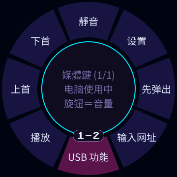
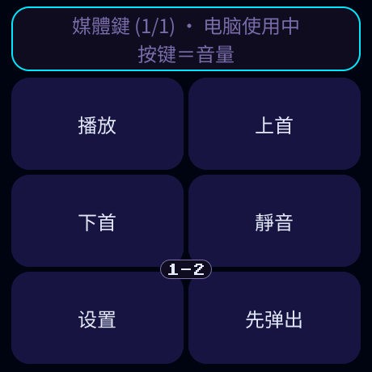
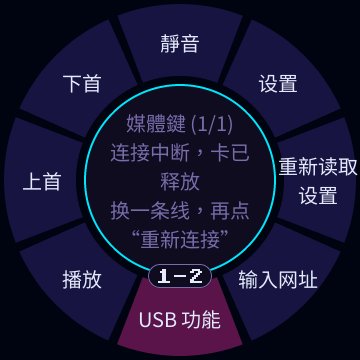

# 14. 外接模式：U 盘、声卡、按键

 

把JukeDial变成电脑配件的重启模式。从菜单进入；用确认退出格（点两下）离开，JukeDial会重新启动。

- **USB U 盘（大容量存储）：** TF 卡在电脑上显示为一个磁盘。复制音乐、字体或设置文件，退出，离开模式。
- **USB 声卡（UAC2）：** 电脑可以把声音播到JukeDial的 DAC。格式 16／24／32 位；提供的采样率是 DAC 允许且不超过 `dac_max_rate` 的那几档（默认 44.1／48 kHz）。旋钮（FakePod 用按键）调设备音量。某个采样率太吃资源时，描述符会拿掉它，屏幕会说明。这个模式在不同操作系统上的兼容度还没有完整验证。
- **USB 按键（HID）与蓝牙 BLE 按键（HOGP）：** 默认一层媒体键（播放／暂停、上下首、静音）。更多层来自 `_player/config/keys.txt`；宏与文字只送 ASCII。USB 与蓝牙不会同时使用：有插线就用 USB，没插就用 BLE（Just Works 配对）。
- 如果某个操作系统不接受三合一 USB 设备，退路是两合一（U 盘加按键，或声卡加按键）：模式里的功能格会依次切换三合一、U 盘＋按键、声卡＋按键，要再点一下确认，然后重开模式。哪些操作系统需要它，目前还没有完整验证。

## U 盘模式与卡片保护
存储卡也可以直接从设置进入 U 盘模式：设置 > 存储卡与连接 > U 盘模式。电脑把卡当成一个盘写入时，播放器不能同时使用它，所以有这些保护：

- **每条离开的路都会把卡还给播放器。** 屏幕上离开、改功能组合、或电脑突然不见，都会先等写入完成再释放卡。
- **电脑不见就立刻释放。** 拔线、断电、电脑睡眠超过约 2 秒，画面会显示“连接中断，卡已释放”与“换一条线，再点‘重新连接’”（电脑睡眠时是“电脑醒来后，点‘重新连接’”）。换线或唤醒电脑后点**重新连接**；离开模式也随时可以。如果电脑先“弹出”了这个盘再拔线，那是正常的安全移除，画面会写“已弹出，可以拔了”。

  
- **卡没有响应时说明原因与该做什么。** 不正常拔线偶尔会让卡卡在内部状态，之后开机挂载失败。设置第一行会出现“存储卡无法使用”，点进去看原因：“存储卡没有正常响应”时，圆形板请用电源开关关机再开；FakePod 请重新插卡，或完全关机再开。没有卡、读不到卡会写对应的说明。只有文件系统问题（GPT、无法识别的格式）才会出现格式化选项，卡没有响应时绝不会给。

**名称。**USB 设备与磁盘显示为“JukeDial”（各功能为“JukeDial Card”“JukeDial Keys”“JukeDial Sound”），TF 卡磁盘标签是 JUKEDIAL；BLE 按键是“JukeDial Keys”。电脑或手机若记得旧名称，可能要先移除旧项目（BLE 按键要重新配对）。

下一章：[安全模式与救援](15-safe-recovery.md)。
