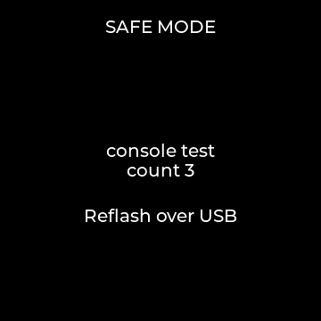

# 15. 安全模式与救援

- **开机循环保护。** 死机次数会跨重启累计。连续三次之后，JukeDial进入静态的 **SAFE MODE** 画面（黑底、三行英文、亮度 40%、DAC 静音、不理触控和旋钮），不碰卡、蓝牙和 Wi-Fi。要用 USB 重新刷机才能离开（第 13 章）。
- **任何一次死机后**（panic、看门狗、欠压），下一次开机会进正常JukeDial，但蓝牙模式回到默认（蓝牙关闭）。
- **死机时正在播的歌会被标示并跳过。** 下一次开机后，那首歌在列表里显示“上次播放时死机，已跳过”，不会再被自动挑到；自己点它就会播并清除标记（第 3 章）。
- **刷错镜像。** FakePod 的镜像在圆形主板上拒绝执行，反之亦然（印出 "WRONG BOARD" 然后等着）。
- **开不了机或刷不进去：** 芯片永远可以经 USB 进下载模式。插 USB 时用细针按住 BOOT 针孔（圆形机：USB-C 接口旁边的小孔；FakePod 没有针孔，改成两个键同时按住再开机或插上 USB），再用网页工具或 `make flash-all` 刷机。请保留备份：网页工具第一次刷机会提供原厂闪存的完整备份。
- **电量耗尽（FakePod）：** 欠压重启不会显示安全画面，避免点亮屏幕又欠压的循环。
- 不要自己烧 eFuse 或使用深度睡眠，可能把自己锁在外面。

下一章：[疑难排解与常见问题](16-faq.md)。
