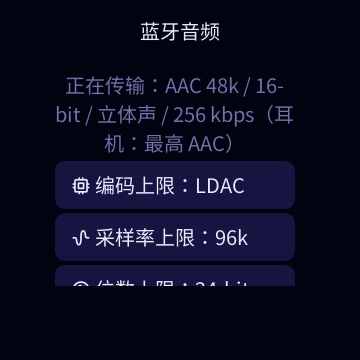
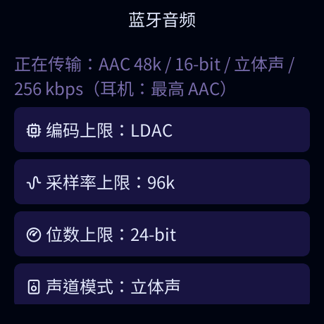
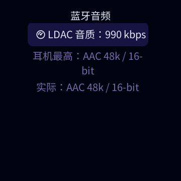
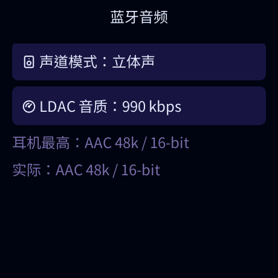
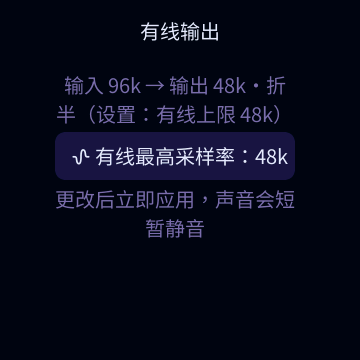
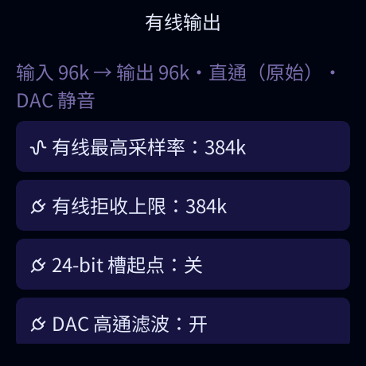
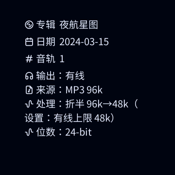
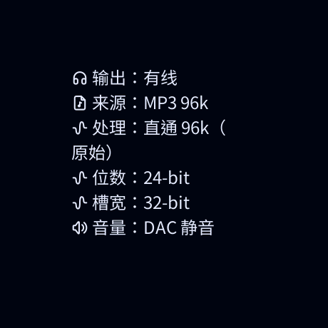
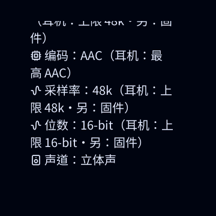
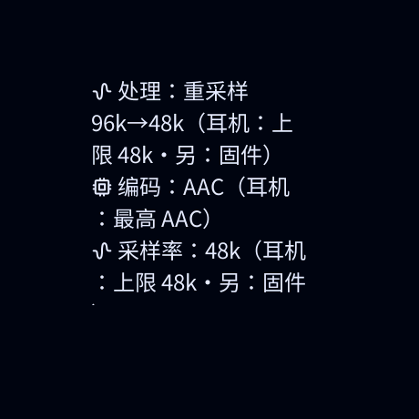

# 17. 音频输出：蓝牙音频、有线输出与屏幕上的诚实说明

JukeDial 不隐瞒它对声音做了什么。两个设置页决定上限，两个地方汇报实际结果。

## 蓝牙音频（设置 > 声音 > 蓝牙音频）
 
- **实时行：**当前连接的编码、采样率、位深、声道模式与码率（例如“AAC 48k / 16-bit / 立体声 / 256 kbps”）。
- **选项行：**编码上限、采样率上限、位深上限、声道模式、LDAC 最高码率（990／660／492／330 kbps；实际码率会依连接质量在上限之内调整）。你选的是**上限**，不是保证：耳机与固件版本只会把它往下压。不再有灰掉的格子。
- **末尾的信息行：**“耳机最高：…”是耳机能提供的最好规格；“实际：…”是协商出的结果；未连接则显示“未连接”。
- 改了选项会先保存，**离开此页时重新连接一次**。不会重启，也不会动蓝牙模式。

 

## 有线输出（设置 > 声音 > 有线输出）
 
- 最上面一行是实时的：输入采样率、输出采样率，两者不同时附原因（图中是 96 kHz 文件因有线上限 48k 而减半）。
- **有线最高采样率**是“减半”门槛：高于它的文件会在频率族相符时以一半（或四分之一）的采样率播放。圆屏默认 48 kHz，FakePod 默认 384 kHz。
- 仅 FakePod：**有线拒绝上限**（硬上限：高于它的文件打开前就拒绝，正在播的曲目不会被中断，从下一个来源起生效）、**24 位槽起点**（默认关，从指定采样率起送 24 位槽给 DAC，尚未在实机上验证）、**DAC 高通**，以及**输出推力**（1.0／1.41／1.73 V，见[第 19 章](19-fakepod.md)）。硬上限与减半门槛都是 384k 时，一切直通。
- 更改立即生效并短暂静音（有三个以上值的选项是草稿，松开控件或离开页面时才生效）。

## 两块板子的 DAC 怎么处理
| | 圆屏（PCM5102A） | FakePod（CS43131） |
|---|---|---|
| 原生采样率 | 1 到 48 kHz，以及 88.2 / 96 / 176.4 / 192 / 352.8 / 384 kHz | 32 到 384 kHz 直通 |
| 16 到不足 32 kHz | 原生播放 | **升频**到同一频率族（22.05 到 44.1、24 到 32、16 到 32） |
| 低于 16 kHz | 原生播放 | **拒绝**，屏幕说明原因 |
| 音量 | 数字 | **在 DAC 硬件内**（音频路径到 DAC 前保持单位增益），并读回确认 |

蓝牙与 Auracast 一律使用数字音量。有线输出永远使用有线自己的音量，蓝牙远端的音量不会影响它；FakePod 的有线路径在数字端是单位增益，由 DAC 芯片硬件负责衰减。

## 诚实说明
- **详细页的输出区块**（从播放环打开“详细”，滚到最后）：每个事实一行、前面有图标：输出（有线／蓝牙／Auracast）、来源（格式与采样率）、处理、位数、槽宽、音量。每秒刷新。
 
 
- **原因标签。**凡是与文件不同的行都会说明原因，并标出是谁决定的：文件、设置、耳机、DAC、固件、信号、“忙碌”或模式（也有电量标签，目前没有东西会设置它）。状态行显示最严格的原因，详细页列出全部。暂停的重型效果会明说，而不是默默停止。
- **直通**发生时会写明（“直通（原始）”），倍速或效果迫使处理时也会写明。

下一章：[主题配色](18-themes.md)。
