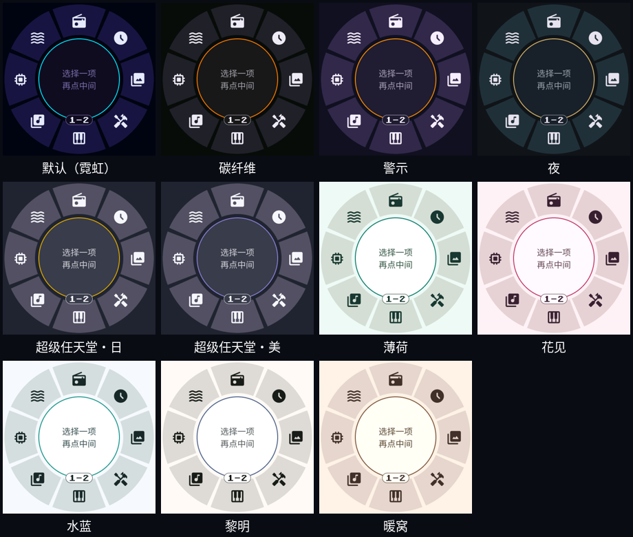
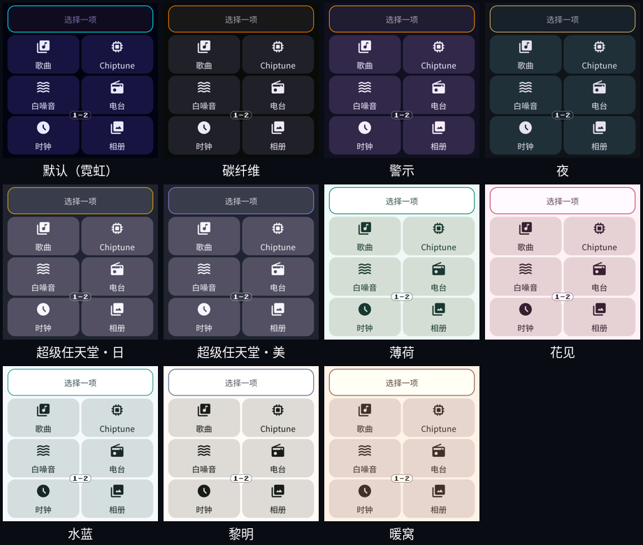

# 18. 主题配色

设置 > 显示 > 配色 会逐一切换外观：内置主题（默认是霓虹）加上**十个卡片主题**：碳纤维、警示、夜、超级任天堂·日、超级任天堂·美（深色），以及薄荷、花见、水蓝、黎明、暖窝（浅色）。行上会以你的语言显示主题名称。浅色主题会让 LVGL 切到浅色模式；游戏棋盘在每个主题下都看得清楚。每个主题都通过对比检查（正文至少 4.5:1，图形至少 3:1）。

## 主题文件
- 卡片主题放在 `/sdcard/_player/themes/<名称>.txt`；`_player/config/app.txt` 里的 `theme=<名称>` 决定用哪个（设置行会替你写）。卡片模板（`make card-zip`）内含十个主题和 `template.txt`。
- 文件是纯文本：每行一个 `键 = #RRGGBB`，`#` 或 `;` 开头是注释，`base = <内置主题>` 指定起点（默认 neon），调色板项目写成 `键.索引`，`name_tc` / `name_sc` / `name_en` 是显示名称。
- `template.txt` 列出所有颜色 token、默认值与中英文用途说明：复制、改名、改几行即可。
- 坏行、未知键、坏值只会被跳过并计数；文件不存在或名称不安全（只允许字母数字、`_`、`-`，最长 23 字）就回到默认外观，绝不崩溃。
- 内置主题名称优先于同名文件。

下一章：[FakePod](19-fakepod.md)。
