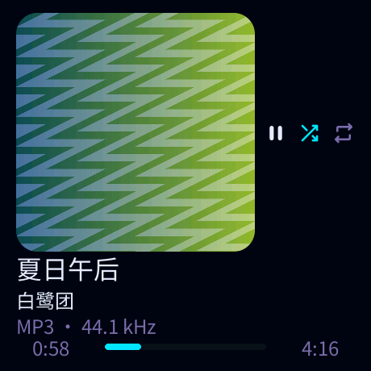
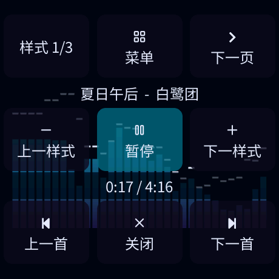
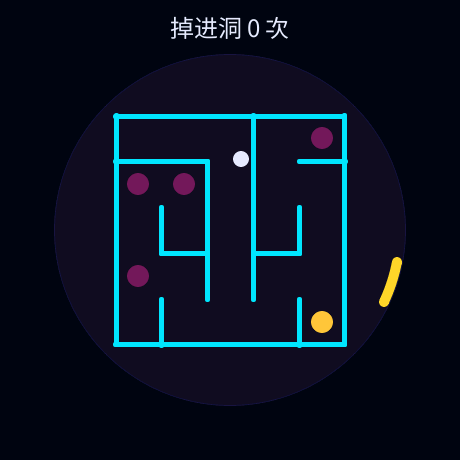

# 19. Fake Pod Nano Pro（FakePod）专属操作

FakePod 是 460 × 460 的方形屏幕，没有旋钮，只有两个按键（上键＝“＋1”兼电源键，下键＝“－1”）加触控。这一章集中说明它和圆形板不同的地方；其余功能与前面各章相同。硬件差异见[第 0 章](00-hardware.md)。

## 三种播放页
设置 > 显示 > 播放页样式，三个值；下次进播放页生效。

| 样式 | 画面 |
|---|---|
| 满版封面（默认） | 整个屏幕都是封面，没有任何按钮，操作靠隐形九宫格 |
| 封面＋信息 | 封面在左上，下面是歌名、艺人、格式行与进度条；右侧三个图标只显示状态（播放／暂停、随机、循环），不能点 |
| 菜单格 | 与圆形板相同的旋转圆盘，点一下打开播放环 |

  

进度条只显示位置，不能点着跳；播放器没有“跳到某个位置”的功能。

## 九宫格点击区
满版封面、封面＋信息与频谱页都不画屏幕上的按钮，而是整页分成 3 × 3 等大的隐形点击区。**第一下点屏幕只会显示九个格子的标签；第二下点某一格才执行。**没显示标签时点屏幕不会执行任何动作；标签约 4 秒没有触碰会自动收起，点中间下排的“关闭”格会立刻收起。标签显示期间，频谱、旋转的封面与相册照片会暂停（进度条与时间照走）。

 

格子位置：

| | 左 | 中 | 右 |
|---|---|---|---|
| 上排 | 切换组合 | 菜单 | 下一页 |
| 中排 | 左功能 | 播放／暂停 | 右功能 |
| 下排 | 上一首 | 关闭 | 下一首 |

- **切换组合**会显示“名称 i／n”，轮流换掉中排左右两格的功能（各页的选择在开机期间记住）。封面页只有“播放模式”：左格是随机（开／关），右格是循环（全部／单曲）。频谱页有三组：样式（上一个／下一个样式）、配色，以及播放模式。
- **下一页**依序走封面 → 频谱页 → 歌词（只有曲目旁边有同名的 `.lrc` 文件时才有）→ 回封面。
- **菜单**打开该页原本的菜单（播放环等）。

## 频谱页
频谱页的样式、配色与播放模式都是上面的组合，用九宫格操作；种类与高级设置见[第 3 章](03-music.md)。

## 列表、音量与按键
- **较大的列表。** 列表行与按钮更大、更好点，每页六行。
- **音量提示。** 按上下键调音量时，下方显示一个胶囊（扬声器图标、音量条、数字），几秒后消失（第 10 章）。
- **屏幕关着时唤醒。** 屏幕关着时，**两个键同时按**才会点亮屏幕；触碰屏幕不会唤醒（避免放口袋里误触）。屏幕一定会在闲置后关闭（OLED 久亮会烧屏）。
- **屏幕关着的盲按键。** 有播放来源时：按上键一下音量加、按下键一下音量减（按住连续调）；上键连按两下＝下一首，下键连按两下＝播放／暂停。单按因此晚约 0.3 秒才生效。没有播放来源时，任何键都会点亮屏幕。

## 倾斜迷宫与运动传感器
游戏“旋钮小玩意”在 FakePod 上的第一个玩法是倾斜迷宫：把机器倾斜，弹珠就往那个方向滚，掉进洞就回到起点，滚到出口过关。运动传感器会在机器静止时自动校正比例；进入迷宫时会自动取当前的姿势当中立点，拿不稳时画面会提示“请拿稳或放平，再点重新归零”，规则环里的**重新归零**可以随时重设中立点。

## 时钟
FakePod 有内置的实时时钟：设置时间（第 6 章）或 Wi-Fi 校时后，关机、断电后时间仍会保留。

## 输出推力
设置 > 声音 > 有线输出 > 输出推力，三档：**1.0 V**、**1.41 V**、**1.73 V**。1.73 V 是**实验性**的高电压模式：比 1.0 V 大约 4.8 dB，芯片厂只保证用在 600 Ω 以上的耳机，低阻抗入耳式耳机增益很小、还可能失真；从 1.41 V 切到 1.73 V 时，第一下点只显示警告，第二下才生效。每次调高推力时，如果音量高于 20，会自动降到 20。行下方会显示芯片实际使用的推力。

## 不支持的项目
- 耳机插孔检测与线控：不支持（这块板没有接到可用的检测脚）。
- 屏幕上的圆形按钮：已被九宫格取代。

## 下载模式与刷机
两个键**同时按住再上电**就进下载模式。可以用托管的网页工具（第 13 章：“刷机”标签页，板子选“FakePod（方形屏幕、两个按键）”；写完页面会用 watchdog 复位，如果屏幕一直不亮，就拔掉 USB 线和电池电源再接回去，不要按任何键），或用 esptool 手动写入合并镜像（第 13 章；写完要用 watchdog 复位才会离开下载模式）。从源码构建的步骤在[第 20 章](20-build-flash.md)。

下一章：[从源码构建与刷机](20-build-flash.md)。
