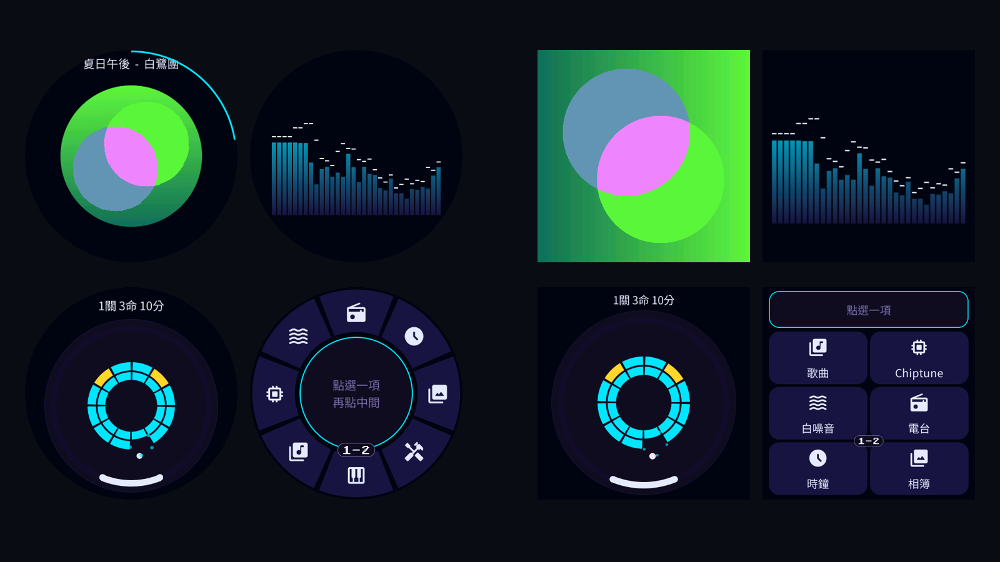

# 0. 硬體

JukeDial 跑在兩塊板子上，都以 **ESP32-S31**（雙核 RISC-V、320 MHz、Wi-Fi 6、藍牙 Classic + BLE 5.4、16 MB flash）為核心。同一份程式碼服務兩塊板；映像檔依板子分別建置，絕不自動猜板（刷錯板的映像會拒絕開機）。

## 圓形主板：JC3636F118
附旋鈕、360 × 360 圓形觸控螢幕的板子。
- **顯示與輸入：** 360 × 360 圓形螢幕、電容觸控、旋鈕（轉動與按下）、DRV2605L 震動驅動（旋鈕有段落感）、螢幕外圍的 LED 環。
- **音訊：** 有線輸出走 **PCM5102A** DAC（原廠板附 PCM5100A，腳位相容；本機已換成 PCM5102A）到 3.5 mm 耳機孔；PDM 麥克風；TF 卡槽（4 位元 SD）。
- **記憶體：** 16 MB flash；PSRAM 實測 16 MB。
- **電源：** USB-C。沒有電池晶片，也沒有時鐘晶片；只能用 ADC 讀供電電壓，所以沒有電量百分比，關機後時間不保留（開機後靠網路對時或手動設定）。
- **動作感測：** 沒有可用的動作感測器，所以重力迷宮是用旋鈕轉重力。

## 方形主板：FakePod Nano Pro
第三方的開源硬體設計（作者：ZYFDroid；公開儲存庫：<https://gitee.com/ZYFDroid/night-player-fake-pod-nano>）。JukeDial 在它上面的韌體是我們自己寫的，依照公開的原理圖與筆記實作。
- **顯示與輸入：** 460 × 460 方形 AMOLED（CO5300 控制器）、CST820 電容觸控、**兩顆按鍵**（上鍵＝「＋1」兼電源鍵，下鍵＝「－1」），沒有旋鈕。
- **音訊：** 有線輸出走 **CS43131** DAC 兼耳機放大器（3.5 mm 耳機孔）；PDM 麥克風；TF 卡槽。
- **電源：** **AXP2101** 電源晶片，具電池充電與電量計。原理圖上沒有電池接頭，所以接電池要自己動手；沒接電池時 JukeDial 只顯示 USB 供電。
- **感測器：** QMI8658 動作感測器（傾斜迷宮用，會自動校正比例，並可「重新歸零」）與 PCF85063 即時時鐘（關機後時間仍會保留）。
- **記憶體：** 16 MB flash，另有 PSRAM。
- **不支援：** 耳機插孔偵測與線控（板上沒有接到可用的偵測腳）。
- **下載模式：** 兩顆鍵同時按住再通電（第 15 章、第 20 章）。

更多 FakePod 專屬的操作（九宮格、三種播放頁、傾斜迷宮、輸出推力）在[第 19 章](19-fakepod.md)。

## 比較
| | 圓形（JC3636F118） | 方形（FakePod Nano Pro） |
|---|---|---|
| 螢幕 | 360 × 360 圓形、背光 | 460 × 460 方形 AMOLED（CO5300） |
| 觸控 | 有 | 有（CST820） |
| 輸入 | 旋鈕（轉、按）＋觸控 | 兩顆按鍵＋觸控 |
| 有線 DAC | PCM5102A，最高 384 kHz | CS43131，32 到 384 kHz 直通，16 到 32 kHz 升頻，低於 16 kHz 拒絕；音量在 DAC 硬體內調整 |
| 電池／電源 | USB-C，只用 ADC 讀電壓 | AXP2101：電量 %、充電、顯示 USB／電池 |
| 即時時鐘 | 無（關機後時間不保留） | 有（RTC 晶片，關機後時間保留） |
| 觸覺 | DRV2605L（旋鈕段落感、回饋） | 無 |
| LED | LED 環 | 無 |
| 動作感測 | 無 | QMI8658（傾斜迷宮） |
| 麥克風 | PDM | PDM |
| TF 卡 | 有 | 有 |

## 使用上的差別
- **操作。** 圓形板用旋鈕捲動與調音量，三個值以上的控制項是先點一下再轉旋鈕。FakePod 用兩顆按鍵做同樣的步進：上鍵往上／「＋1」，下鍵往下／「－1」；按住會連續（最多約 2.5 秒，因為長按上鍵是硬體關機）。兩鍵同時按是螢幕開關。觸控與第 2 章的手勢兩塊板都能用。
- **手感。** 觸覺回饋與 LED 環是圓形板的功能；FakePod 上沒有，對應的設定也不會有作用。
- **聲音。** 兩塊板都播 44.1／48 kHz 與 DAC 能力內的高解析取樣率（見表）；輸出上限是設定（第 11 章）。
- **電源。** FakePod 在快速設定顯示「USB」或電池電量（第 10 章）；圓形板兩者都不顯示。
- **電源規則（只有 FakePod）。** 設定→自動關機（關／10／30／60 分，預設 30）：沒有播放、也沒有觸碰時自動關機；接著 USB 電源時不會關。電量 15 % 會警告，低於 5 % 滿一分鐘（或開機時低於 2 %）會記住播放位置後關機。關機時插上線會顯示充電畫面（百分比、充電狀態），不會啟動播放器；按電源鍵才開機。圓形板沒有這些。
- **螢幕一定會關（只有 FakePod）。** 它的螢幕是 OLED，久亮會烙印，所以閒置一段時間後一定關螢幕（接著 USB 電源時關的是螢幕、不是整機），沒有「常亮」選項；圓形主板的 LCD 不受影響。
- **螢幕形狀。** 環形與圓形版面是為圓畫的；方形螢幕上同樣的內容使用較大的面積。

下一章：[第一次開機](01-first-boot.md)。
