# 1. 第一次開機

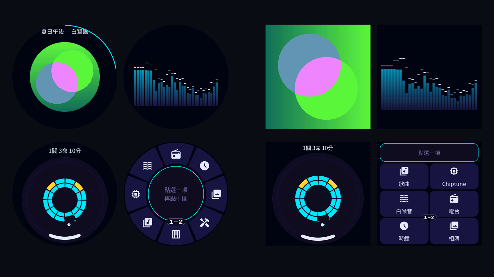

**準備：** JukeDial 主板（圓形 JC3636F118 或 FakePod）、一條 USB-C 線、一張 TF 卡（見第 12 章）。沒有卡也能先看看畫面，但音樂、電台清單和完整字型都放在卡上。

1. **接上電源。** 插上 USB-C，第一次開機要幾秒鐘。
2. **選語言。** 卡上還沒有語言設定時會出現語言選單：繁體中文／简体中文／English。點一下就好，結果存在 `_player/config/app.txt` 的 `lang`，之後可在設定裡改（第 11 章）。
   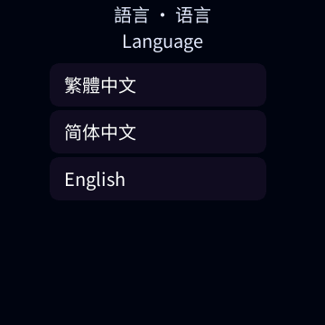
3. **手勢教學。** 選完語言後，會一步一步教你四種手勢：快速往上滑、快速往下滑、左右快速滑，最後是按住 3 秒。要真的做出手勢才會進到下一步；不想看就點螢幕中央下方的小按鈕「略過」。教學只出現一次（`tour_done`），設定裡有一格可以重看。兩塊板的「略過」是同一顆按鈕，不需要按鍵。
   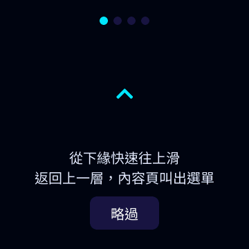 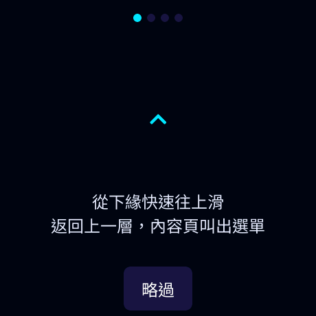
   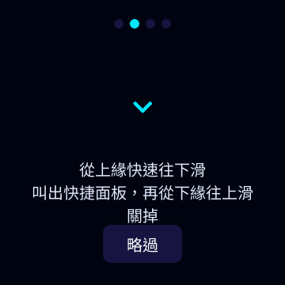 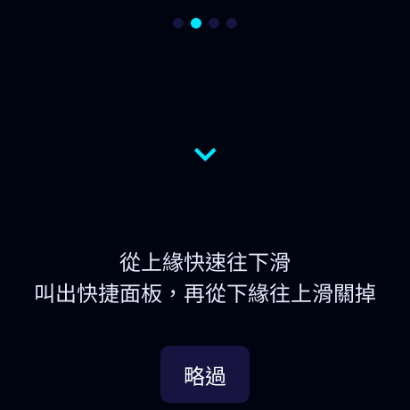
   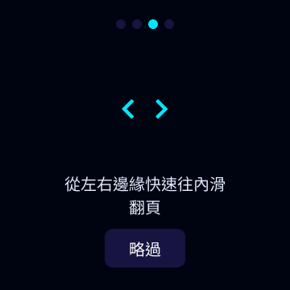 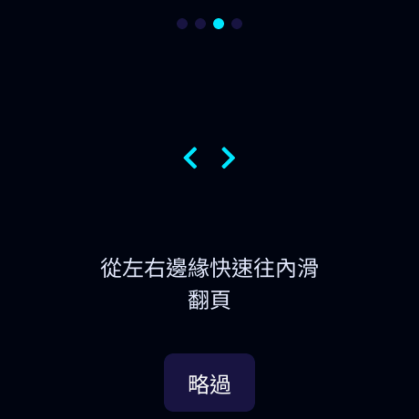
   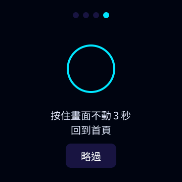 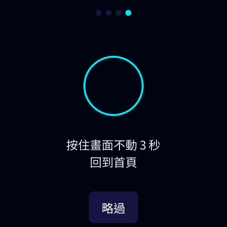
4. **首頁。** 教學結束後進入首頁。
   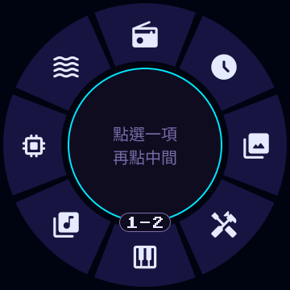
   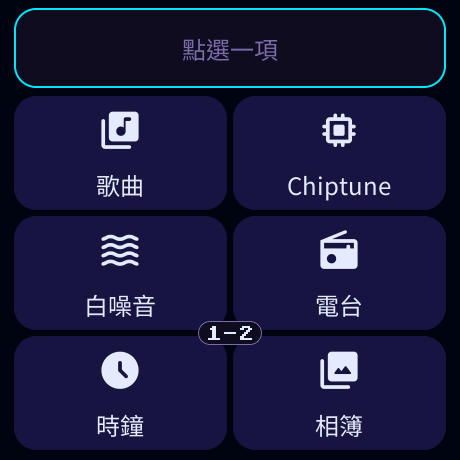

**圓形主板與 FakePod 的差別：** 圓形主板有觸控螢幕和旋鈕（轉動＝捲動／音量，按下＝確認）。FakePod 是 460 × 460 方形螢幕，只有兩顆按鍵：上鍵是「+1」（同時是電源鍵），下鍵是「-1」。旋鈕做得到的事，在 FakePod 上用這兩顆鍵加觸控來做，例外會特別說明。

下一章：[手勢與操作](02-gestures.md)。
