# 2. 手勢與操作

兩塊板、每一頁都用同一套手勢。辨識器是共用的，頁面不會自己發明手勢。

| 手勢 | 怎麼做 | 效果 |
|---|---|---|
| 快速往上滑 | 快速往上滑 | 內容頁（播放中、遊戲…）：叫出該頁的選單。清單或子頁面：返回上一層。首頁：沒有動作。快捷面板開著時：關閉面板。 |
| 快速往下滑 | 快速往下滑 | 叫出快捷面板（第 10 章）。在遊戲裡同時會暫停遊戲。 |
| 往左／往右快速滑 | 快速橫向滑 | 環、格子、清單的下一頁／上一頁；沒有下一頁就不動。 |
| 慢拖 | 比快速滑慢 | 1:1 捲動長內容（說明頁、長清單），沒有慣性，不會翻頁。 |
| 按住 | 手指在任何地方按著不放 | 3 秒後回首頁（設定可選 2、3、4 秒）。這是任何頁面的緊急出口。 |
| 點一下 | 點 | 確認，沒有改變。 |

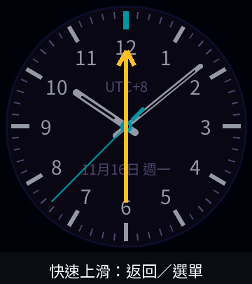 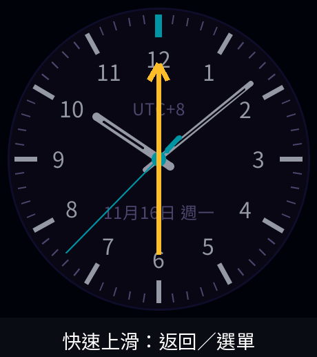
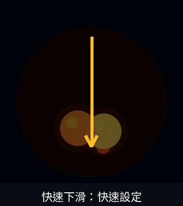 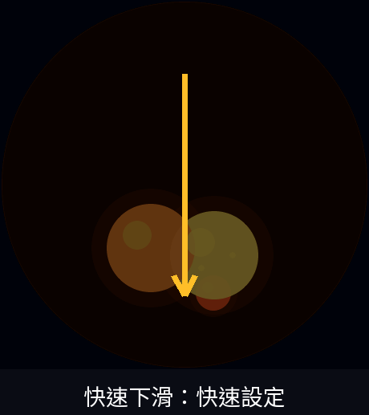
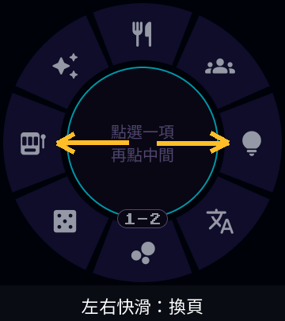 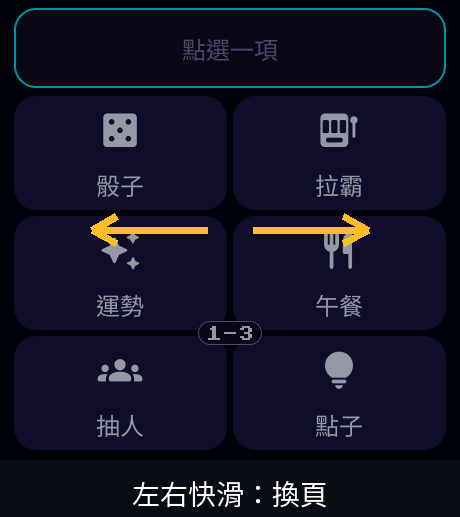
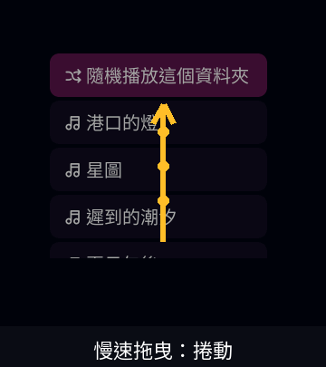 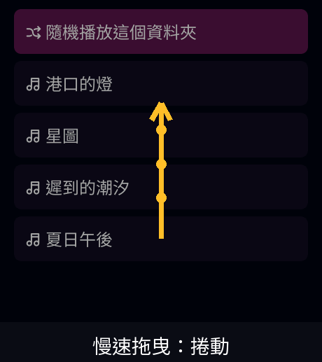
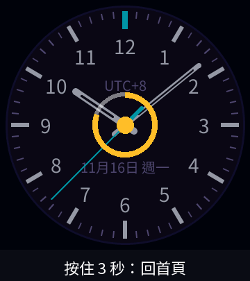 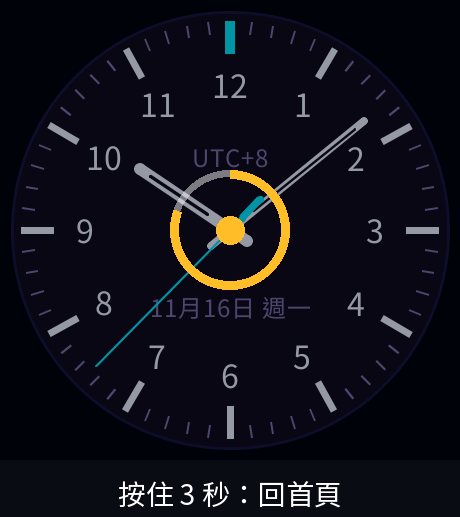

**頁數氣泡。** 環或清單超過一頁時，會出現一個很小、點不了的氣泡，例如「2/3」。圓屏上它跨在環最下方與中央圓之間的縫上；FakePod 上在下方四格交會處。現在沒有「返回」和「下一頁」按鈕，用快速滑的就行。

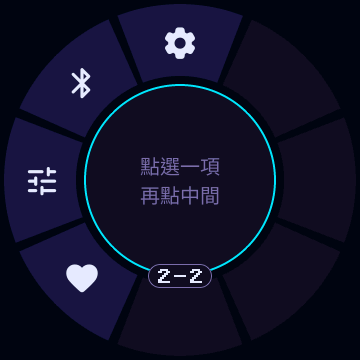 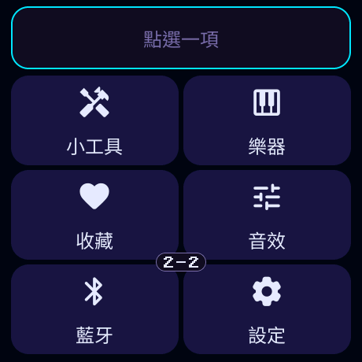

**旋鈕環。** 三個值以上的控制項（倍速、等化器頻段、亮度…）用「借旋鈕」的方式：點一下該控制項，再左右轉旋鈕改值；4 秒沒動作就自動放開。FakePod 用兩顆鍵做同樣的事。

**FakePod 按鍵。** 上鍵＝+1（下一個／往上／加大聲），下鍵＝-1。短於約 70 毫秒的按壓會被忽略。

**FakePod 的九宮格。** FakePod 的播放頁與頻譜頁沒有螢幕上的按鈕，而是整頁分成 3 × 3 的隱形點擊區：第一下點螢幕只會顯示九個格子的標籤，第二下點某一格才執行（沒顯示時點不會執行任何動作）。細節在[第 19 章](19-fakepod.md)。

**遊戲與拖曳。** 遊戲裡照樣可以快速滑（遊戲用點擊和旋鈕）。如果某個遊戲需要拖曳，它會說明，那時只有按住 3 秒回首頁有效。

**彈出卡片。**在內容頁上快速上滑（或依頁面點一下、轉旋鈕），該頁的選單會以一張實心圓角卡片出現在畫面中央：頁面標題、各項目與最後一列「關閉｜離開」（關閉只收卡片，離開才離開該頁）。背後的內容不會變暗。遊戲暫停選單與離開提示也用同一張卡片。

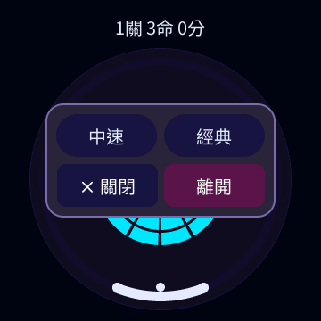 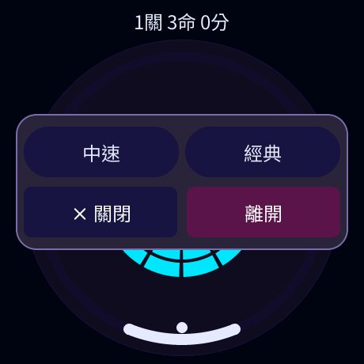

**選單圖示。**選單環與格子每格有一個圖示。圓屏的格子裡只有圖示，名字在第一下點選後顯示在中央（第二下才開啟）；FakePod 的格子是圖示加下方短名，點一下即開啟。設定列、清單列、快速設定狀態行與詳細頁的文字前面有小型行內圖示。說明格一律是第二主色的問號。

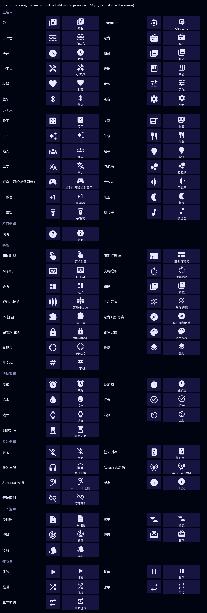

下一章：[播放音樂](03-music.md)。
