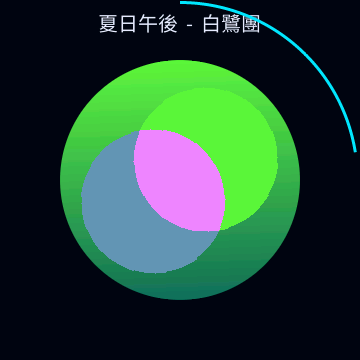
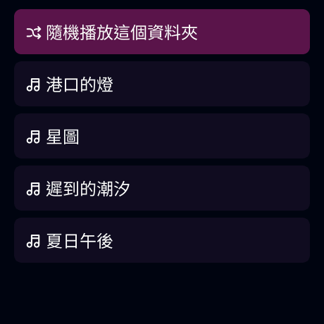
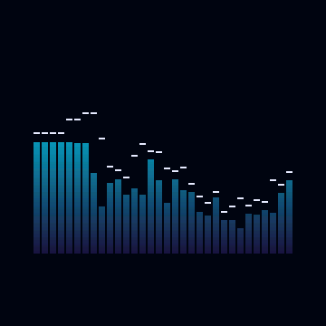
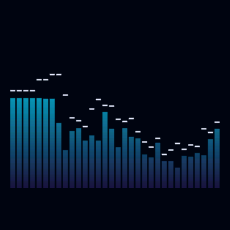
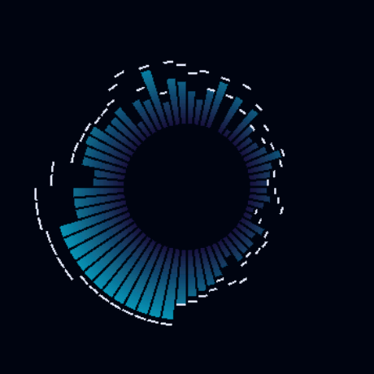

# 3. 播放音樂

 

**曲庫。** 把音樂放進 TF 卡（第 12 章）。JukeDial第一次使用時會掃描，索引快取在 `_player/index/library.bin`；掃描不會中斷播放。頁面有：全部曲目、資料夾／專輯、收藏、封面、重新掃描。

 

**資料夾成樹狀。** 掃描會讀到 8 層子資料夾（機器自己的 `_player` 資料夾和以點開頭的資料夾會略過；底下完全沒有可播檔案的資料夾不列出）。音樂頁顯示最上層：第一列「全部隨機」，接著是直接放在音樂資料夾裡的歌，再來是各資料夾，最後是「重新掃描曲庫」。點一個資料夾，就在同一頁打開它那一層：第一列「隨機播放這個資料夾」會連同所有子資料夾一起播，然後是這一層自己的歌，最後是子資料夾（和依序播放的順序一致）。快速往上滑（或按返回）回到上一層；在最上層就離開本頁。隨機播放（含加權隨機：新檔案、收藏權重較高）從整個曲庫或選定資料夾（含子資料夾）抽歌，幾萬首歌也不會卡。舊版韌體寫的索引會自動重新掃描一次。

**長清單分頁。** 資料夾層或歌曲清單每頁 40 列。左右快速滑翻頁（會繞回），小氣泡（例如「2-5」）顯示第幾頁；旋鈕轉過一頁的最後（最前）一列，會接著進下一頁（上一頁）。開啟清單時，會停在正在播放那首歌所在的頁。

**曲庫接受的格式：** MP3、FLAC、Ogg Vorbis／Opus（`.ogg`、`.oga`、`.opus`）、M4A（AAC）、WAV（PCM 16／24／32 位元整數與 32 位元浮點），以及 tracker 模組（libxmp：`.mod` `.xm` `.s3m` `.it` `.stm` `.669` `.far` `.mtm` `.ptm` `.okt` `.ult` `.mdl` `.stx` `.pt3` `.sfx` `.st` `.stk` `.m15` `.nt` `.flx` `.wow` `.ice` `.mtn` `.liq` `.psm` `.ps16` `.j2b` `.amf` `.gdm` `.med` `.mmd0`–`.mmd3` `.rtm` `.mgt` `.dsym` `.digi` `.dbm` `.emod` `.umx` `.hmn` `.stim` `.coco` `.fnk` `.abk` `.xmf`；也包含 ProWizard 打包的 Amiga 模組，以及 PowerPacker／XPK／Pack-Ice／ARC／LZX／MMCMP 壓縮的檔案；不使用 Amiga Paula 模擬；含 AdLib 音色的 S3M、內嵌 Ogg 取樣的 XM，不以 tracker 播放；`.imf`／`.dtm`／`.ims` 兩種播放器都認，先當 AdLib 音樂試，不是的話再當 tracker 模組試）。

**另外還能播放：**AIFF／AIFF-C、Musepack（`.mpc`）、TTA、HivelyTracker／AHX（`.ahx`、`.hvl`，含子曲目）、Commodore 64 SID（`.sid`，PSID 與 RSID，最多 4 顆 SID，含子曲目；每首播放 3 分鐘並淡出；BASIC 類 RSID 會註明原因後拒絕）、DOS AdLib／OPL 音樂（`.rad`、`.hsc`、`.imf`、`.wlf`、`.dro`、`.cmf`、`.a2m`、`.a2t`、`.d00`、`.sop`、`.xad`、`.amd`、`.bam`、`.lds`、`.rol`、`.ksm`、`.mus`、`.ims`、`.mdi`、`.sci`、`.laa`、`.mtr`、`.mkj`、`.cff`、`.dmo`、`.dtm`、`.sat`、`.sa2`、`.plx`、`.msc`、`.rix`、`.got`、`.hsq` 等，另有 `.sng` 等；OPL2 音色，第二顆晶片成為右聲道；需要 OPL3 四運算子音色的曲子、Westwood ADL、aPlib 壓縮的 A2M 會註明原因後拒絕）、PICO-8 卡帶（`.p8`、`.p8.png`，只播音樂，不讀程式碼）、遊戲串流 ADX、VAG、BRSTM（`.adx`、`.vag`、`.brstm`；只播一遍，忽略迴圈）、Atari ST YM（`.ym`，明文或 LHA 壓縮；數位混音與追蹤變體會被拒絕並顯示原因）。

**格式分級：實驗性格式。** 有些播放器比較不成熟：DOS AdLib 的 `.a2m` `.a2t` `.d00` `.hsq` `.sqx` `.sdb` `.agd` `.ha2` `.lds` `.sa2` `.dtm` `.plx` `.rix` `.xms` `.mtr` `.sat` `.dfm` `.mad` `.laa` `.sci` `.cmf` `.mdi` `.pis`，以及 tracker 的 `.ice`。它們預設**關閉**（設定 → 實驗性格式）：關閉時掃描曲庫**完全不讀這些檔案**（只用檔名，標題就是檔名），檔案仍列在清單裡，點開會顯示「實驗性格式未開啟（設定 → 實驗性格式）」。要開，點兩下（第一下會說明：這些播放器較不成熟，損壞的檔案可能讓播放器重開機）；開啟後重新掃描曲庫才會讀到標籤。其他格式不受影響。

**Amiga 音色。** 設定頁有 Amiga 音色一列（關／A500／A500 + LED／A1200）：只對 Amiga 系的 `.mod`（ProTracker、Soundtracker、Noisetracker、ProWizard 壓縮包），用 Paula 模擬器重現硬體的聲音；A500 較悶（固定濾波），A1200 較亮，播放中的模組一個區塊內就換。耗處理器較多：最重的 4 聲道 `.mod` 約佔音訊核心 55 %；六、八聲道的 `.mod` 不套用，其他格式也不受影響。

**當機保護（所有格式）。** 播放時，正在解碼的曲目會記在重開機也不會消失的記憶體裡。如果播放器當機重開，那一首（若是在準備下一首時當機，則兩首）會被標示「上次播放時當機，已略過」：下一首、隨機、重開後接續播放都不會再自動挑到它；你自己在清單點它就會播，標記隨之消失（再當機會再標）。標記存在卡上的 `_player/config/crashed.txt`。

**取樣率與位元深度。**
- 有線輸出經 DAC，一般為 44.1／48 kHz；高解析路徑可到 88.2／96／176.4／192／352.8／384 kHz。開到哪一檔由設定 `dac_max_rate`（四段）決定：圓形板預設 48 kHz，到「設定 > 有線輸出」調高，或用「取樣率測試」找出 DAC 與線材吃得下的最高一檔；FakePod 預設 384 kHz（直通）。DAC 不吃的取樣率會自動重取樣；低於 32 kHz 的來源在有線路徑上會被拒絕並顯示原因。
- 藍牙輸出受編碼限制（第 5 章）；44.1 與 48 kHz 之間JukeDial會自己重取樣。
- FLAC 原生解到 192 kHz；352.8／384 kHz 的 FLAC 受區塊大小限制，來源的區塊對輸出太大時會減半（最多三級），並在現況頁顯示原因。
- 2 GiB 以上的檔案會被略過（見第 12 章）。

**播放頁。** 圓形板的播放頁是旋轉的封面圓盤，點中央打開播放環。FakePod 有三種風格，在「設定 > 顯示 > 播放頁樣式」切換：滿版封面（預設）、封面加資訊、選單格（旋轉圓盤）；操作靠隱形的九宮格（[第 19 章](19-fakepod.md)）。

**播放環。** 點中央區域打開環：播放／暫停、上一首／下一首、隨機／重複、收藏、倍速、詳細資訊、視覺化、音效。格子多時環有兩頁，左右快速滑翻頁。

**倍速與淡入淡出（Track B）。**
- *倍速*（只有曲庫檔案）：0.75、1.00、1.25、1.50、2.00 倍，音高不變（WSOLA）。點倍速格，再轉旋鈕。
- *淡入淡出*：設定裡的「淡入淡出」，歌與歌之間的秒數，等功率；**只在前後兩首取樣率相同時**才作用（下一首已預先開好）。取樣率不同（例如 44.1 與 48 kHz）或你手動跳歌時，直接換歌；打開這個設定時，畫面會提醒這一點。
- 使用 aptX、LDAC、Auracast，或管線取樣率高於 48 kHz（88.2 kHz 以上）時，這兩項會自己關掉並顯示原因。淡入淡出可選 關／2／4／6 秒。

**封面。** 封面來自 `cover.jpg` 或標籤，集中快取在一個檔案（`_player/index/thumbs.pak`）。96 kHz 以上不解封面；內部記憶體吃緊時改用預設圖。藍牙喇叭模式會顯示手機的歌名與封面（AVRCP 1.6）。

**頻譜與音效。** 頻譜頁有多種樣式（長條、環形…），音效有等化器、殘響、聲場加寬、串音、響度、限幅器等。CPU 忙的時候（aptX、LDAC、廣播、高解析）重的音效會自動暫停，音效頁會寫原因。

 
 

**視覺化的進階種類。** 在視覺化頁點一下打開設定環，「種類」可以換到下面這些：

- **聲部列、鋼琴捲簾**（播放晶片音樂或模組檔時才有）：聲部列一個聲部一列，有名稱、發音燈、音量條、音名和聲像；鋼琴捲簾畫最近 6 秒的音高，每個聲部一種顏色。在這兩種畫面打開設定環，「聲部」格選一個聲部，「狀態」格換「開、靜音、獨奏」：獨奏是只聽那一個聲部，換曲就全部恢復。
- **歌詞**：讀歌曲旁邊同名的 `.lrc` 檔（`song.mp3` 配 `song.lrc`），目前這句放大，前後各一兩句較暗，跟著播放位置走，快轉、暫停、換曲都會跟上。檔案要是 UTF-8（GBK、Big5 不轉換，會提示）；沒有檔就顯示「沒有歌詞」。上限是檔案前 64 KB、400 行、每行 160 位元組。
- **大小**（只有方屏）：放大或原尺寸。原尺寸比較銳利。

設定環的最後一格是「說明」，有完整的說明。

**睡眠定時與鬧鐘** 在時鐘相關的 app（第 6 章）。

下一章：[網路電台](04-radio.md)。
