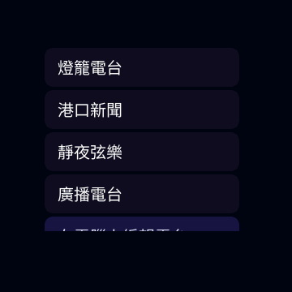
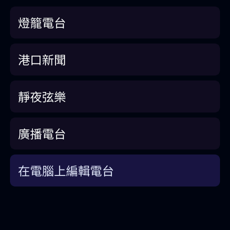

# 4. 網路電台

 

電台需要 Wi-Fi。JukeDial不會在螢幕上問你帳密；網路資訊從卡上的 `_player/config/wifi.txt` 讀取（第 12 章）；網頁工具也能寫入（Wi-Fi 區：網路名稱與密碼）。Wi-Fi 只在需要時才開（電台、對時），可以在快捷面板允許或禁止。

- **電台清單**是卡上的純文字：`_player/config/radio.txt`、`radio_cn.txt`，以及你自己的 `radio_<名稱>.txt`，一行一個 `名稱|網址`。第一次用會寫入預設清單。電台清單最後一列是「在電腦上編輯」的說明。
- **先試 http。** http 串流直接播。https 也能播：TLS 放在 PSRAM、帶憑證包；只列 https 的電台會先試它的 http 孿生網址。每條 TLS 連線約吃 31 KB PSRAM；內部記憶體太低時會拒絕 https，並在頁面告訴你。
- **串流類型：** MP3、AAC、Ogg／Opus，以及 TS／AAC 分段的 HLS（BBC、許多台灣電台）。fMP4 分段的 HLS 不支援。
- **輸出：** 電台和音樂走同一條輸出：有線、藍牙（耳機模式可邊聽邊播，但 Wi-Fi 連線那一下耳機會斷約半秒）。完整播放器在 Auracast 廣播時不開 Wi-Fi，要廣播電台請用廣播電台模式（第 5 章）。
- **找電台：** 網頁工具有電台搜尋（radio-browser.info）和編輯器，可把清單寫到裝置。
- **電台調頻尋寶**是個小遊戲：轉刻度盤找電台（第 7 章）。

下一章：[藍牙、Auracast 與廣播電台模式](05-bluetooth-cast.md)。
