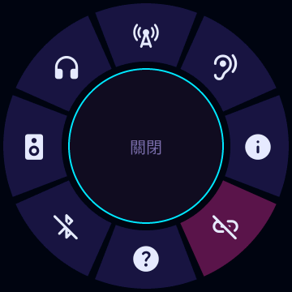
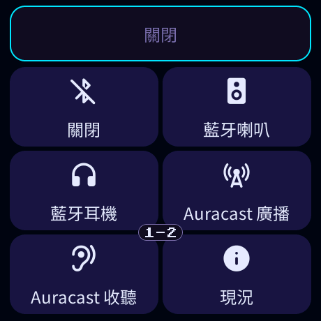
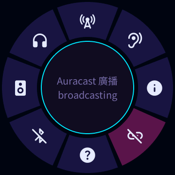
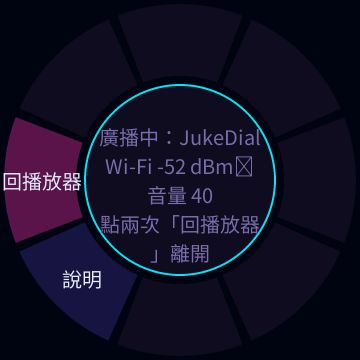

# 5. 藍牙、Auracast 與廣播電台模式

 

藍牙模式在藍牙頁選擇。**換模式會重開機**（約 10 秒），重開後接著播。異常重開機（當機、看門狗、欠壓）或安全模式之後，模式會回到預設、藍牙關閉。

**耳機模式（JukeDial → 耳機，A2DP 來源端）。** 在配對頁配對（環上會顯示 6 位數配對碼）。預設韌體就含全部編碼：SBC、AAC、aptX、aptX HD、LDAC；aptX 與 LDAC 由 JukeDial 編碼送出，所以只在耳機模式可用，而且只有 44.1／48 kHz。LDAC 會依連線品質在 990／660／492／330 kbps 之間調整，品質回復後再升回；開著 Wi-Fi 時最高約 660 kbps。連線品質差時 aptX HD 會降到 aptX 再降到 SBC，安靜 2 分鐘後再試著升回。耳機按鍵（播放／暫停、上下首、音量）可用。aptX／LDAC 時重的音效會暫停，音效清單會說明。

**每個輸出各自的音量。** 有線輸出一個音量；每支藍牙耳機依它的位址各記一個音量，新耳機第一次連線從約三分之一（33）開始；喇叭模式另有自己的音量（預設 60）。切換輸出時音量不會比新輸出原本的設定更大聲，所以換到另一個輸出不會突然變大聲。

**喇叭模式（手機 → JukeDial，A2DP 接收端）。** 手機的聲音從JukeDial的有線輸出播出（接收 SBC 或 AAC），JukeDial會顯示手機的歌名、演出者和封面（AVRCP 1.6）。喇叭模式是**獨佔的來源**：在這個模式下要播放本機曲目時，畫面會問「離開藍牙喇叭模式並播放？」，選擇離開會重新開機，然後開始播放。

**Auracast。**
- *廣播：* JukeDial把 48 kHz 立體聲送給任何 Auracast 接收器。完整播放器廣播時**不開 Wi-Fi**（記憶體限制），音效降為 EQ 加限幅器。
- *收聽：* JukeDial接收廣播，Wi-Fi 可以開（封包遺失從約 0.6% 升到 1.6%，有補償）。

**廣播電台模式。** 獨立的開機模式：先開 Wi-Fi，再開 Auracast，把**網路電台廣播**給 Auracast 接收器。它是精簡載入的重開機模式。離開要點兩下「回JukeDial」武裝格，按住螢幕不會重開機離開。長時間運作的穩定度還沒有完整驗證。

**不提供：** 手機端的藍牙設定頁、LE Audio 單點連線、MIDI。

**音訊設定。**編碼、取樣率、位元深度、聲道的上限與 LDAC 最高位元率在 設定 > 聲音 > 藍牙音訊；該頁顯示耳機能提供什麼、實際協商出什麼（第 17 章）。**名稱。**JukeDial 在藍牙與 Auracast 上顯示為「JukeDial」，BLE MIDI 是「JukeDial MIDI」，BLE 按鍵是「JukeDial Keys」。若你曾用舊名稱（JC Player／JC MIDI／JC Keypad）配對過，請在手機或電腦上移除舊項目後重新配對。

下一章：[時鐘、鬧鐘與習慣](06-clock.md)。
