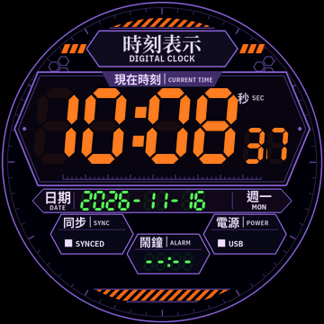
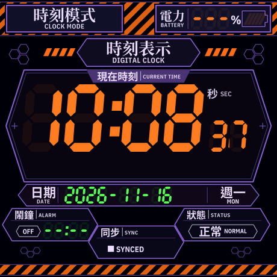
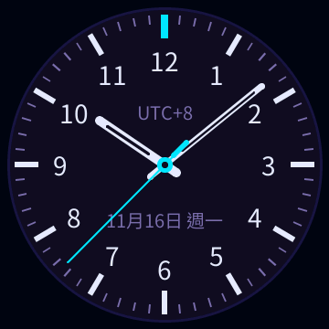
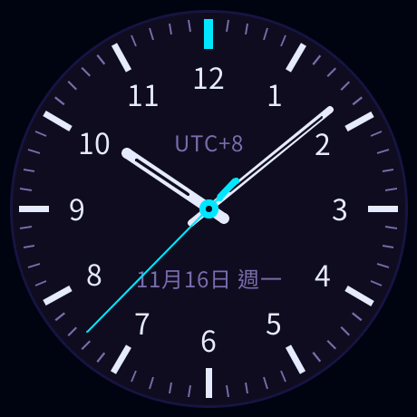
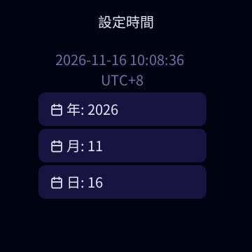
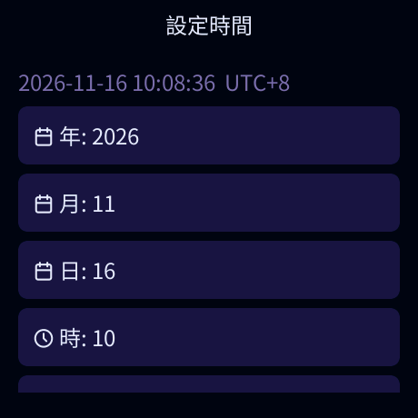
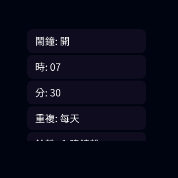
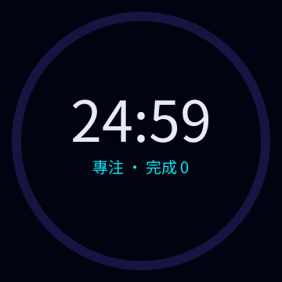
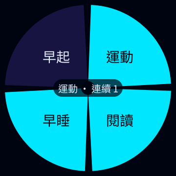
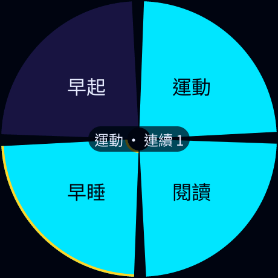

# 6. 時鐘、鬧鐘、番茄鐘、喝水與打卡

 

- **時鐘。** 多種錶面與字型；預設錶面是 HUD 設計錶面（紫框、橘色數字，需要卡片內容包裡的 `_player/faces.zip`，沒有它就改用資訊錶面）。其他錶面例如經典指針：
   
  時間靠 Wi-Fi 對時（NTP），也可手動設定。圓屏**沒有電池時鐘**：完全斷電後要等下次對時或手動設定才會準（軟體重開會保留）；FakePod 有內建時鐘晶片，關機後時間仍會保留。時區與日出地點只能在網頁工具設定。
- **手動設定時間。** 設定 > 系統 > 設定時間（時鐘選單最後一格也進得去）。頁面上方是目前的日期時間與時區，下面是年、月、日、時、分五列：點一下該列加一，或轉旋鈕（FakePod 用兩顆鍵）改值，到頭會繞回（年份是 2025 到 2040），日數會跟著月份夾住。輸入的是你設定的時區的當地時間，按「套用」才生效，秒數歸零。最後一列「用 Wi-Fi 對時」直接在這一頁對時（Wi-Fi 對時成功後會取代手動時間）。頁面最下面一行說明時間關機後會不會保留。
   
- **鬧鐘。** 一定會響。鈴聲是內建鈴聲或你指定的一首 MP3（不能用電台）。鬧鐘頁旋鈕可以操作。
  
- **番茄鐘。** 環形計時。正在放音樂時只震動（圓形主板的觸感馬達），不打斷歌曲。
  
- **喝水**與**習慣打卡**：提醒與每日打勾清單，存在卡上。
   

FakePod 沒有震動馬達，提醒只用聲音和畫面（這塊板沒有震動驅動器）。

下一章：[小工具與遊戲](07-toys-games.md)。
