# 7. 小工具與遊戲

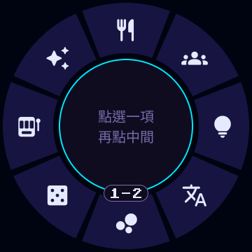 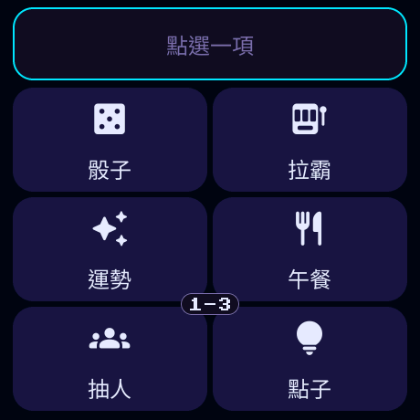

小工具在「工具」選單裡，音樂播放時也能用。它們的聲音是很小的晶片音色合成，在音量之前混入，所以和音樂一樣受音量控制。

**小工具（各一句）：** 骰子；拉霸（頁面會說明贏在哪）；午餐／抽人／點子清單；籤詩（御神籤）與轉盤（文字可由卡上檔案覆蓋）；捏泡泡紙；計數器；音效庫（試聽晶片音色）；相片；單字卡；調音器（「聆聽」用麥克風報出音名與偏幾音分、A4 基準 430–450 Hz 可調，聆聽時音樂暫停、離開再接著播；「發音」播出 C2–C6 的指定音，正弦、方波、三角、鋸齒可選，附吉他空弦）；手電筒（整個螢幕純白、亮度開到最大，不顯示任何文字；往上滑、長按回首頁、螢幕休眠或打開快速設定都會還原你原本的亮度）。

**遊戲**（圓屏 360 與方屏 460 都能玩，只用點擊與旋鈕，不需要拖曳）：節拍點擊、環形打磚塊、四子棋、旋轉擋板、骨牌、猜歌、旋鈕小玩意（迷宮、上發條、釣魚）、生命遊戲、15 拼圖、電台調頻尋寶、保險箱開鎖、四色記憶、萬花尺、疊塔、井字棋。多數有規則變體、畫風與存檔。快速往下滑會暫停遊戲並開快捷面板。

**旋鈕小玩意與迷宮。** 這個遊戲一頁有六種玩法。圓形板開啟後的第一個是**重力迷宮**：彈珠從中心出發，旋鈕轉動重力的方向（邊緣的小弧線標出「下」在哪），讓它滾到環上的缺口、穿過去，最外面的出口就是終點；另有斥力與吸力兩種變化。FakePod 有動作感測器，第一個是**傾斜迷宮**（[第 19 章](19-fakepod.md)）：把機器傾斜來滾動彈珠，掉進洞就回到起點。

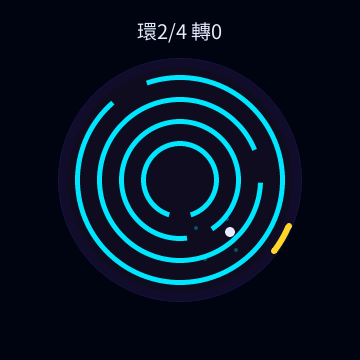

主力展示：
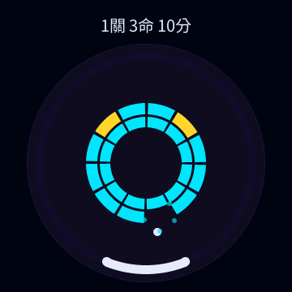 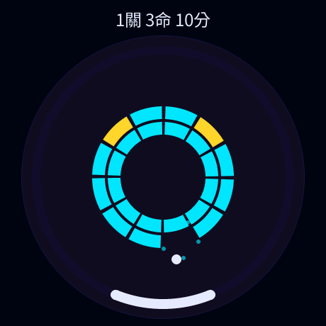
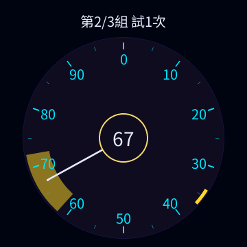 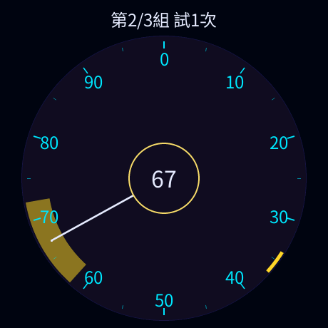
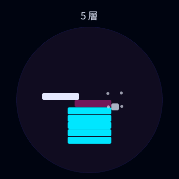 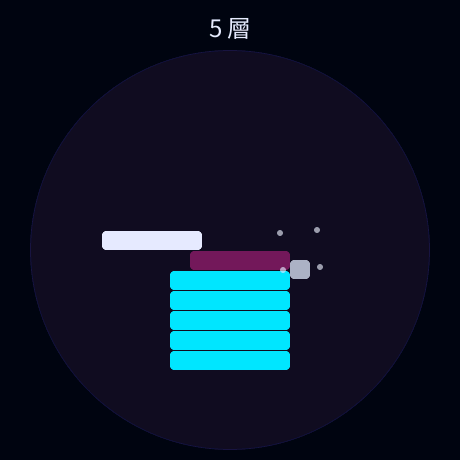
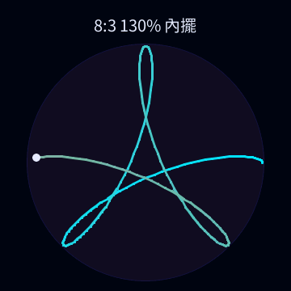 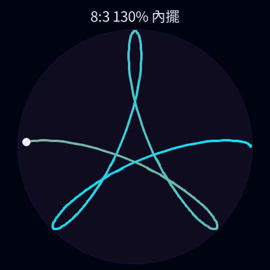

下一章：[樂器](08-instruments.md)。
