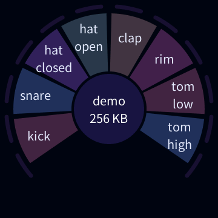
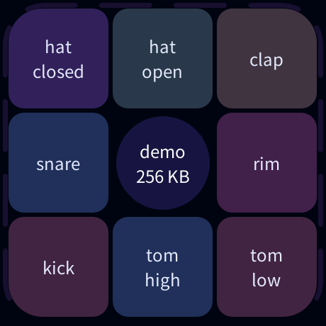

# 8. 樂器

 

樂器 app 是獨立的開機模式（重開機進入；離開要點武裝格再點第二下），使用和JukeDial同一套環形介面。內容有：鼓墊、節拍器／節拍、循環錄音（存成 `_player/loops/loop_NNN.jcl`）、晶片與 FM 音色、取樣套組。

套組放在 `instrument/kits/<名稱>/`，裡面有 `kit.txt` 與 WAV 或 SFZ 檔；示範套組可用 `tools/gen/make_demo_kit.py` 產生。演奏方式是點鼓墊，旋鈕改目前選的參數。

樂器 app 也會以藍牙 LE MIDI 裝置「JukeDial MIDI」廣播：用手機或電腦的 MIDI app 連上就能演奏，它也會回傳 MIDI 時脈。

下一章：[氛圍、白噪音與呼吸](09-ambient.md)。
